# 果蝇与感觉

> 共 92 张。图片是按原图缩放的本地预览；查看原文可获取完整图注和高清版本。

## Fig. 1 · A connectomic reconstruction of a whole fly brain.

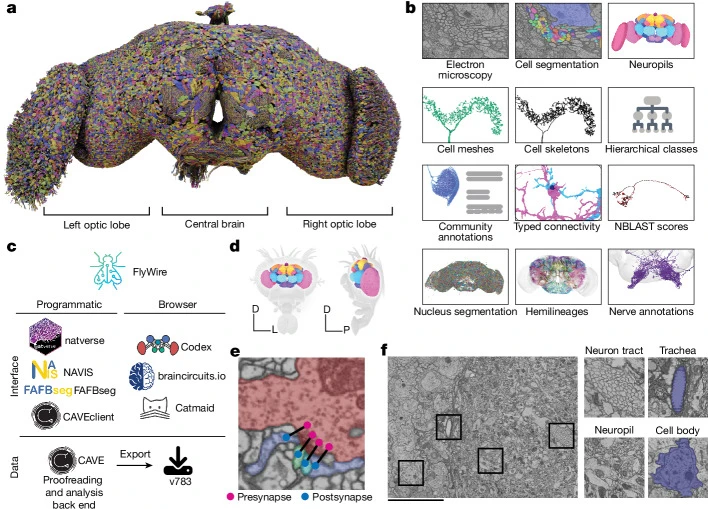

See paper · *Nature* · 2024  
[Neuronal wiring diagram of an adult brain](https://pmc.ncbi.nlm.nih.gov/articles/PMC11446842/#Fig1) · [原始图片](https://cdn.ncbi.nlm.nih.gov/pmc/blobs/066c/11446842/c87db67f45fc/41586_2024_7558_Fig1_HTML.jpg) · [CC BY 4.0](https://creativecommons.org/licenses/by/4.0/)

## Fig. 1 · Hierarchical annotation schema for a whole-brain connectome.

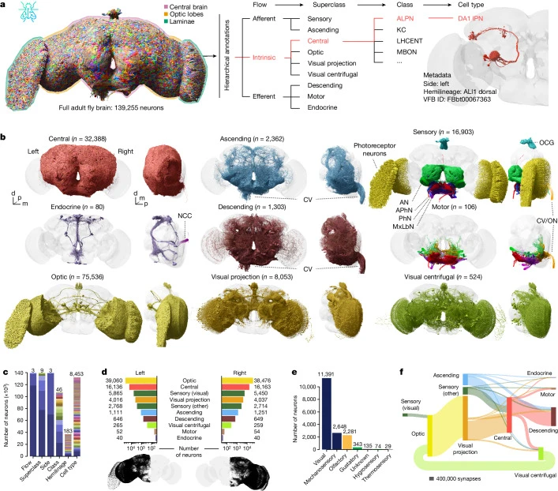

Schlegel et al. · *Nature* · 2024  
[Whole-brain annotation and multi-connectome cell typing of Drosophila](https://pmc.ncbi.nlm.nih.gov/articles/PMC11446831/#Fig1) · [原始图片](https://cdn.ncbi.nlm.nih.gov/pmc/blobs/8e54/11446831/a9a06f06d53f/41586_2024_7686_Fig1_HTML.jpg) · [CC BY 4.0](https://creativecommons.org/licenses/by/4.0/)

## Fig. 1 · The computational model accurately predicts neurons that respond to sugar stimulation and neurons required for proboscis extension to sugar.

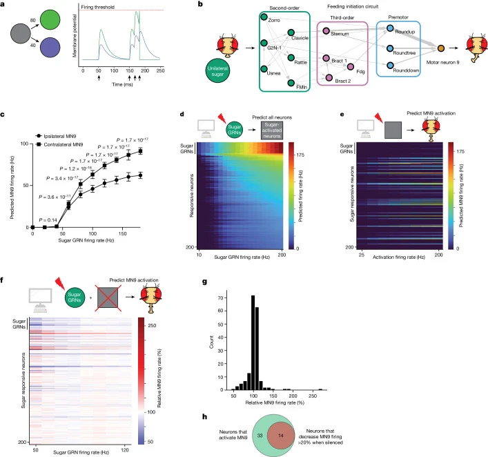

See paper · *Nature* · 2024  
[A Drosophila computational brain model reveals sensorimotor processing](https://pmc.ncbi.nlm.nih.gov/articles/PMC11446845/#Fig1) · [原始图片](https://cdn.ncbi.nlm.nih.gov/pmc/blobs/3567/11446845/e633d51dfc84/41586_2024_7763_Fig1_HTML.jpg) · [CC BY 4.0](https://creativecommons.org/licenses/by/4.0/)

## Fig. 1 · Identification of halt neurons.

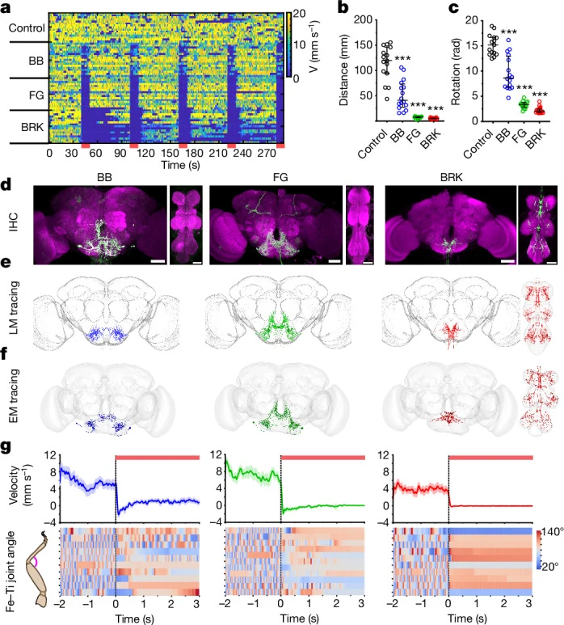

See paper · *Nature* · 2024  
[Neural circuit mechanisms underlying context-specific halting in Drosophila](https://pmc.ncbi.nlm.nih.gov/articles/PMC11446846/#Fig1) · [原始图片](https://cdn.ncbi.nlm.nih.gov/pmc/blobs/5b36/11446846/226238f2242e/41586_2024_7854_Fig1_HTML.jpg) · [CC BY 4.0](https://creativecommons.org/licenses/by/4.0/)

## Fig. 1 · The neurons of a male Drosophila visual system.

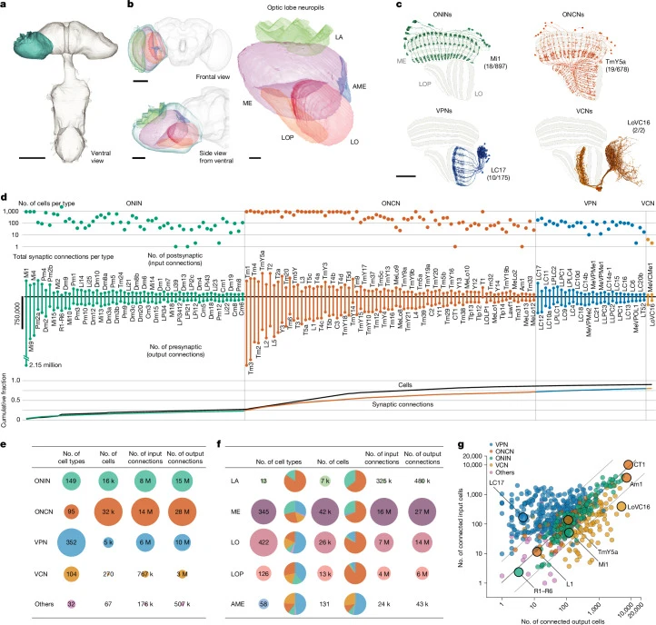

Nern et al. · *Nature* · 2025  
[Connectome-driven neural inventory of a complete visual system](https://pmc.ncbi.nlm.nih.gov/articles/PMC12119369/#Fig1) · [原始图片](https://cdn.ncbi.nlm.nih.gov/pmc/blobs/e7bf/12119369/6cb042f0c8b5/41586_2025_8746_Fig1_HTML.jpg) · [CC BY 4.0](https://creativecommons.org/licenses/by/4.0/)

## Fig. 1 · Drosophila melanogaster circadian clock network.

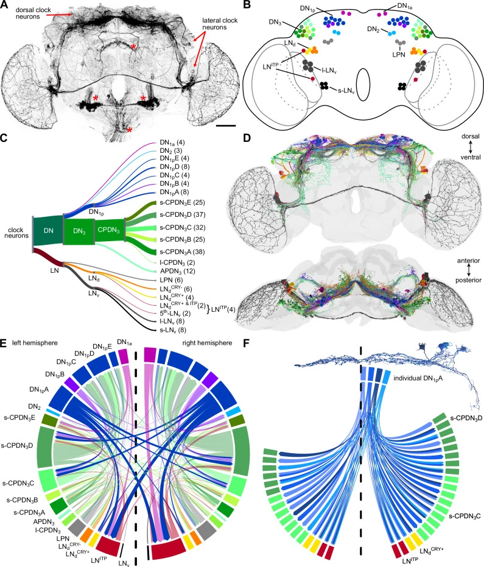

See paper · *Nature Communications* · 2024  
[Synaptic connectome of the Drosophila circadian clock](https://pmc.ncbi.nlm.nih.gov/articles/PMC11621569/#Fig1) · [原始图片](https://cdn.ncbi.nlm.nih.gov/pmc/blobs/e877/11621569/fe88d7dddbc0/41467_2024_54694_Fig1_HTML.jpg) · [CC BY 4.0](https://creativecommons.org/licenses/by/4.0/)

## Fig. 1 · Valence-specific model of the mushroom body.

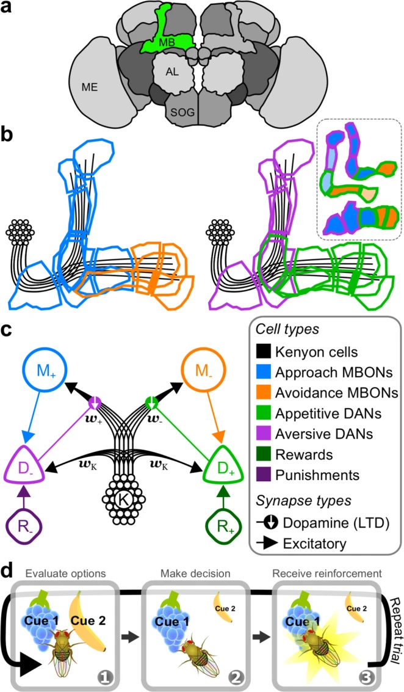

Bennett et al. · *Nature Communications* · 2021  
[Learning with reinforcement prediction errors in a model of the Drosophila mushroom body](https://pmc.ncbi.nlm.nih.gov/articles/PMC8105414/#Fig1) · [原始图片](https://cdn.ncbi.nlm.nih.gov/pmc/blobs/2de8/8105414/07e5e008cdee/41467_2021_22592_Fig1_HTML.jpg) · [CC BY 4.0](https://creativecommons.org/licenses/by/4.0/)

## Fig. 1 · PAM-β′2a DANs change CS+ odor response during aversive memory acquisition and reversal.

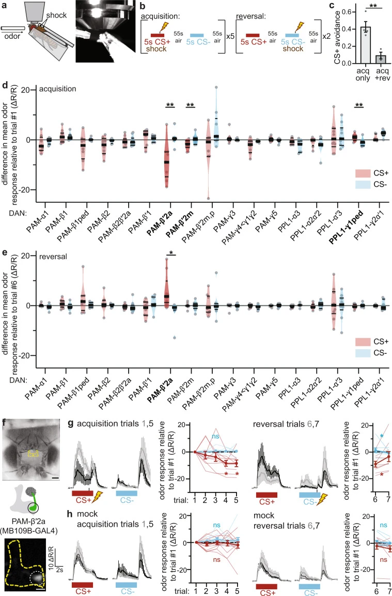

McCurdy et al. · *Nature Communications* · 2021  
[Dopaminergic mechanism underlying reward-encoding of punishment omission during reversal learning in Drosophila](https://pmc.ncbi.nlm.nih.gov/articles/PMC7893153/#Fig1) · [原始图片](https://cdn.ncbi.nlm.nih.gov/pmc/blobs/aee3/7893153/adb8b650d2c4/41467_2021_21388_Fig1_HTML.jpg) · [CC BY 4.0](https://creativecommons.org/licenses/by/4.0/)

## Fig. 1 · Drosophila males produce two multimodal signals—song and vibration—during courtship.

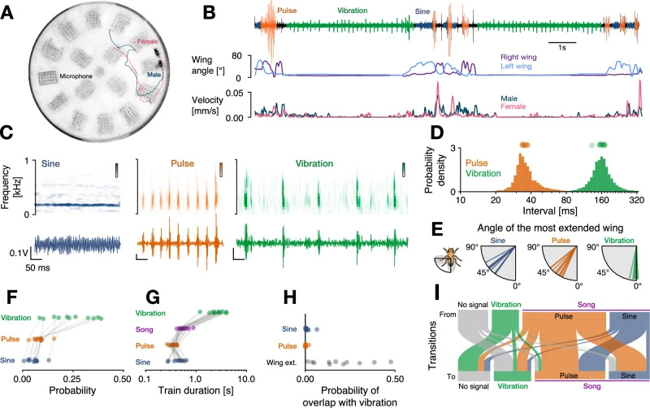

Steinfath et al. · *Nature Communications* · 2025  
[A neural circuit for context-dependent multimodal signaling in Drosophila](https://pmc.ncbi.nlm.nih.gov/articles/PMC12559195/#Fig1) · [原始图片](https://cdn.ncbi.nlm.nih.gov/pmc/blobs/cf40/12559195/f8e17377d8c0/41467_2025_64907_Fig1_HTML.jpg) · [CC BY 4.0](https://creativecommons.org/licenses/by/4.0/)

## Fig. 2 · Neuron categories.

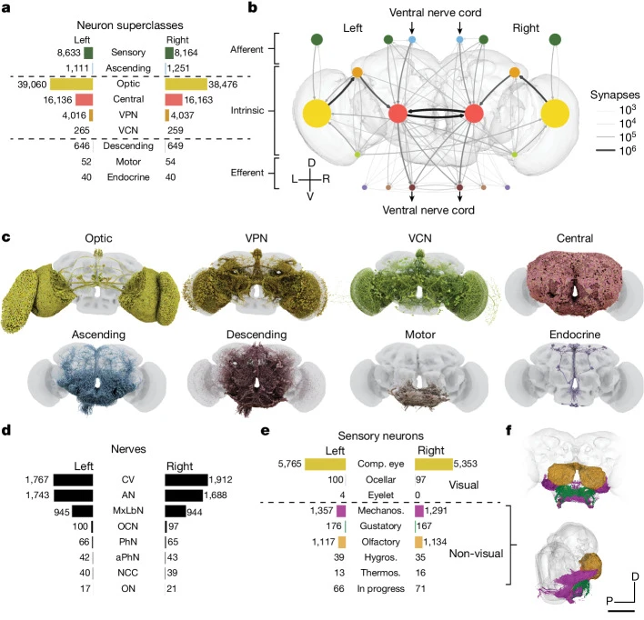

See paper · *Nature* · 2024  
[Neuronal wiring diagram of an adult brain](https://pmc.ncbi.nlm.nih.gov/articles/PMC11446842/#Fig2) · [原始图片](https://cdn.ncbi.nlm.nih.gov/pmc/blobs/066c/11446842/8dc8d0ed28d6/41586_2024_7558_Fig2_HTML.jpg) · [CC BY 4.0](https://creativecommons.org/licenses/by/4.0/)

## Fig. 2 · Annotation of developmental units.

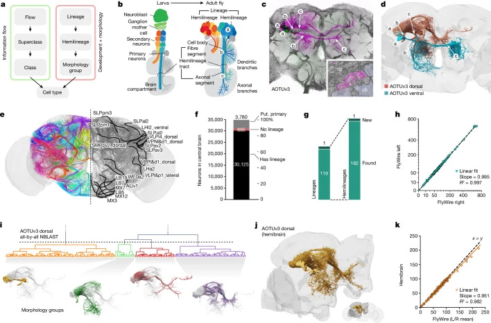

Schlegel et al. · *Nature* · 2024  
[Whole-brain annotation and multi-connectome cell typing of Drosophila](https://pmc.ncbi.nlm.nih.gov/articles/PMC11446831/#Fig2) · [原始图片](https://cdn.ncbi.nlm.nih.gov/pmc/blobs/8e54/11446831/e11760043866/41586_2024_7686_Fig2_HTML.jpg) · [CC BY 4.0](https://creativecommons.org/licenses/by/4.0/)

## Fig. 2 · The computational model predicts neurons that cause proboscis extension.

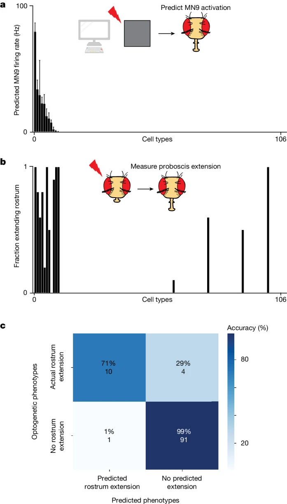

See paper · *Nature* · 2024  
[A Drosophila computational brain model reveals sensorimotor processing](https://pmc.ncbi.nlm.nih.gov/articles/PMC11446845/#Fig2) · [原始图片](https://cdn.ncbi.nlm.nih.gov/pmc/blobs/3567/11446845/8b91b2555276/41586_2024_7763_Fig2_HTML.jpg) · [CC BY 4.0](https://creativecommons.org/licenses/by/4.0/)

## Fig. 2 · Ensembles of DMNs predict tuning properties.

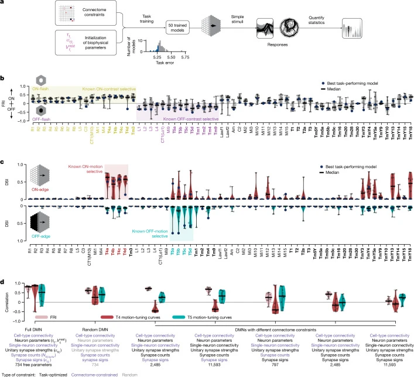

Lappalainen et al. · *Nature* · 2024  
[Connectome-constrained networks predict neural activity across the fly visual system](https://pmc.ncbi.nlm.nih.gov/articles/PMC11525180/#Fig2) · [原始图片](https://cdn.ncbi.nlm.nih.gov/pmc/blobs/a0a5/11525180/2d0ed5d4ab72/41586_2024_7939_Fig2_HTML.jpg) · [CC BY 4.0](https://creativecommons.org/licenses/by/4.0/)

## Fig. 2 · Walk–halt interactions.

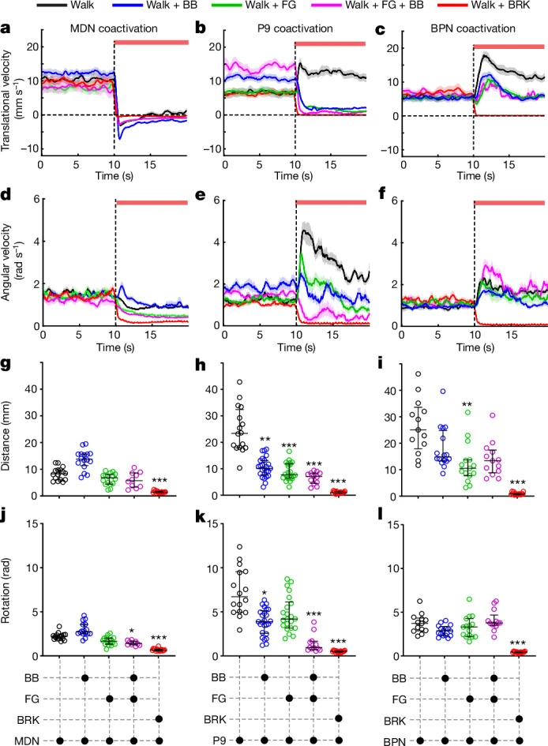

See paper · *Nature* · 2024  
[Neural circuit mechanisms underlying context-specific halting in Drosophila](https://pmc.ncbi.nlm.nih.gov/articles/PMC11446846/#Fig2) · [原始图片](https://cdn.ncbi.nlm.nih.gov/pmc/blobs/5b36/11446846/2d98e6b94f35/41586_2024_7854_Fig2_HTML.jpg) · [CC BY 4.0](https://creativecommons.org/licenses/by/4.0/)

## Fig. 2 · Sorting neurons into types on the basis of morphology and connectivity.

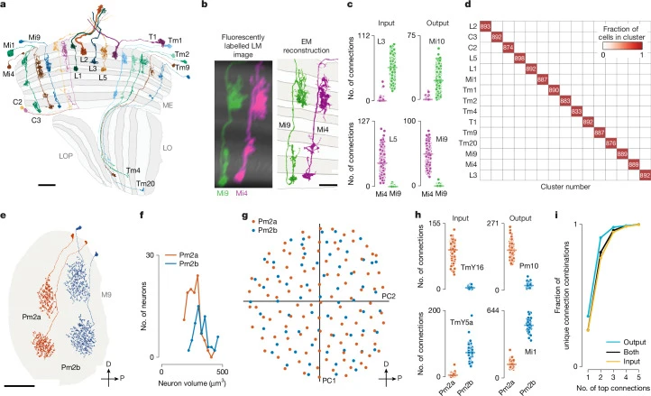

Nern et al. · *Nature* · 2025  
[Connectome-driven neural inventory of a complete visual system](https://pmc.ncbi.nlm.nih.gov/articles/PMC12119369/#Fig2) · [原始图片](https://cdn.ncbi.nlm.nih.gov/pmc/blobs/e7bf/12119369/b5e92bc2cfe0/41586_2025_8746_Fig2_HTML.jpg) · [CC BY 4.0](https://creativecommons.org/licenses/by/4.0/)

## Fig. 2 · Morphology of newly identified s-CPDN3 and DN1p subtypes.

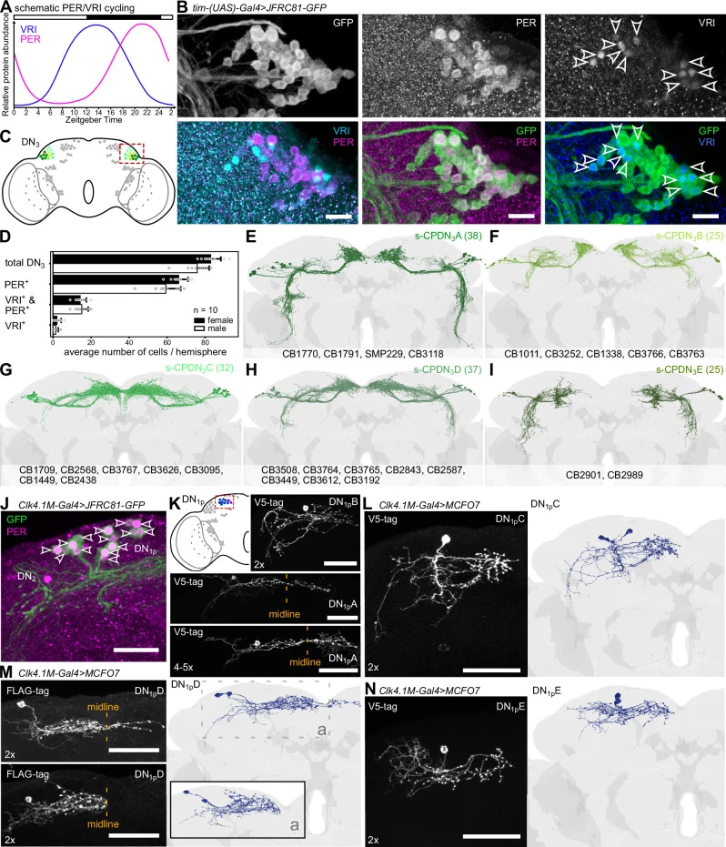

See paper · *Nature Communications* · 2024  
[Synaptic connectome of the Drosophila circadian clock](https://pmc.ncbi.nlm.nih.gov/articles/PMC11621569/#Fig2) · [原始图片](https://cdn.ncbi.nlm.nih.gov/pmc/blobs/e877/11621569/a0d843870f58/41467_2024_54694_Fig2_HTML.jpg) · [CC BY 4.0](https://creativecommons.org/licenses/by/4.0/)

## Fig. 2 · RPs in the valence-specific model track reinforcements but only within specified bounds.

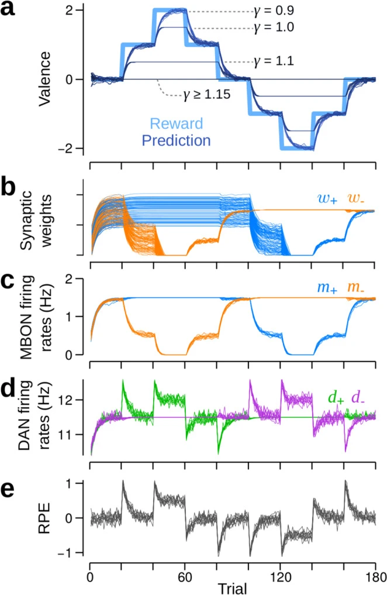

Bennett et al. · *Nature Communications* · 2021  
[Learning with reinforcement prediction errors in a model of the Drosophila mushroom body](https://pmc.ncbi.nlm.nih.gov/articles/PMC8105414/#Fig2) · [原始图片](https://cdn.ncbi.nlm.nih.gov/pmc/blobs/2de8/8105414/68cf7ce66053/41467_2021_22592_Fig2_HTML.jpg) · [CC BY 4.0](https://creativecommons.org/licenses/by/4.0/)

## Fig. 2 · PAM-β′2a DANs encode reward of shock omission during CS+ presentation during reversal learning.

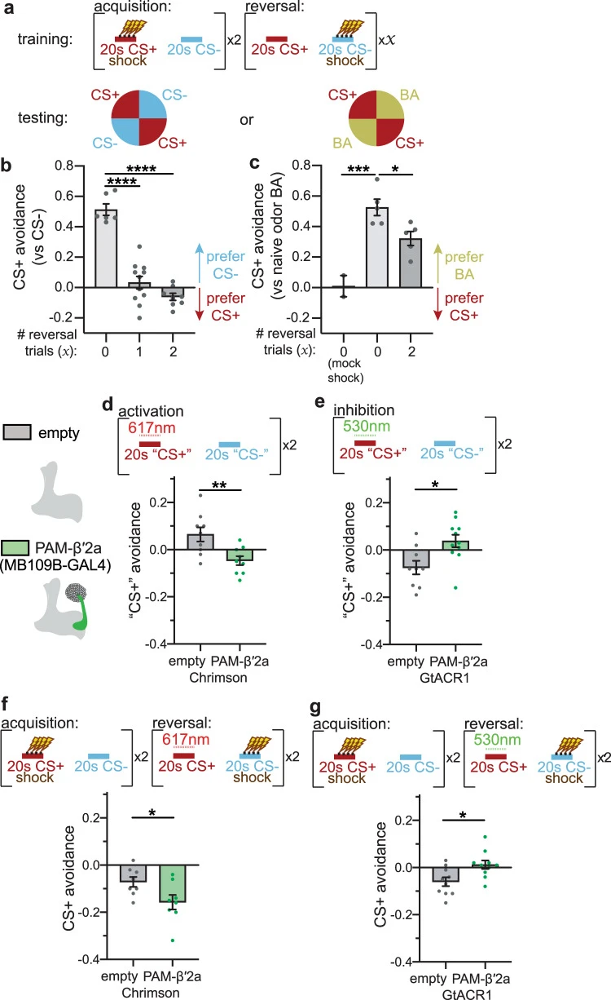

McCurdy et al. · *Nature Communications* · 2021  
[Dopaminergic mechanism underlying reward-encoding of punishment omission during reversal learning in Drosophila](https://pmc.ncbi.nlm.nih.gov/articles/PMC7893153/#Fig2) · [原始图片](https://cdn.ncbi.nlm.nih.gov/pmc/blobs/aee3/7893153/ef9ecd79b489/41467_2021_21388_Fig2_HTML.jpg) · [CC BY 4.0](https://creativecommons.org/licenses/by/4.0/)

## Fig. 2 · FeCO neurons exhibit subtype-specific postsynaptic connectivity.

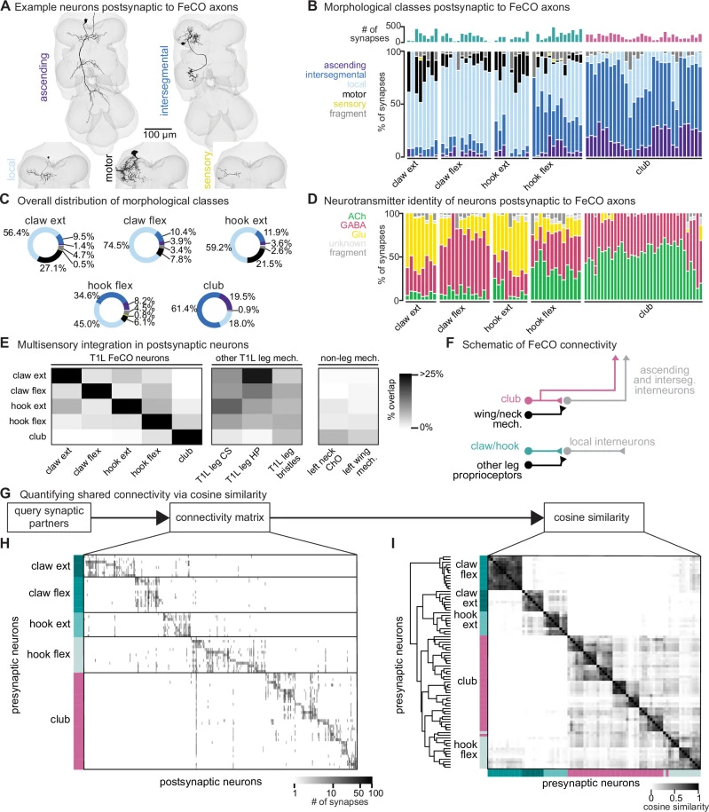

Lee et al. · *Nature Communications* · 2025  
[Divergent neural circuits for proprioceptive and exteroceptive sensing of the Drosophila leg](https://pmc.ncbi.nlm.nih.gov/articles/PMC12048489/#Fig2) · [原始图片](https://cdn.ncbi.nlm.nih.gov/pmc/blobs/bb17/12048489/608bd2f42835/41467_2025_59302_Fig2_HTML.jpg) · [CC BY 4.0](https://creativecommons.org/licenses/by/4.0/)

## Fig. 2 · Locomotion and distance predict signal choice.

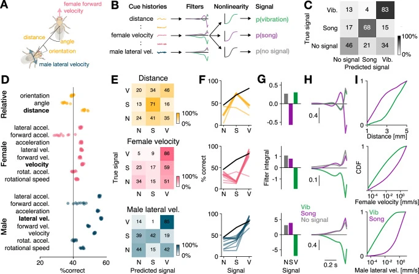

Steinfath et al. · *Nature Communications* · 2025  
[A neural circuit for context-dependent multimodal signaling in Drosophila](https://pmc.ncbi.nlm.nih.gov/articles/PMC12559195/#Fig2) · [原始图片](https://cdn.ncbi.nlm.nih.gov/pmc/blobs/cf40/12559195/bc7249750cb1/41467_2025_64907_Fig2_HTML.jpg) · [CC BY 4.0](https://creativecommons.org/licenses/by/4.0/)

## Fig. 3 · Neuron and connection sizes.

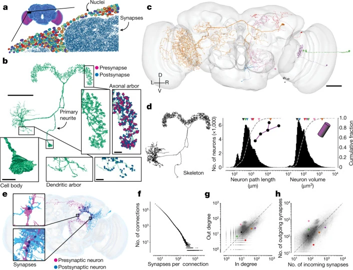

See paper · *Nature* · 2024  
[Neuronal wiring diagram of an adult brain](https://pmc.ncbi.nlm.nih.gov/articles/PMC11446842/#Fig3) · [原始图片](https://cdn.ncbi.nlm.nih.gov/pmc/blobs/066c/11446842/9d2783a2abab/41586_2024_7558_Fig3_HTML.jpg) · [CC BY 4.0](https://creativecommons.org/licenses/by/4.0/)

## Fig. 3 · Across-brain stereotypy.

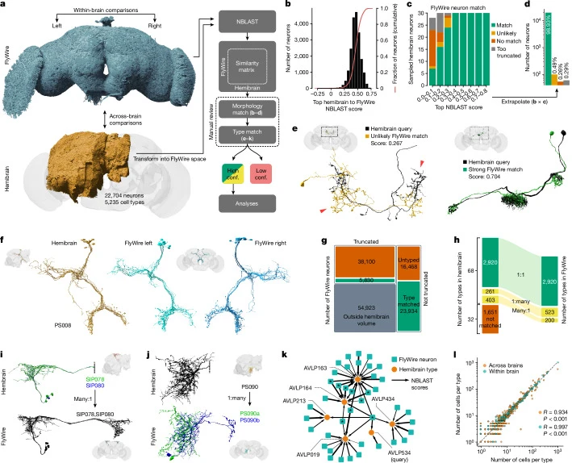

Schlegel et al. · *Nature* · 2024  
[Whole-brain annotation and multi-connectome cell typing of Drosophila](https://pmc.ncbi.nlm.nih.gov/articles/PMC11446831/#Fig3) · [原始图片](https://cdn.ncbi.nlm.nih.gov/pmc/blobs/8e54/11446831/5cb8c8e21b4c/41586_2024_7686_Fig3_HTML.jpg) · [CC BY 4.0](https://creativecommons.org/licenses/by/4.0/)

## Fig. 3 · The computational model correctly predicts that Ir94e neurons are aversive but fail to inhibit proboscis extension to a strong sugar stimulus.

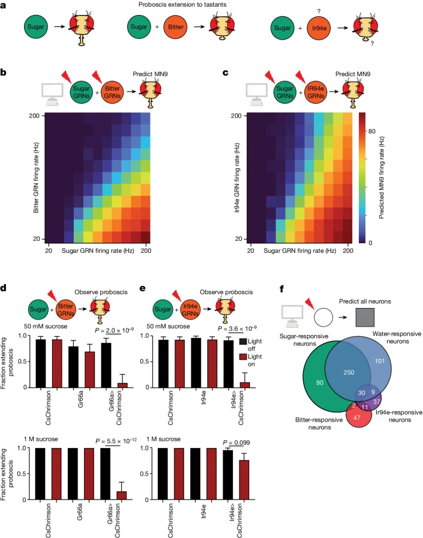

See paper · *Nature* · 2024  
[A Drosophila computational brain model reveals sensorimotor processing](https://pmc.ncbi.nlm.nih.gov/articles/PMC11446845/#Fig3) · [原始图片](https://cdn.ncbi.nlm.nih.gov/pmc/blobs/3567/11446845/38bac63cc181/41586_2024_7763_Fig3_HTML.jpg) · [CC BY 4.0](https://creativecommons.org/licenses/by/4.0/)

## Fig. 3 · Cluster analysis of DMN ensembles enables hypothesis generation and suggests experimental tests.

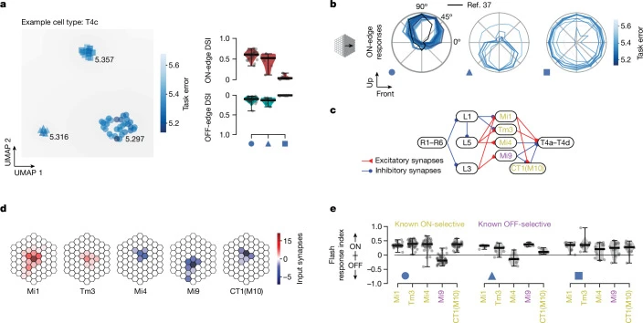

Lappalainen et al. · *Nature* · 2024  
[Connectome-constrained networks predict neural activity across the fly visual system](https://pmc.ncbi.nlm.nih.gov/articles/PMC11525180/#Fig3) · [原始图片](https://cdn.ncbi.nlm.nih.gov/pmc/blobs/a0a5/11525180/ffdb017e99db/41586_2024_7939_Fig3_HTML.jpg) · [CC BY 4.0](https://creativecommons.org/licenses/by/4.0/)

## Fig. 3 · Modelling and functional data uncover critical walking-promotion nodes inhibited by halting pathways in the walk-OFF mechanism.

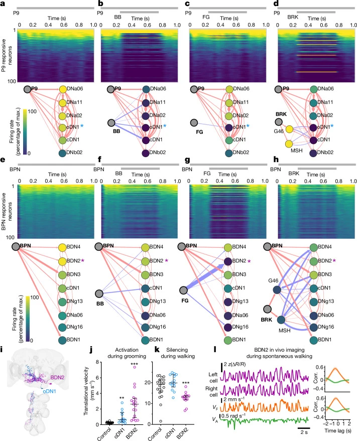

See paper · *Nature* · 2024  
[Neural circuit mechanisms underlying context-specific halting in Drosophila](https://pmc.ncbi.nlm.nih.gov/articles/PMC11446846/#Fig3) · [原始图片](https://cdn.ncbi.nlm.nih.gov/pmc/blobs/5b36/11446846/75017ad0de47/41586_2024_7854_Fig3_HTML.jpg) · [CC BY 4.0](https://creativecommons.org/licenses/by/4.0/)

## Fig. 3 · Capturing the architecture of the visual system by analysing the connectivity of key cell types.

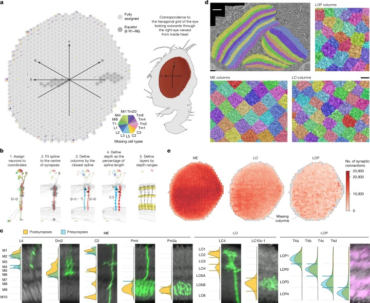

Nern et al. · *Nature* · 2025  
[Connectome-driven neural inventory of a complete visual system](https://pmc.ncbi.nlm.nih.gov/articles/PMC12119369/#Fig3) · [原始图片](https://cdn.ncbi.nlm.nih.gov/pmc/blobs/e7bf/12119369/7a41a90c4f3c/41586_2025_8746_Fig3_HTML.jpg) · [CC BY 4.0](https://creativecommons.org/licenses/by/4.0/)

## Fig. 3 · Light and other inputs to the clock network.

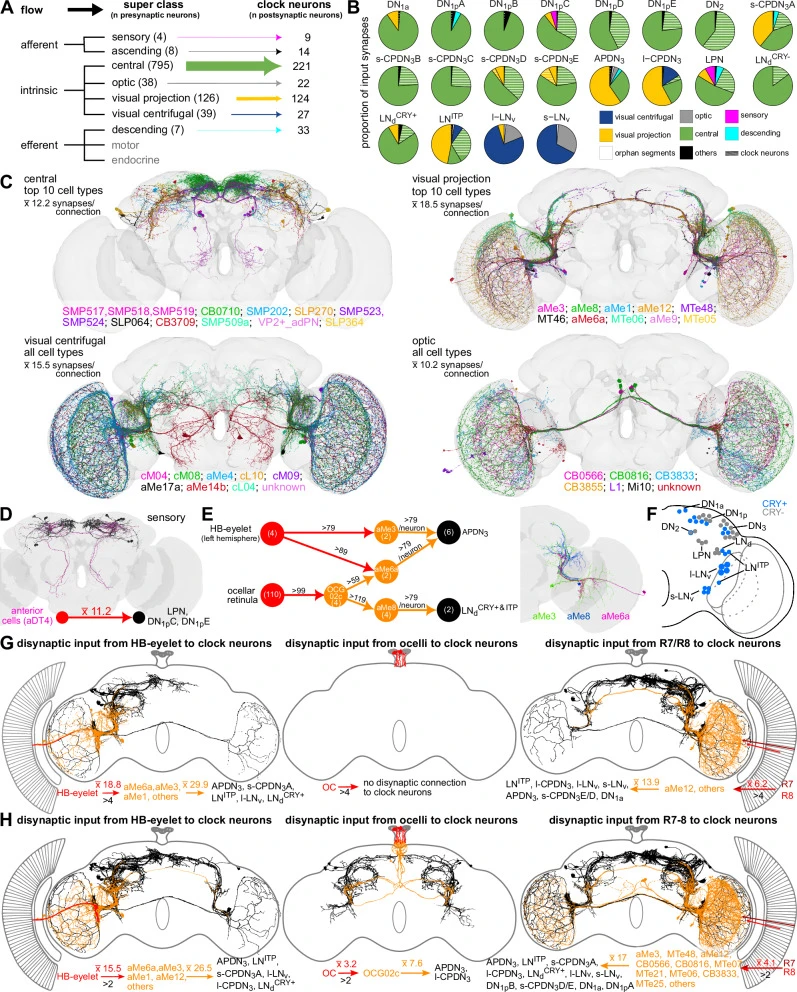

See paper · *Nature Communications* · 2024  
[Synaptic connectome of the Drosophila circadian clock](https://pmc.ncbi.nlm.nih.gov/articles/PMC11621569/#Fig3) · [原始图片](https://cdn.ncbi.nlm.nih.gov/pmc/blobs/e877/11621569/76799c5912d0/41467_2024_54694_Fig3_HTML.jpg) · [CC BY 4.0](https://creativecommons.org/licenses/by/4.0/)

## Fig. 3 · Dual versions of unbounded valence-specific (VSu) models can be combined to create the mixed-valence (MV) model, which also learns unbounded RPs.

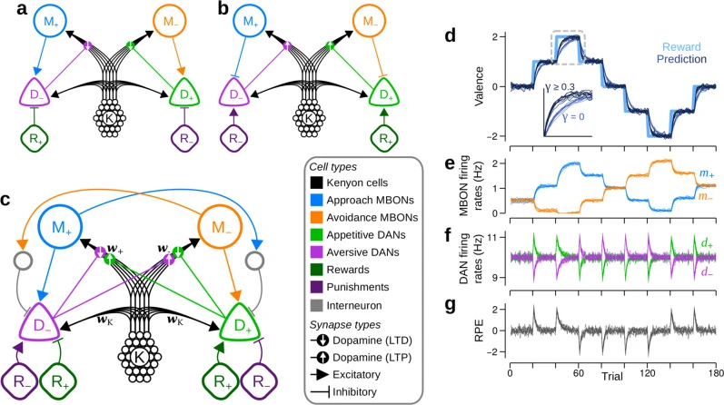

Bennett et al. · *Nature Communications* · 2021  
[Learning with reinforcement prediction errors in a model of the Drosophila mushroom body](https://pmc.ncbi.nlm.nih.gov/articles/PMC8105414/#Fig3) · [原始图片](https://cdn.ncbi.nlm.nih.gov/pmc/blobs/2de8/8105414/28ed9de3b2c7/41467_2021_22592_Fig3_HTML.jpg) · [CC BY 4.0](https://creativecommons.org/licenses/by/4.0/)

## Fig. 3 · PAM-β′2a DANs likely induce depression of KC-MBON-γ5β′2a synapses to decrease CS+ odor avoidance during reversal.

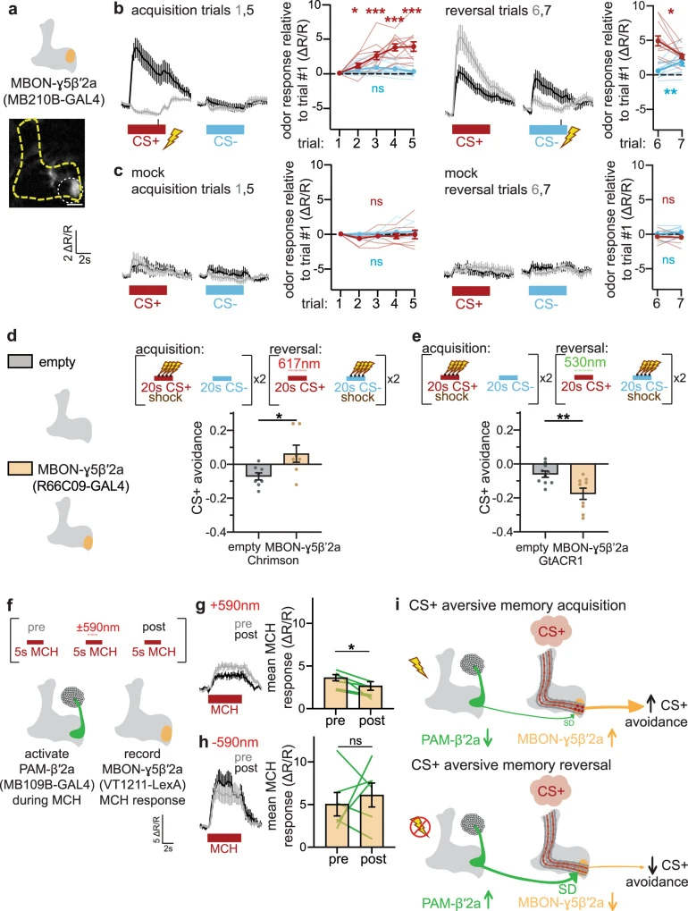

McCurdy et al. · *Nature Communications* · 2021  
[Dopaminergic mechanism underlying reward-encoding of punishment omission during reversal learning in Drosophila](https://pmc.ncbi.nlm.nih.gov/articles/PMC7893153/#Fig3) · [原始图片](https://cdn.ncbi.nlm.nih.gov/pmc/blobs/aee3/7893153/3f732f866013/41467_2021_21388_Fig3_HTML.jpg) · [CC BY 4.0](https://creativecommons.org/licenses/by/4.0/)

## Fig. 3 · The connectivity of hook and claw neurons is structured to impact activity of leg motor neurons.

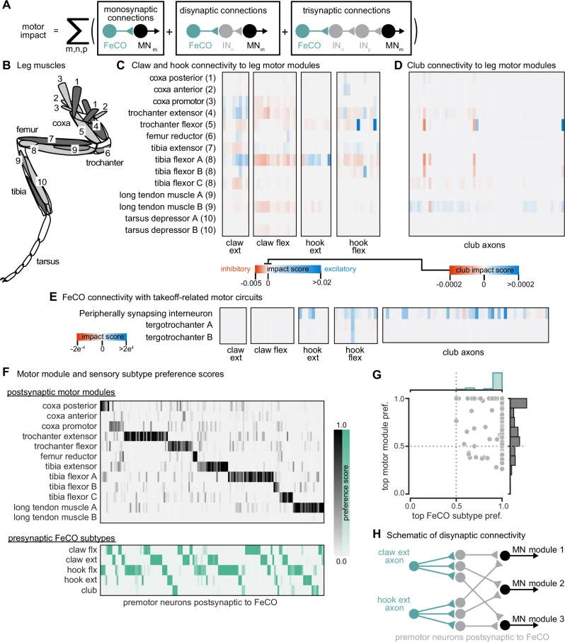

Lee et al. · *Nature Communications* · 2025  
[Divergent neural circuits for proprioceptive and exteroceptive sensing of the Drosophila leg](https://pmc.ncbi.nlm.nih.gov/articles/PMC12048489/#Fig3) · [原始图片](https://cdn.ncbi.nlm.nih.gov/pmc/blobs/bb17/12048489/d074ddb3c8e1/41467_2025_59302_Fig3_HTML.jpg) · [CC BY 4.0](https://creativecommons.org/licenses/by/4.0/)

## Fig. 3 · Immobility is a necessary and sufficient trigger of male vibrations.

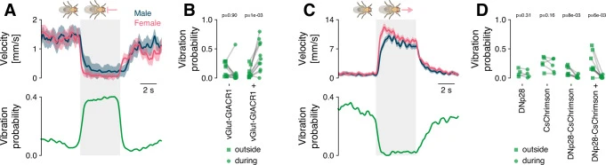

Steinfath et al. · *Nature Communications* · 2025  
[A neural circuit for context-dependent multimodal signaling in Drosophila](https://pmc.ncbi.nlm.nih.gov/articles/PMC12559195/#Fig3) · [原始图片](https://cdn.ncbi.nlm.nih.gov/pmc/blobs/cf40/12559195/ad59cc84cb9c/41467_2025_64907_Fig3_HTML.jpg) · [CC BY 4.0](https://creativecommons.org/licenses/by/4.0/)

## Fig. 4 · Neuropil projections and analysis of crossing neurons.

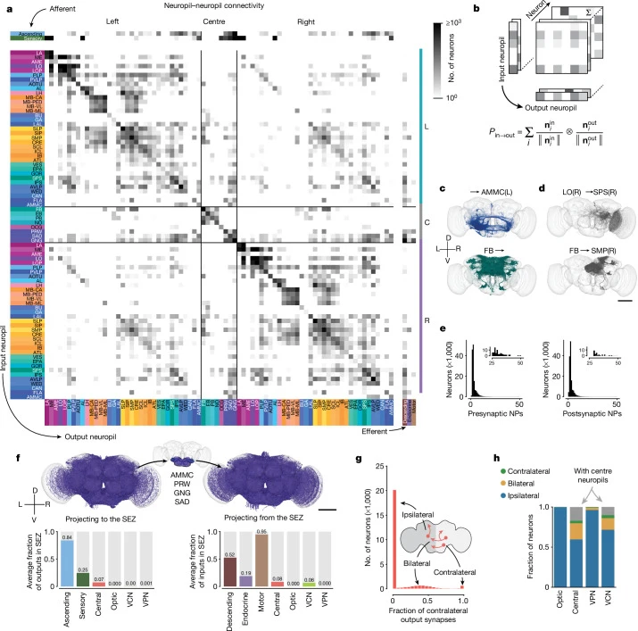

See paper · *Nature* · 2024  
[Neuronal wiring diagram of an adult brain](https://pmc.ncbi.nlm.nih.gov/articles/PMC11446842/#Fig4) · [原始图片](https://cdn.ncbi.nlm.nih.gov/pmc/blobs/066c/11446842/789b4cfe79a6/41586_2024_7558_Fig4_HTML.jpg) · [CC BY 4.0](https://creativecommons.org/licenses/by/4.0/)

## Fig. 4 · Connectivity stereotypy.

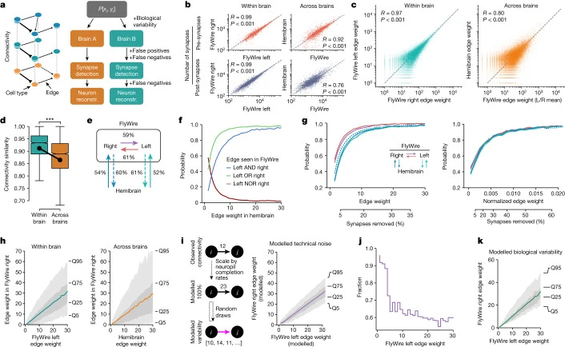

Schlegel et al. · *Nature* · 2024  
[Whole-brain annotation and multi-connectome cell typing of Drosophila](https://pmc.ncbi.nlm.nih.gov/articles/PMC11446831/#Fig4) · [原始图片](https://cdn.ncbi.nlm.nih.gov/pmc/blobs/8e54/11446831/288de8a63308/41586_2024_7686_Fig4_HTML.jpg) · [CC BY 4.0](https://creativecommons.org/licenses/by/4.0/)

## Fig. 4 · The computational model correctly predicts that the sugar and water pathways share components and additively promote proboscis extension.

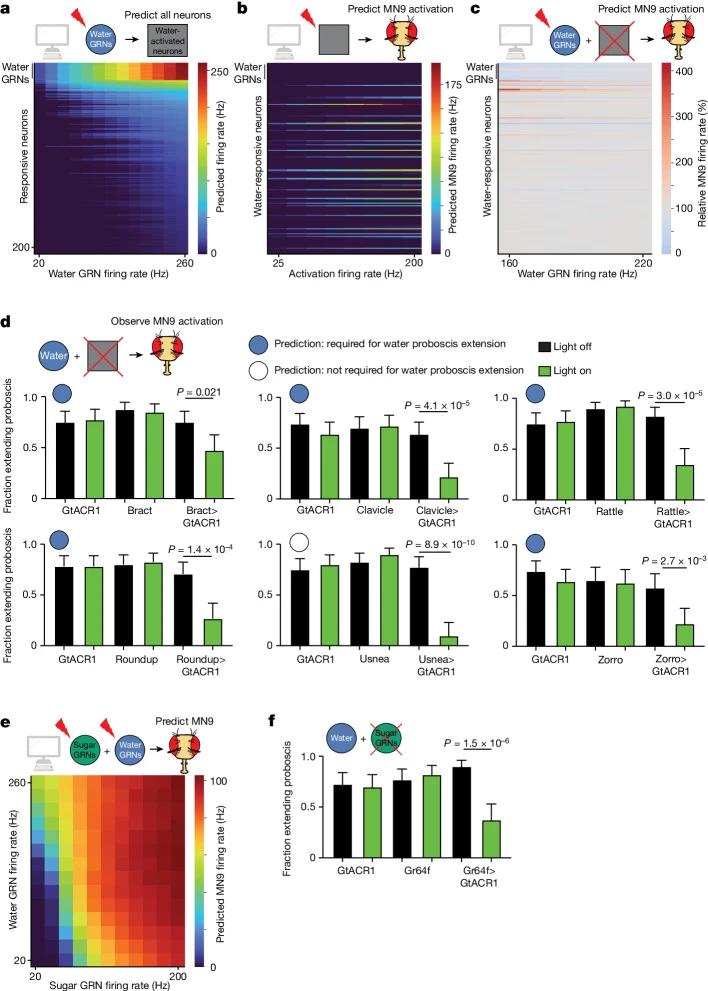

See paper · *Nature* · 2024  
[A Drosophila computational brain model reveals sensorimotor processing](https://pmc.ncbi.nlm.nih.gov/articles/PMC11446845/#Fig4) · [原始图片](https://cdn.ncbi.nlm.nih.gov/pmc/blobs/3567/11446845/3d6741fac10d/41586_2024_7763_Fig4_HTML.jpg) · [CC BY 4.0](https://creativecommons.org/licenses/by/4.0/)

## Fig. 4 · Task-optimal DMNs largely recapitulate known mechanisms of motion computation.

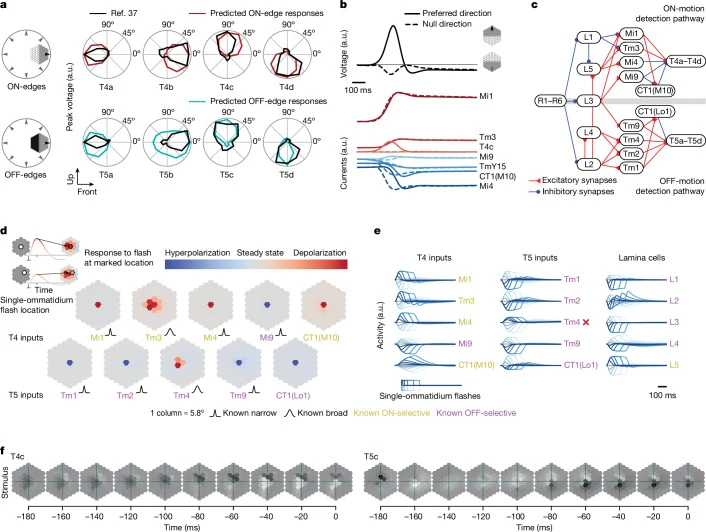

Lappalainen et al. · *Nature* · 2024  
[Connectome-constrained networks predict neural activity across the fly visual system](https://pmc.ncbi.nlm.nih.gov/articles/PMC11525180/#Fig4) · [原始图片](https://cdn.ncbi.nlm.nih.gov/pmc/blobs/a0a5/11525180/df2c8ab949bc/41586_2024_7939_Fig4_HTML.jpg) · [CC BY 4.0](https://creativecommons.org/licenses/by/4.0/)

## Fig. 4 · VNC-specific halting pathway for increasing resistance to leg movements in the brake mechanism.

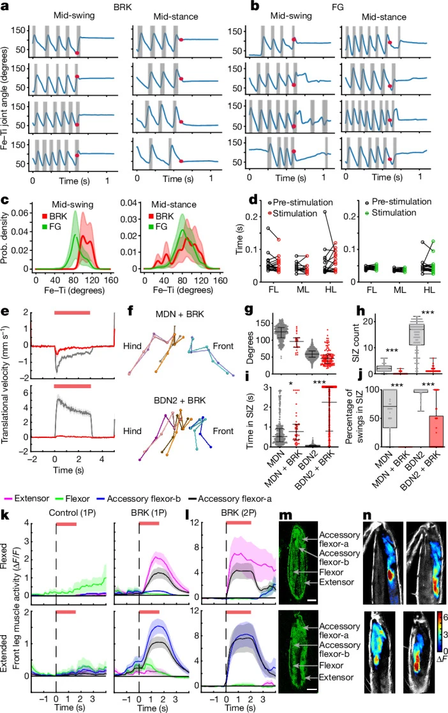

See paper · *Nature* · 2024  
[Neural circuit mechanisms underlying context-specific halting in Drosophila](https://pmc.ncbi.nlm.nih.gov/articles/PMC11446846/#Fig4) · [原始图片](https://cdn.ncbi.nlm.nih.gov/pmc/blobs/5b36/11446846/db9fa288554d/41586_2024_7854_Fig4_HTML.jpg) · [CC BY 4.0](https://creativecommons.org/licenses/by/4.0/)

## Fig. 4 · Diversity of neurotransmitter signalling in the visual system.

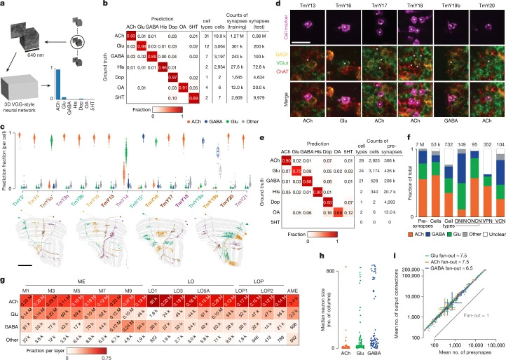

Nern et al. · *Nature* · 2025  
[Connectome-driven neural inventory of a complete visual system](https://pmc.ncbi.nlm.nih.gov/articles/PMC12119369/#Fig4) · [原始图片](https://cdn.ncbi.nlm.nih.gov/pmc/blobs/e7bf/12119369/f3a0fb577787/41586_2025_8746_Fig4_HTML.jpg) · [CC BY 4.0](https://creativecommons.org/licenses/by/4.0/)

## Fig. 4 · Direct and indirect clock output pathways.

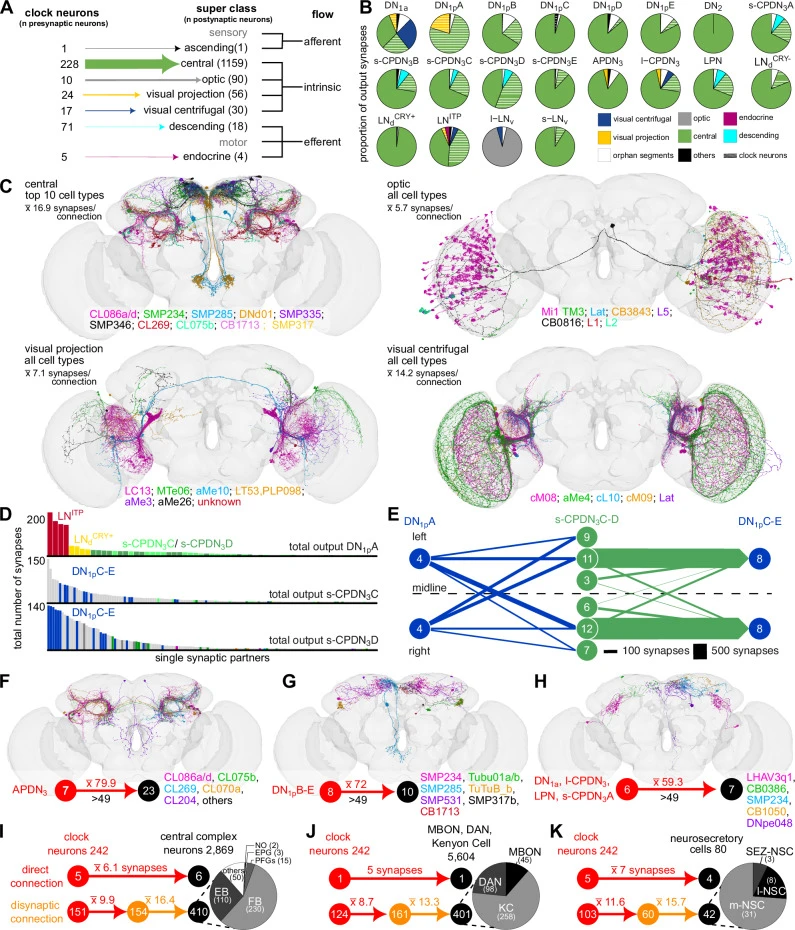

See paper · *Nature Communications* · 2024  
[Synaptic connectome of the Drosophila circadian clock](https://pmc.ncbi.nlm.nih.gov/articles/PMC11621569/#Fig4) · [原始图片](https://cdn.ncbi.nlm.nih.gov/pmc/blobs/e877/11621569/7295e4e03659/41467_2024_54694_Fig4_HTML.jpg) · [CC BY 4.0](https://creativecommons.org/licenses/by/4.0/)

## Fig. 4 · Learning RPs in tasks with multiple cues.

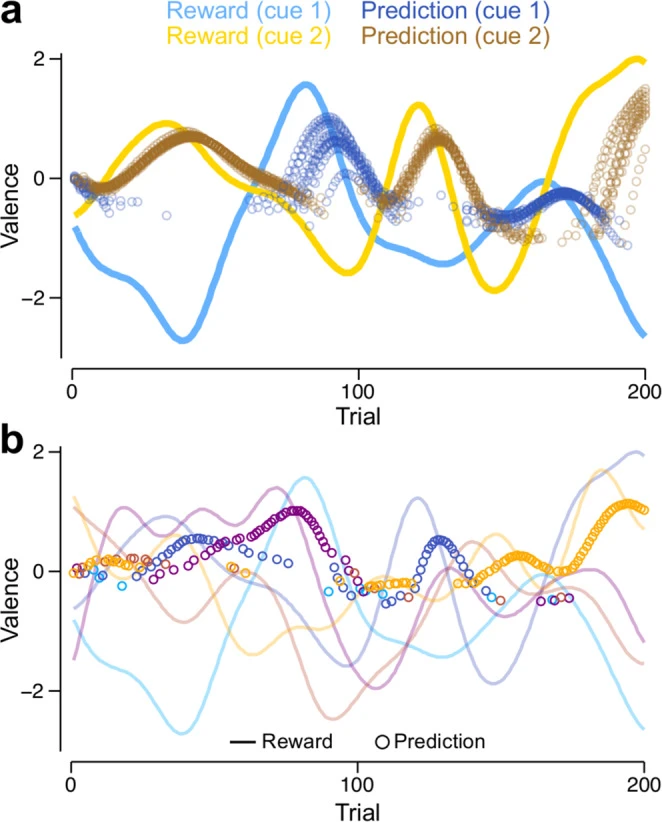

Bennett et al. · *Nature Communications* · 2021  
[Learning with reinforcement prediction errors in a model of the Drosophila mushroom body](https://pmc.ncbi.nlm.nih.gov/articles/PMC8105414/#Fig4) · [原始图片](https://cdn.ncbi.nlm.nih.gov/pmc/blobs/2de8/8105414/12860fc21ba6/41467_2021_22592_Fig4_HTML.jpg) · [CC BY 4.0](https://creativecommons.org/licenses/by/4.0/)

## Fig. 4 · Five MBONs significantly change odor responses during reversal.

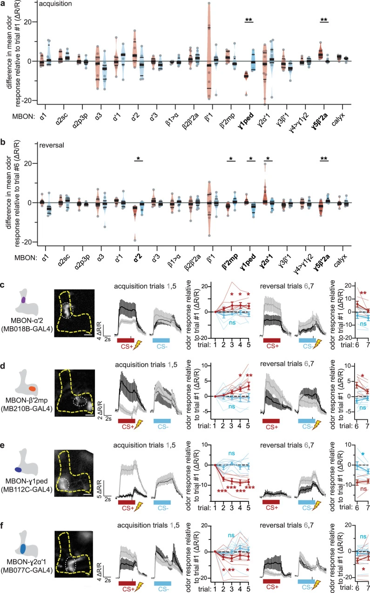

McCurdy et al. · *Nature Communications* · 2021  
[Dopaminergic mechanism underlying reward-encoding of punishment omission during reversal learning in Drosophila](https://pmc.ncbi.nlm.nih.gov/articles/PMC7893153/#Fig4) · [原始图片](https://cdn.ncbi.nlm.nih.gov/pmc/blobs/aee3/7893153/dba92b895f1a/41467_2021_21388_Fig4_HTML.jpg) · [CC BY 4.0](https://creativecommons.org/licenses/by/4.0/)

## Fig. 4 · Receptive fields (RFs) of direct and indirect VPNs.

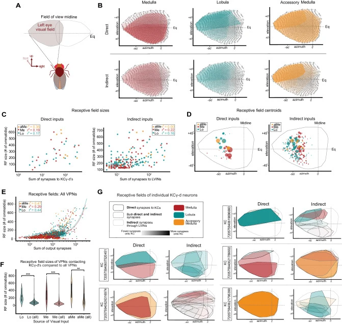

See paper · *Nature Communications* · 2024  
[Diversity of visual inputs to Kenyon cells of the Drosophila mushroom body](https://pmc.ncbi.nlm.nih.gov/articles/PMC11228034/#Fig4) · [原始图片](https://cdn.ncbi.nlm.nih.gov/pmc/blobs/ffee/11228034/ff369722a8c8/41467_2024_49616_Fig4_HTML.jpg) · [CC BY 4.0](https://creativecommons.org/licenses/by/4.0/)

## Fig. 4 · Dynamical multimodal signaling is controlled by a network including P1a and pC2l neurons.

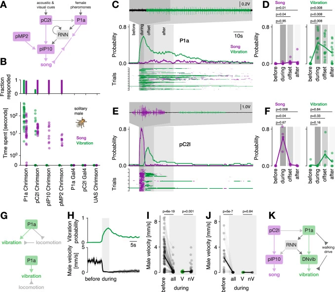

Steinfath et al. · *Nature Communications* · 2025  
[A neural circuit for context-dependent multimodal signaling in Drosophila](https://pmc.ncbi.nlm.nih.gov/articles/PMC12559195/#Fig4) · [原始图片](https://cdn.ncbi.nlm.nih.gov/pmc/blobs/cf40/12559195/b7f0ccf4208a/41467_2025_64907_Fig4_HTML.jpg) · [CC BY 4.0](https://creativecommons.org/licenses/by/4.0/)

## Fig. 5 · Optic lobes.

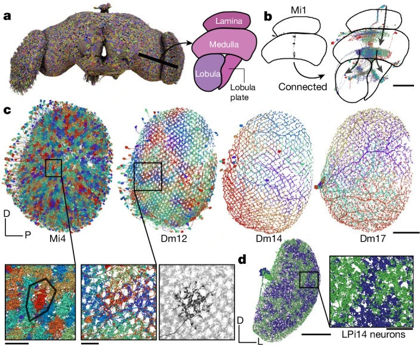

See paper · *Nature* · 2024  
[Neuronal wiring diagram of an adult brain](https://pmc.ncbi.nlm.nih.gov/articles/PMC11446842/#Fig5) · [原始图片](https://cdn.ncbi.nlm.nih.gov/pmc/blobs/066c/11446842/077fa383e9f5/41586_2024_7558_Fig5_HTML.jpg) · [CC BY 4.0](https://creativecommons.org/licenses/by/4.0/)

## Fig. 5 · Variability in the mushroom body.

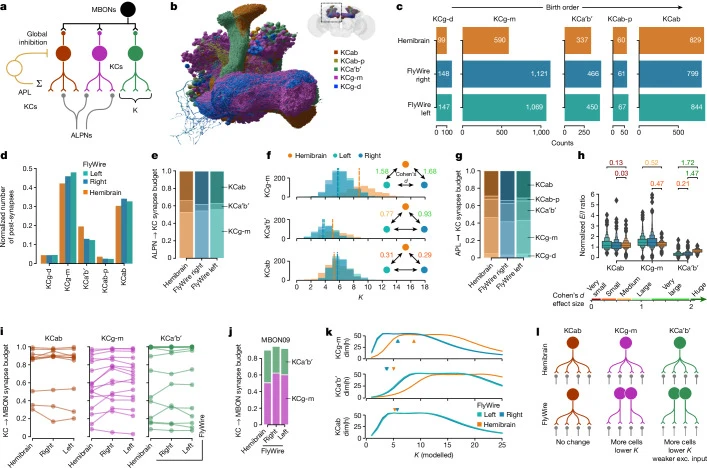

Schlegel et al. · *Nature* · 2024  
[Whole-brain annotation and multi-connectome cell typing of Drosophila](https://pmc.ncbi.nlm.nih.gov/articles/PMC11446831/#Fig5) · [原始图片](https://cdn.ncbi.nlm.nih.gov/pmc/blobs/8e54/11446831/9fdca6f106b9/41586_2024_7686_Fig5_HTML.jpg) · [CC BY 4.0](https://creativecommons.org/licenses/by/4.0/)

## Fig. 5 · The computational model correctly identifies key neurons in the antennal grooming circuit as well as subtype circuit responses.

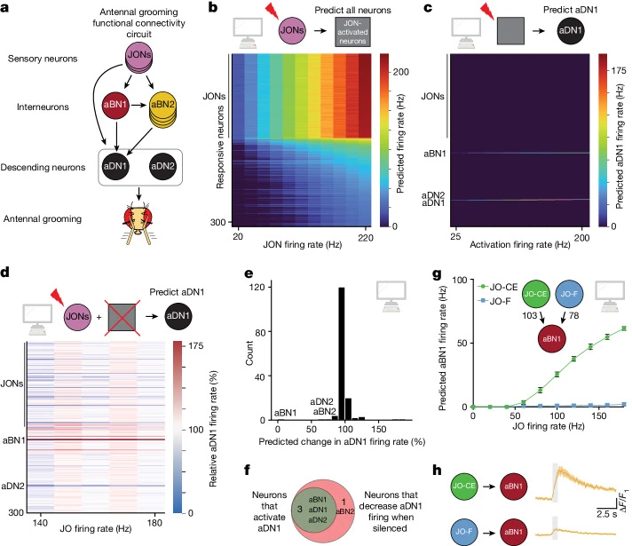

See paper · *Nature* · 2024  
[A Drosophila computational brain model reveals sensorimotor processing](https://pmc.ncbi.nlm.nih.gov/articles/PMC11446845/#Fig5) · [原始图片](https://cdn.ncbi.nlm.nih.gov/pmc/blobs/3567/11446845/b7b5320b42e4/41586_2024_7763_Fig5_HTML.jpg) · [CC BY 4.0](https://creativecommons.org/licenses/by/4.0/)

## Fig. 5 · Connectome measurements constrain neural networks in circuits with sparse connectivity.

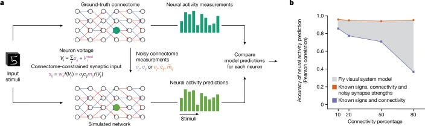

Lappalainen et al. · *Nature* · 2024  
[Connectome-constrained networks predict neural activity across the fly visual system](https://pmc.ncbi.nlm.nih.gov/articles/PMC11525180/#Fig5) · [原始图片](https://cdn.ncbi.nlm.nih.gov/pmc/blobs/a0a5/11525180/5c08a87e4d37/41586_2024_7939_Fig5_HTML.jpg) · [CC BY 4.0](https://creativecommons.org/licenses/by/4.0/)

## Fig. 5 · FG and BB recruited for halting in the context of feeding.

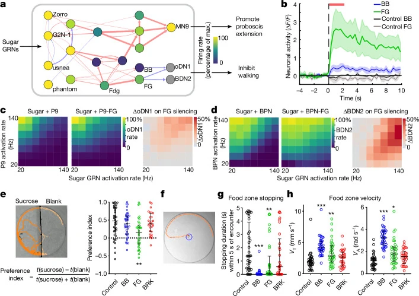

See paper · *Nature* · 2024  
[Neural circuit mechanisms underlying context-specific halting in Drosophila](https://pmc.ncbi.nlm.nih.gov/articles/PMC11446846/#Fig5) · [原始图片](https://cdn.ncbi.nlm.nih.gov/pmc/blobs/5b36/11446846/5a6b55b6f7d8/41586_2024_7854_Fig5_HTML.jpg) · [CC BY 4.0](https://creativecommons.org/licenses/by/4.0/)

## Fig. 5 · Quantitative summary of anatomy and connectivity of visual system neurons.

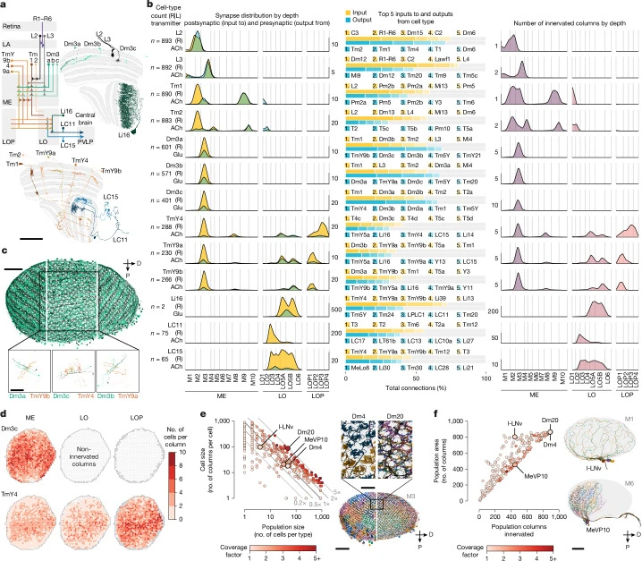

Nern et al. · *Nature* · 2025  
[Connectome-driven neural inventory of a complete visual system](https://pmc.ncbi.nlm.nih.gov/articles/PMC12119369/#Fig5) · [原始图片](https://cdn.ncbi.nlm.nih.gov/pmc/blobs/e7bf/12119369/412fbcab4973/41586_2025_8746_Fig5_HTML.jpg) · [CC BY 4.0](https://creativecommons.org/licenses/by/4.0/)

## Fig. 5 · Clock output to descending neurons.

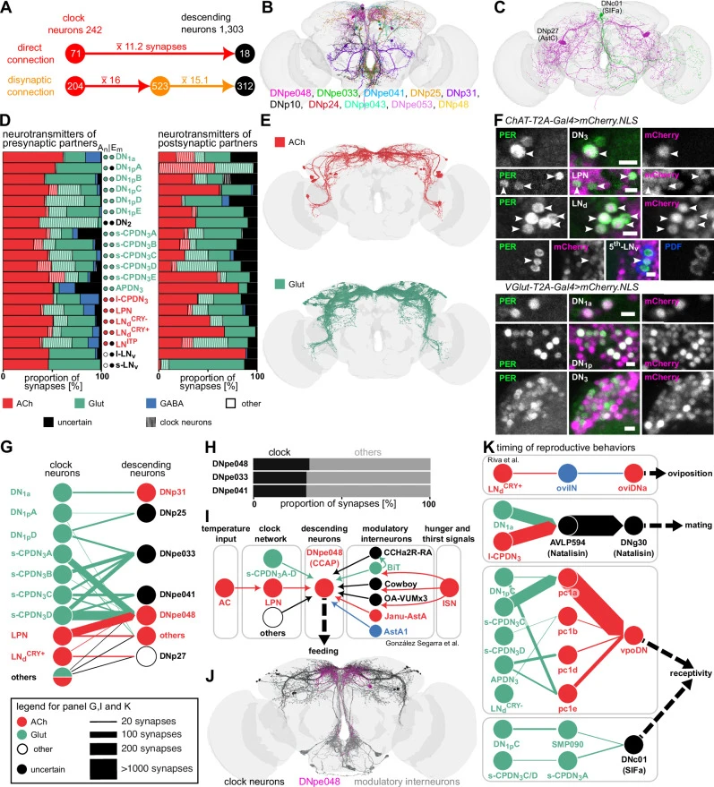

See paper · *Nature Communications* · 2024  
[Synaptic connectome of the Drosophila circadian clock](https://pmc.ncbi.nlm.nih.gov/articles/PMC11621569/#Fig5) · [原始图片](https://cdn.ncbi.nlm.nih.gov/pmc/blobs/e877/11621569/b3a0379fe5b2/41467_2024_54694_Fig5_HTML.jpg) · [CC BY 4.0](https://creativecommons.org/licenses/by/4.0/)

## Fig. 5 · Both the modified valence-specific (VSλ) and mixed-valence (MV) models produce choice behaviour that corresponds well with experiments under a broad range of experimental manipulations.

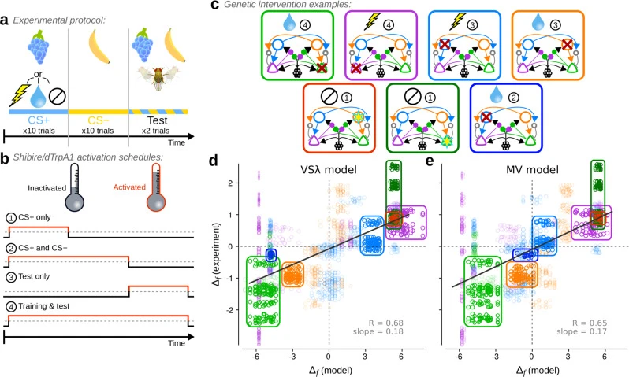

Bennett et al. · *Nature Communications* · 2021  
[Learning with reinforcement prediction errors in a model of the Drosophila mushroom body](https://pmc.ncbi.nlm.nih.gov/articles/PMC8105414/#Fig5) · [原始图片](https://cdn.ncbi.nlm.nih.gov/pmc/blobs/2de8/8105414/197afb5daf8f/41467_2021_22592_Fig5_HTML.jpg) · [CC BY 4.0](https://creativecommons.org/licenses/by/4.0/)

## Fig. 5 · MBON-γ2α′1 activation of PAM-β′2a encodes shock omission during reversal learning.

McCurdy et al. · *Nature Communications* · 2021  
[Dopaminergic mechanism underlying reward-encoding of punishment omission during reversal learning in Drosophila](https://pmc.ncbi.nlm.nih.gov/articles/PMC7893153/#Fig5) · [原始图片](https://cdn.ncbi.nlm.nih.gov/pmc/blobs/aee3/7893153/852042d7fbb9/41467_2021_21388_Fig5_HTML.jpg) · [CC BY 4.0](https://creativecommons.org/licenses/by/4.0/)

## Fig. 5 · VPNs and LVINs make distributed, combinatorial inputs onto KCγ-d’s.

See paper · *Nature Communications* · 2024  
[Diversity of visual inputs to Kenyon cells of the Drosophila mushroom body](https://pmc.ncbi.nlm.nih.gov/articles/PMC11228034/#Fig5) · [原始图片](https://cdn.ncbi.nlm.nih.gov/pmc/blobs/ffee/11228034/fe49008a9e2a/41467_2024_49616_Fig5_HTML.jpg) · [CC BY 4.0](https://creativecommons.org/licenses/by/4.0/)

## Fig. 5 · VNC neurons integrate vibration signals from club neurons across multiple legs.

Lee et al. · *Nature Communications* · 2025  
[Divergent neural circuits for proprioceptive and exteroceptive sensing of the Drosophila leg](https://pmc.ncbi.nlm.nih.gov/articles/PMC12048489/#Fig5) · [原始图片](https://cdn.ncbi.nlm.nih.gov/pmc/blobs/bb17/12048489/d9fda8a67f01/41467_2025_59302_Fig5_HTML.jpg) · [CC BY 4.0](https://creativecommons.org/licenses/by/4.0/)

## Fig. 5 · Coordination and modulation of song and vibration via mutual inhibition, female cues, and motivational state.

Steinfath et al. · *Nature Communications* · 2025  
[A neural circuit for context-dependent multimodal signaling in Drosophila](https://pmc.ncbi.nlm.nih.gov/articles/PMC12559195/#Fig5) · [原始图片](https://cdn.ncbi.nlm.nih.gov/pmc/blobs/cf40/12559195/bbf6fab6978d/41467_2025_64907_Fig5_HTML.jpg) · [CC BY 4.0](https://creativecommons.org/licenses/by/4.0/)

## Fig. 6 · Information flow through the Drosophila central brain.

See paper · *Nature* · 2024  
[Neuronal wiring diagram of an adult brain](https://pmc.ncbi.nlm.nih.gov/articles/PMC11446842/#Fig6) · [原始图片](https://cdn.ncbi.nlm.nih.gov/pmc/blobs/066c/11446842/0da3720e9046/41586_2024_7558_Fig6_HTML.jpg) · [CC BY 4.0](https://creativecommons.org/licenses/by/4.0/)

## Fig. 6 · Across-brain cell typing.

Schlegel et al. · *Nature* · 2024  
[Whole-brain annotation and multi-connectome cell typing of Drosophila](https://pmc.ncbi.nlm.nih.gov/articles/PMC11446831/#Fig6) · [原始图片](https://cdn.ncbi.nlm.nih.gov/pmc/blobs/8e54/11446831/b78769e7d96c/41586_2024_7686_Fig6_HTML.jpg) · [CC BY 4.0](https://creativecommons.org/licenses/by/4.0/)

## Fig. 6 · BRK is recruited for halting during grooming.

See paper · *Nature* · 2024  
[Neural circuit mechanisms underlying context-specific halting in Drosophila](https://pmc.ncbi.nlm.nih.gov/articles/PMC11446846/#Fig6) · [原始图片](https://cdn.ncbi.nlm.nih.gov/pmc/blobs/5b36/11446846/7daec6961f51/41586_2024_7854_Fig6_HTML.jpg) · [CC BY 4.0](https://creativecommons.org/licenses/by/4.0/)

## Fig. 6 · Visual projection neurons.

Nern et al. · *Nature* · 2025  
[Connectome-driven neural inventory of a complete visual system](https://pmc.ncbi.nlm.nih.gov/articles/PMC12119369/#Fig6) · [原始图片](https://cdn.ncbi.nlm.nih.gov/pmc/blobs/e7bf/12119369/fc0c32aa6531/41586_2025_8746_Fig6_HTML.jpg) · [CC BY 4.0](https://creativecommons.org/licenses/by/4.0/)

## Fig. 6 · Circadian clock neuropeptidome.

See paper · *Nature Communications* · 2024  
[Synaptic connectome of the Drosophila circadian clock](https://pmc.ncbi.nlm.nih.gov/articles/PMC11621569/#Fig6) · [原始图片](https://cdn.ncbi.nlm.nih.gov/pmc/blobs/e877/11621569/3c567a43a4fd/41467_2024_54694_Fig6_HTML.jpg) · [CC BY 4.0](https://creativecommons.org/licenses/by/4.0/)

## Fig. 6 · The absence of blocking does not imply the absence of reinforcement prediction errors.

Bennett et al. · *Nature Communications* · 2021  
[Learning with reinforcement prediction errors in a model of the Drosophila mushroom body](https://pmc.ncbi.nlm.nih.gov/articles/PMC8105414/#Fig6) · [原始图片](https://cdn.ncbi.nlm.nih.gov/pmc/blobs/2de8/8105414/899bcaf89c82/41467_2021_22592_Fig6_HTML.jpg) · [CC BY 4.0](https://creativecommons.org/licenses/by/4.0/)

## Fig. 6 · Shock-responsive PPL1-γ2α′1 dopaminergic neurons convey shock omission during reversal.

McCurdy et al. · *Nature Communications* · 2021  
[Dopaminergic mechanism underlying reward-encoding of punishment omission during reversal learning in Drosophila](https://pmc.ncbi.nlm.nih.gov/articles/PMC7893153/#Fig6) · [原始图片](https://cdn.ncbi.nlm.nih.gov/pmc/blobs/aee3/7893153/cd831113955e/41467_2021_21388_Fig6_HTML.jpg) · [CC BY 4.0](https://creativecommons.org/licenses/by/4.0/)

## Fig. 6 · KCγ-d’s receive a random set of inputs from VPNs and LVINs.

See paper · *Nature Communications* · 2024  
[Diversity of visual inputs to Kenyon cells of the Drosophila mushroom body](https://pmc.ncbi.nlm.nih.gov/articles/PMC11228034/#Fig6) · [原始图片](https://cdn.ncbi.nlm.nih.gov/pmc/blobs/ffee/11228034/11e7dcdd791b/41467_2024_49616_Fig6_HTML.jpg) · [CC BY 4.0](https://creativecommons.org/licenses/by/4.0/)

## Fig. 6 · Vibration signals from club neurons are transmitted directly and indirectly to the brain and integrated with mechanosensory signals from the antenna.

Lee et al. · *Nature Communications* · 2025  
[Divergent neural circuits for proprioceptive and exteroceptive sensing of the Drosophila leg](https://pmc.ncbi.nlm.nih.gov/articles/PMC12048489/#Fig6) · [原始图片](https://cdn.ncbi.nlm.nih.gov/pmc/blobs/bb17/12048489/4f985af95310/41467_2025_59302_Fig6_HTML.jpg) · [CC BY 4.0](https://creativecommons.org/licenses/by/4.0/)

## Fig. 6 · A neural circuit model proposes elementary computations underlying multimodal signaling.

Steinfath et al. · *Nature Communications* · 2025  
[A neural circuit for context-dependent multimodal signaling in Drosophila](https://pmc.ncbi.nlm.nih.gov/articles/PMC12559195/#Fig6) · [原始图片](https://cdn.ncbi.nlm.nih.gov/pmc/blobs/cf40/12559195/cb47310a9e00/41467_2025_64907_Fig6_HTML.jpg) · [CC BY 4.0](https://creativecommons.org/licenses/by/4.0/)

## Fig. 7 · Ocellar circuits and their integration with VPNs.

See paper · *Nature* · 2024  
[Neuronal wiring diagram of an adult brain](https://pmc.ncbi.nlm.nih.gov/articles/PMC11446842/#Fig7) · [原始图片](https://cdn.ncbi.nlm.nih.gov/pmc/blobs/066c/11446842/06ad43cc4104/41586_2024_7558_Fig7_HTML.jpg) · [CC BY 4.0](https://creativecommons.org/licenses/by/4.0/)

## Fig. 7 · Genetic driver lines for targeting visual-system neuron types and summary of connectivity.

Nern et al. · *Nature* · 2025  
[Connectome-driven neural inventory of a complete visual system](https://pmc.ncbi.nlm.nih.gov/articles/PMC12119369/#Fig7) · [原始图片](https://cdn.ncbi.nlm.nih.gov/pmc/blobs/e7bf/12119369/10e750c8831c/41586_2025_8746_Fig7_HTML.jpg) · [CC BY 4.0](https://creativecommons.org/licenses/by/4.0/)

## Fig. 7 · Paracrine signaling within the clock network.

See paper · *Nature Communications* · 2024  
[Synaptic connectome of the Drosophila circadian clock](https://pmc.ncbi.nlm.nih.gov/articles/PMC11621569/#Fig7) · [原始图片](https://cdn.ncbi.nlm.nih.gov/pmc/blobs/e877/11621569/90180fd93647/41467_2024_54694_Fig7_HTML.jpg) · [CC BY 4.0](https://creativecommons.org/licenses/by/4.0/)

## Fig. 7 · Prominent visual inputs to KCγ-d are shared across brains.

See paper · *Nature Communications* · 2024  
[Diversity of visual inputs to Kenyon cells of the Drosophila mushroom body](https://pmc.ncbi.nlm.nih.gov/articles/PMC11228034/#Fig7) · [原始图片](https://cdn.ncbi.nlm.nih.gov/pmc/blobs/ffee/11228034/27af3761e661/41467_2024_49616_Fig7_HTML.jpg) · [CC BY 4.0](https://creativecommons.org/licenses/by/4.0/)

## Fig. 8 · Parallels in Drosophila and vertebrate clock input and output pathways.

See paper · *Nature Communications* · 2024  
[Synaptic connectome of the Drosophila circadian clock](https://pmc.ncbi.nlm.nih.gov/articles/PMC11621569/#Fig8) · [原始图片](https://cdn.ncbi.nlm.nih.gov/pmc/blobs/e877/11621569/e40e048e6132/41467_2024_54694_Fig8_HTML.jpg) · [CC BY 4.0](https://creativecommons.org/licenses/by/4.0/)

## Extended Data Fig. 1 · Neuropils of the fly brain

See paper · *Nature* · 2024  
[Neuronal wiring diagram of an adult brain](https://pmc.ncbi.nlm.nih.gov/articles/PMC11446842/#Fig8) · [原始图片](https://cdn.ncbi.nlm.nih.gov/pmc/blobs/066c/11446842/e075c4d2222f/41586_2024_7558_Fig8_ESM.jpg) · [CC BY 4.0](https://creativecommons.org/licenses/by/4.0/)

## Extended Data Fig. 1 · Identification of water and sugar GRN modality.

See paper · *Nature* · 2024  
[A Drosophila computational brain model reveals sensorimotor processing](https://pmc.ncbi.nlm.nih.gov/articles/PMC11446845/#Fig6) · [原始图片](https://cdn.ncbi.nlm.nih.gov/pmc/blobs/3567/11446845/bb8a13052ea5/41586_2024_7763_Fig6_ESM.jpg) · [CC BY 4.0](https://creativecommons.org/licenses/by/4.0/)

## Extended Data Fig. 1 · Neural activation screen to identify halting neurons.

See paper · *Nature* · 2024  
[Neural circuit mechanisms underlying context-specific halting in Drosophila](https://pmc.ncbi.nlm.nih.gov/articles/PMC11446846/#Fig7) · [原始图片](https://cdn.ncbi.nlm.nih.gov/pmc/blobs/5b36/11446846/abba56233a51/41586_2024_7854_Fig7_ESM.jpg) · [CC BY 4.0](https://creativecommons.org/licenses/by/4.0/)

## Extended Data Fig. 2 · Completeness and accuracy of FlyWire’s reconstruction.

See paper · *Nature* · 2024  
[Neuronal wiring diagram of an adult brain](https://pmc.ncbi.nlm.nih.gov/articles/PMC11446842/#Fig9) · [原始图片](https://cdn.ncbi.nlm.nih.gov/pmc/blobs/066c/11446842/7117c70b671a/41586_2024_7558_Fig9_ESM.jpg) · [CC BY 4.0](https://creativecommons.org/licenses/by/4.0/)

## Extended Data Fig. 2 · Activating any BRK neuron is sufficient to drive halting.

See paper · *Nature* · 2024  
[Neural circuit mechanisms underlying context-specific halting in Drosophila](https://pmc.ncbi.nlm.nih.gov/articles/PMC11446846/#Fig8) · [原始图片](https://cdn.ncbi.nlm.nih.gov/pmc/blobs/5b36/11446846/998714bfc684/41586_2024_7854_Fig8_ESM.jpg) · [CC BY 4.0](https://creativecommons.org/licenses/by/4.0/)

## Extended Data Fig. 3 · Measurements of neuron size.

See paper · *Nature* · 2024  
[Neuronal wiring diagram of an adult brain](https://pmc.ncbi.nlm.nih.gov/articles/PMC11446842/#Fig10) · [原始图片](https://cdn.ncbi.nlm.nih.gov/pmc/blobs/066c/11446842/b1bfd6ee590b/41586_2024_7558_Fig10_ESM.jpg) · [CC BY 4.0](https://creativecommons.org/licenses/by/4.0/)

## Extended Data Fig. 3 · A comparison between predicted water silencing phenotypes and optogenetic silencing.

See paper · *Nature* · 2024  
[A Drosophila computational brain model reveals sensorimotor processing](https://pmc.ncbi.nlm.nih.gov/articles/PMC11446845/#Fig8) · [原始图片](https://cdn.ncbi.nlm.nih.gov/pmc/blobs/3567/11446845/fc11e2c86c3e/41586_2024_7763_Fig8_ESM.jpg) · [CC BY 4.0](https://creativecommons.org/licenses/by/4.0/)

## Extended Data Fig. 3 · High resolution 3D leg kinematics analysis.

See paper · *Nature* · 2024  
[Neural circuit mechanisms underlying context-specific halting in Drosophila](https://pmc.ncbi.nlm.nih.gov/articles/PMC11446846/#Fig9) · [原始图片](https://cdn.ncbi.nlm.nih.gov/pmc/blobs/5b36/11446846/7fa962cef6ef/41586_2024_7854_Fig9_ESM.jpg) · [CC BY 4.0](https://creativecommons.org/licenses/by/4.0/)

## Extended Data Fig. 4 · Measurements of neuron size.

See paper · *Nature* · 2024  
[Neuronal wiring diagram of an adult brain](https://pmc.ncbi.nlm.nih.gov/articles/PMC11446842/#Fig11) · [原始图片](https://cdn.ncbi.nlm.nih.gov/pmc/blobs/066c/11446842/87fb4b32850c/41586_2024_7558_Fig11_ESM.jpg) · [CC BY 4.0](https://creativecommons.org/licenses/by/4.0/)

## Extended Data Fig. 4 · The computational model predicts neurons that elicit aDN2, and neurons that inhibit aBN1.

See paper · *Nature* · 2024  
[A Drosophila computational brain model reveals sensorimotor processing](https://pmc.ncbi.nlm.nih.gov/articles/PMC11446845/#Fig9) · [原始图片](https://cdn.ncbi.nlm.nih.gov/pmc/blobs/3567/11446845/eea498211b00/41586_2024_7763_Fig9_ESM.jpg) · [CC BY 4.0](https://creativecommons.org/licenses/by/4.0/)

## Extended Data Fig. 4 · Walk-Halt Co-activation.

See paper · *Nature* · 2024  
[Neural circuit mechanisms underlying context-specific halting in Drosophila](https://pmc.ncbi.nlm.nih.gov/articles/PMC11446846/#Fig10) · [原始图片](https://cdn.ncbi.nlm.nih.gov/pmc/blobs/5b36/11446846/b0e69cce15e0/41586_2024_7854_Fig10_ESM.jpg) · [CC BY 4.0](https://creativecommons.org/licenses/by/4.0/)

## Extended Data Fig. 5 · Neuropil-neuropil projection maps.

See paper · *Nature* · 2024  
[Neuronal wiring diagram of an adult brain](https://pmc.ncbi.nlm.nih.gov/articles/PMC11446842/#Fig12) · [原始图片](https://cdn.ncbi.nlm.nih.gov/pmc/blobs/066c/11446842/240966e8e154/41586_2024_7558_Fig12_ESM.jpg) · [CC BY 4.0](https://creativecommons.org/licenses/by/4.0/)

## Extended Data Fig. 5 · Validating morphology and neurotransmitter profiles across light and electron microscopy data.

See paper · *Nature* · 2024  
[Neural circuit mechanisms underlying context-specific halting in Drosophila](https://pmc.ncbi.nlm.nih.gov/articles/PMC11446846/#Fig11) · [原始图片](https://cdn.ncbi.nlm.nih.gov/pmc/blobs/5b36/11446846/be85a3c5948b/41586_2024_7854_Fig11_ESM.jpg) · [CC BY 4.0](https://creativecommons.org/licenses/by/4.0/)

## Extended Data Fig. 6 · Neuropil-neuropil projections compared between hemispheres.

See paper · *Nature* · 2024  
[Neuronal wiring diagram of an adult brain](https://pmc.ncbi.nlm.nih.gov/articles/PMC11446842/#Fig13) · [原始图片](https://cdn.ncbi.nlm.nih.gov/pmc/blobs/066c/11446842/ce641a940d3d/41586_2024_7558_Fig13_ESM.jpg) · [CC BY 4.0](https://creativecommons.org/licenses/by/4.0/)

## Extended Data Fig. 6 · Analysis pertaining to Walk-OFF and Brake mechanisms.

See paper · *Nature* · 2024  
[Neural circuit mechanisms underlying context-specific halting in Drosophila](https://pmc.ncbi.nlm.nih.gov/articles/PMC11446846/#Fig12) · [原始图片](https://cdn.ncbi.nlm.nih.gov/pmc/blobs/5b36/11446846/636d7f38ee7a/41586_2024_7854_Fig12_ESM.jpg) · [CC BY 4.0](https://creativecommons.org/licenses/by/4.0/)

## Extended Data Fig. 7 · Input side analysis.

See paper · *Nature* · 2024  
[Neuronal wiring diagram of an adult brain](https://pmc.ncbi.nlm.nih.gov/articles/PMC11446842/#Fig14) · [原始图片](https://cdn.ncbi.nlm.nih.gov/pmc/blobs/066c/11446842/965b0ac340d8/41586_2024_7558_Fig14_ESM.jpg) · [CC BY 4.0](https://creativecommons.org/licenses/by/4.0/)

## Extended Data Fig. 7 · Different halt neurons have distinct effects on muscle activity.

See paper · *Nature* · 2024  
[Neural circuit mechanisms underlying context-specific halting in Drosophila](https://pmc.ncbi.nlm.nih.gov/articles/PMC11446846/#Fig13) · [原始图片](https://cdn.ncbi.nlm.nih.gov/pmc/blobs/5b36/11446846/31ffe229d1a4/41586_2024_7854_Fig13_ESM.jpg) · [CC BY 4.0](https://creativecommons.org/licenses/by/4.0/)

## Extended Data Fig. 8 · Percentile ranks for every modality.

See paper · *Nature* · 2024  
[Neuronal wiring diagram of an adult brain](https://pmc.ncbi.nlm.nih.gov/articles/PMC11446842/#Fig15) · [原始图片](https://cdn.ncbi.nlm.nih.gov/pmc/blobs/066c/11446842/02c479c90fe4/41586_2024_7558_Fig15_ESM.jpg) · [CC BY 4.0](https://creativecommons.org/licenses/by/4.0/)

## Extended Data Fig. 8 · Evaluating the role of different halt neurons in the context of feeding.

See paper · *Nature* · 2024  
[Neural circuit mechanisms underlying context-specific halting in Drosophila](https://pmc.ncbi.nlm.nih.gov/articles/PMC11446846/#Fig14) · [原始图片](https://cdn.ncbi.nlm.nih.gov/pmc/blobs/5b36/11446846/9becedb83f1c/41586_2024_7854_Fig14_ESM.jpg) · [CC BY 4.0](https://creativecommons.org/licenses/by/4.0/)

## Extended Data Fig. 9 · Rank-based UMAP projection and neuropils.

See paper · *Nature* · 2024  
[Neuronal wiring diagram of an adult brain](https://pmc.ncbi.nlm.nih.gov/articles/PMC11446842/#Fig16) · [原始图片](https://cdn.ncbi.nlm.nih.gov/pmc/blobs/066c/11446842/28c208bcb217/41586_2024_7558_Fig16_ESM.jpg) · [CC BY 4.0](https://creativecommons.org/licenses/by/4.0/)

## Extended Data Fig. 9 · Connectome and behavior-based segment-specific analysis of BRK neurons.

See paper · *Nature* · 2024  
[Neural circuit mechanisms underlying context-specific halting in Drosophila](https://pmc.ncbi.nlm.nih.gov/articles/PMC11446846/#Fig15) · [原始图片](https://cdn.ncbi.nlm.nih.gov/pmc/blobs/5b36/11446846/e85c2373b80d/41586_2024_7854_Fig15_ESM.jpg) · [CC BY 4.0](https://creativecommons.org/licenses/by/4.0/)

## Extended Data Fig. 10 · Ocellar circuit.

See paper · *Nature* · 2024  
[Neuronal wiring diagram of an adult brain](https://pmc.ncbi.nlm.nih.gov/articles/PMC11446842/#Fig17) · [原始图片](https://cdn.ncbi.nlm.nih.gov/pmc/blobs/066c/11446842/b22dcef41ff3/41586_2024_7558_Fig17_ESM.jpg) · [CC BY 4.0](https://creativecommons.org/licenses/by/4.0/)

## Extended Data Fig. 10 · Connectome-guided prediction of novel halting pathways.

See paper · *Nature* · 2024  
[Neural circuit mechanisms underlying context-specific halting in Drosophila](https://pmc.ncbi.nlm.nih.gov/articles/PMC11446846/#Fig16) · [原始图片](https://cdn.ncbi.nlm.nih.gov/pmc/blobs/5b36/11446846/9b6559bdcffa/41586_2024_7854_Fig16_ESM.jpg) · [CC BY 4.0](https://creativecommons.org/licenses/by/4.0/)

