# 神经环路与决策

> 共 128 张。图片是按原图缩放的本地预览；查看原文可获取完整图注和高清版本。

## Fig. 1 · Widespread representation of sensory evidence, lick preparation and lick execution across the mouse brain during noisy visual change detection.

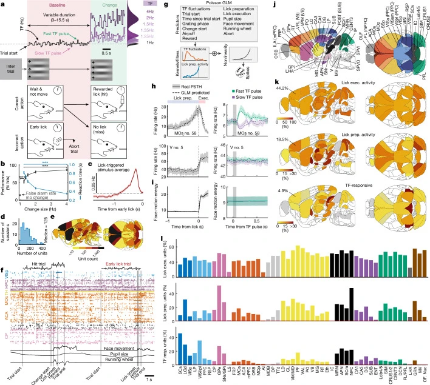

See paper · *Nature* · 2024  
[Brain-wide dynamics linking sensation to action during decision-making](https://pmc.ncbi.nlm.nih.gov/articles/PMC11499283/#Fig1) · [原始图片](https://cdn.ncbi.nlm.nih.gov/pmc/blobs/87a4/11499283/c6db2c70665a/41586_2024_7908_Fig1_HTML.jpg) · [CC BY 4.0](https://creativecommons.org/licenses/by/4.0/)

## Fig. 1 · Rats can perform context-dependent evidence accumulation.

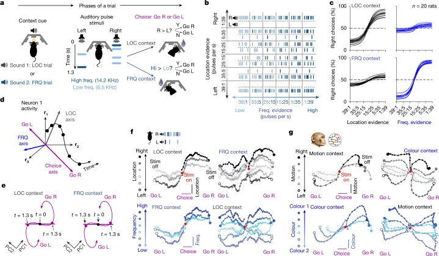

Pagan et al. · *Nature* · 2024  
[Individual variability of neural computations underlying flexible decisions](https://pmc.ncbi.nlm.nih.gov/articles/PMC11903320/#Fig1) · [原始图片](https://cdn.ncbi.nlm.nih.gov/pmc/blobs/6c42/11903320/d7a71a474b17/41586_2024_8433_Fig1_HTML.jpg) · [CC BY 4.0](https://creativecommons.org/licenses/by/4.0/)

## Fig. 1 · Use of CEBRA for consistent and interpretable embeddings.

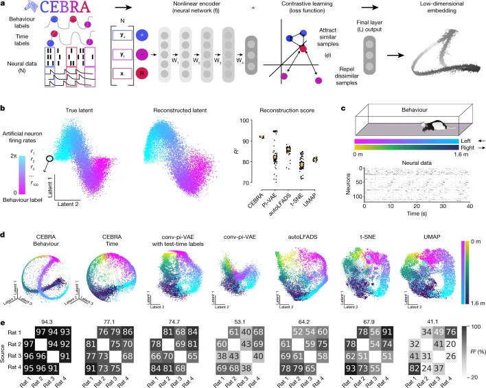

Schneider et al. · *Nature* · 2023  
[Learnable latent embeddings for joint behavioural and neural analysis](https://pmc.ncbi.nlm.nih.gov/articles/PMC10172131/#Fig1) · [原始图片](https://cdn.ncbi.nlm.nih.gov/pmc/blobs/b640/10172131/1fc3c992e4fa/41586_2023_6031_Fig1_HTML.jpg) · [CC BY 4.0](https://creativecommons.org/licenses/by/4.0/)

## Fig. 1 · Hypothesis.

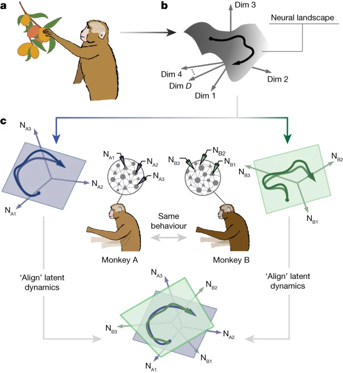

See paper · *Nature* · 2023  
[Preserved neural dynamics across animals performing similar behaviour](https://pmc.ncbi.nlm.nih.gov/articles/PMC10665198/#Fig1) · [原始图片](https://cdn.ncbi.nlm.nih.gov/pmc/blobs/60c6/10665198/67fb5a38c88d/41586_2023_6714_Fig1_HTML.jpg) · [CC BY 4.0](https://creativecommons.org/licenses/by/4.0/)

## Fig. 1 · Behaviour is associated with dopamine transients in DLS.

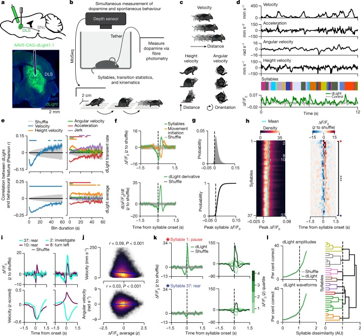

See paper · *Nature* · 2023  
[Spontaneous behaviour is structured by reinforcement without explicit reward](https://pmc.ncbi.nlm.nih.gov/articles/PMC9892006/#Fig1) · [原始图片](https://cdn.ncbi.nlm.nih.gov/pmc/blobs/9efd/9892006/a7aa0f5a0c33/41586_2022_5611_Fig1_HTML.jpg) · [CC BY 4.0](https://creativecommons.org/licenses/by/4.0/)

## Fig. 1 · A behavioral paradigm for investigating odor-evoked wind navigation.

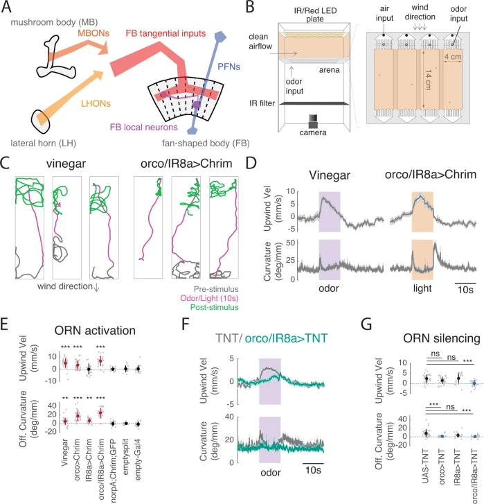

Matheson et al. · *Nature Communications* · 2022  
[A neural circuit for wind-guided olfactory navigation](https://pmc.ncbi.nlm.nih.gov/articles/PMC9360402/#Fig1) · [原始图片](https://cdn.ncbi.nlm.nih.gov/pmc/blobs/5975/9360402/f4229da85e51/41467_2022_32247_Fig1_HTML.jpg) · [CC BY 4.0](https://creativecommons.org/licenses/by/4.0/)

## Fig. 1 · Study design.

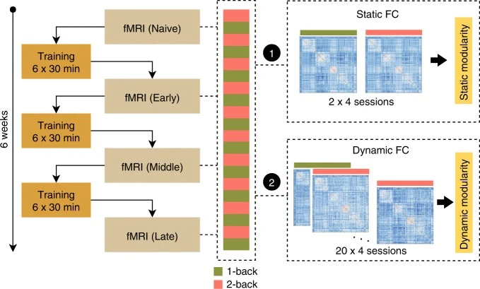

See paper · *Nature Communications* · 2020  
[Dynamic reconfiguration of functional brain networks during working memory training](https://pmc.ncbi.nlm.nih.gov/articles/PMC7229188/#Fig1) · [原始图片](https://cdn.ncbi.nlm.nih.gov/pmc/blobs/3ba0/7229188/dbc00e6757e0/41467_2020_15631_Fig1_HTML.jpg) · [CC BY 4.0](https://creativecommons.org/licenses/by/4.0/)

## Fig. 1 · Memories cluster in a continuous working memory task. a Top: humans (N = 90) performed a color delayed-estimation task in which they reported the color of a spatially-cued sample a

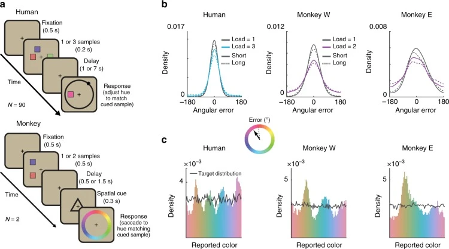

See paper · *Nature Communications* · 2019  
[Error-correcting dynamics in visual working memory](https://pmc.ncbi.nlm.nih.gov/articles/PMC6662698/#Fig1) · [原始图片](https://cdn.ncbi.nlm.nih.gov/pmc/blobs/9581/6662698/93259e843ba5/41467_2019_11298_Fig1_HTML.jpg) · [CC BY 4.0](https://creativecommons.org/licenses/by/4.0/)

## Fig. 1 · Summary of B-SOiD process, GUI, and performance in mice and other animals.

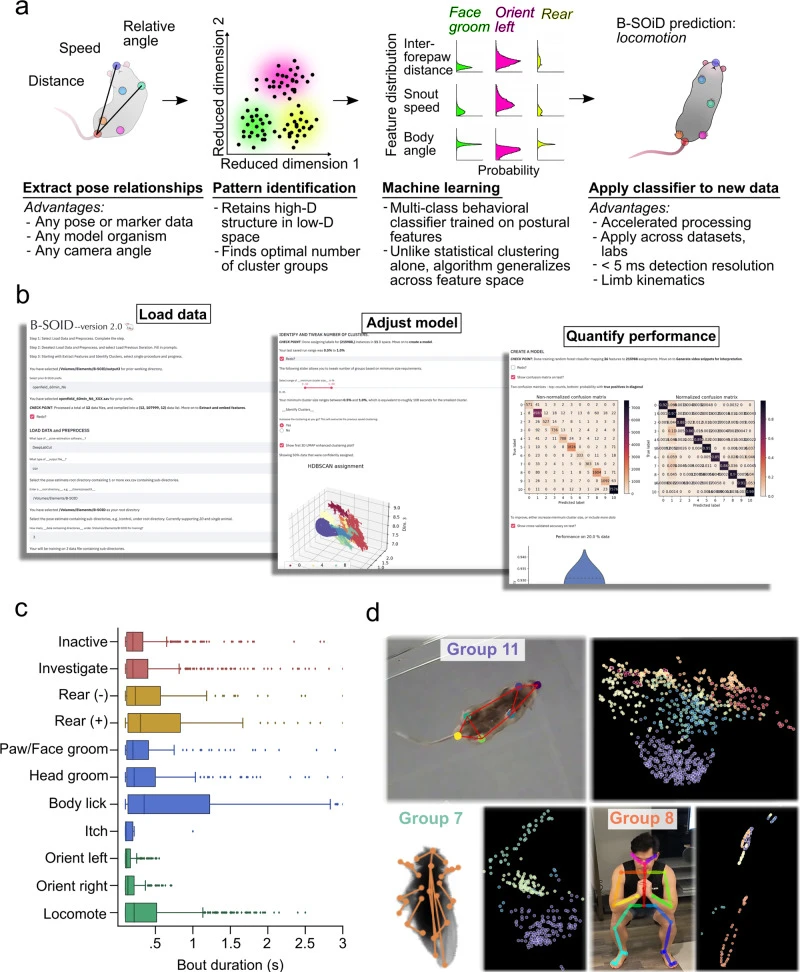

Hsu et al. · *Nature Communications* · 2021  
[B-SOiD, an open-source unsupervised algorithm for identification and fast prediction of behaviors](https://pmc.ncbi.nlm.nih.gov/articles/PMC8408193/#Fig1) · [原始图片](https://cdn.ncbi.nlm.nih.gov/pmc/blobs/2cd9/8408193/618be2cd6885/41467_2021_25420_Fig1_HTML.jpg) · [CC BY 4.0](https://creativecommons.org/licenses/by/4.0/)

## Fig. 2 · Propagation and widening of fast TF pulse responses across the brain.

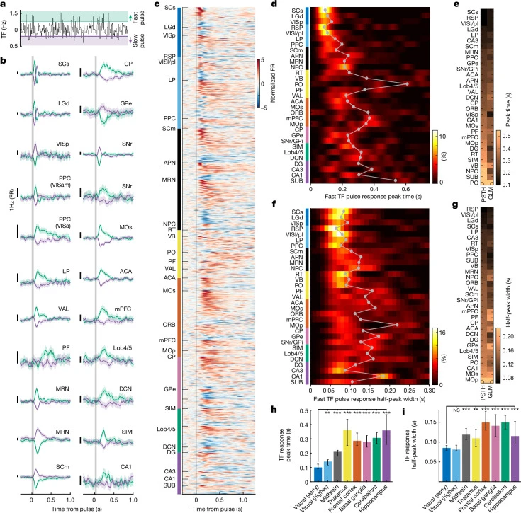

See paper · *Nature* · 2024  
[Brain-wide dynamics linking sensation to action during decision-making](https://pmc.ncbi.nlm.nih.gov/articles/PMC11499283/#Fig2) · [原始图片](https://cdn.ncbi.nlm.nih.gov/pmc/blobs/87a4/11499283/2b5442e0d18e/41586_2024_7908_Fig2_HTML.jpg) · [CC BY 4.0](https://creativecommons.org/licenses/by/4.0/)

## Fig. 2 · Context-dependent evidence selection can be dissected into three components.

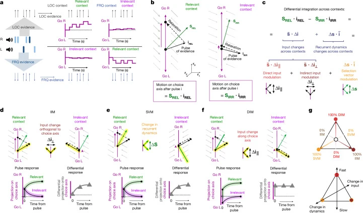

Pagan et al. · *Nature* · 2024  
[Individual variability of neural computations underlying flexible decisions](https://pmc.ncbi.nlm.nih.gov/articles/PMC11903320/#Fig2) · [原始图片](https://cdn.ncbi.nlm.nih.gov/pmc/blobs/6c42/11903320/8ed1b125ac7b/41586_2024_8433_Fig2_HTML.jpg) · [CC BY 4.0](https://creativecommons.org/licenses/by/4.0/)

## Fig. 2 · Prior decoding during the ITI.

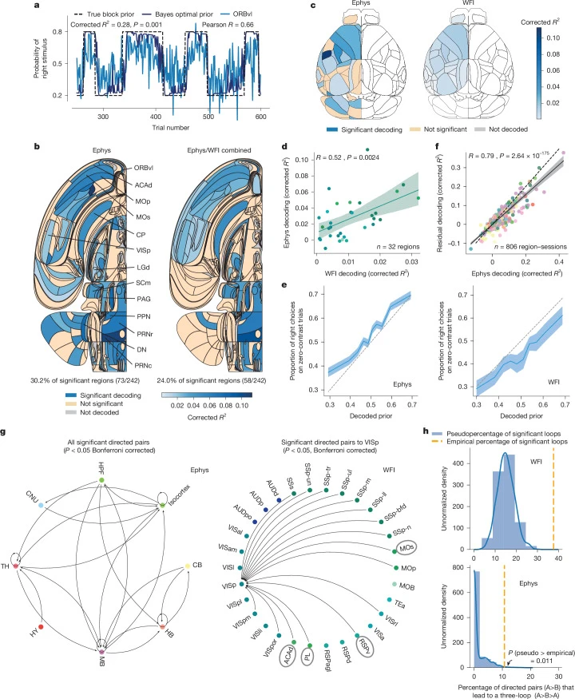

See paper · *Nature* · 2025  
[Brain-wide representations of prior information in mouse decision-making](https://pmc.ncbi.nlm.nih.gov/articles/PMC12408363/#Fig2) · [原始图片](https://cdn.ncbi.nlm.nih.gov/pmc/blobs/7180/12408363/f3979057f8c4/41586_2025_9226_Fig2_HTML.jpg) · [CC BY 4.0](https://creativecommons.org/licenses/by/4.0/)

## Fig. 2 · Brain-wide recordings during behaviour.

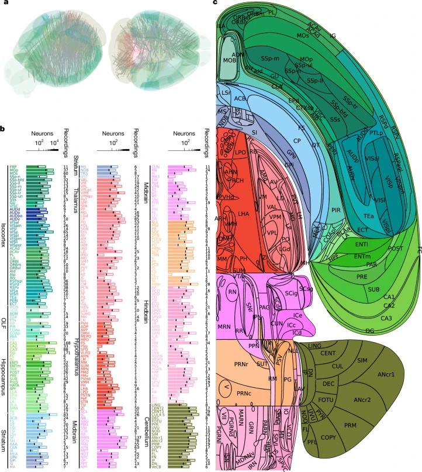

See paper · *Nature* · 2025  
[A brain-wide map of neural activity during complex behaviour](https://pmc.ncbi.nlm.nih.gov/articles/PMC12408349/#Fig2) · [原始图片](https://cdn.ncbi.nlm.nih.gov/pmc/blobs/eb24/12408349/ce0fb9467ff0/41586_2025_9235_Fig2_HTML.jpg) · [CC BY 4.0](https://creativecommons.org/licenses/by/4.0/)

## Fig. 2 · Hypothesis- and discovery-driven analysis with CEBRA.

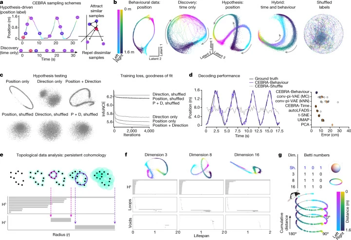

Schneider et al. · *Nature* · 2023  
[Learnable latent embeddings for joint behavioural and neural analysis](https://pmc.ncbi.nlm.nih.gov/articles/PMC10172131/#Fig2) · [原始图片](https://cdn.ncbi.nlm.nih.gov/pmc/blobs/b640/10172131/1a98bce08aba/41586_2023_6031_Fig2_HTML.jpg) · [CC BY 4.0](https://creativecommons.org/licenses/by/4.0/)

## Fig. 2 · Preserved latent dynamics across animals performing the same behaviour.

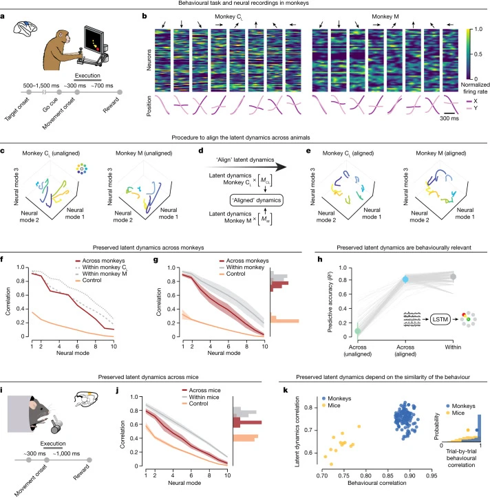

See paper · *Nature* · 2023  
[Preserved neural dynamics across animals performing similar behaviour](https://pmc.ncbi.nlm.nih.gov/articles/PMC10665198/#Fig2) · [原始图片](https://cdn.ncbi.nlm.nih.gov/pmc/blobs/60c6/10665198/38b5c1c66c58/41586_2023_6714_Fig2_HTML.jpg) · [CC BY 4.0](https://creativecommons.org/licenses/by/4.0/)

## Fig. 2 · Endogenous dopamine transients predict average syllable use and sequence variability.

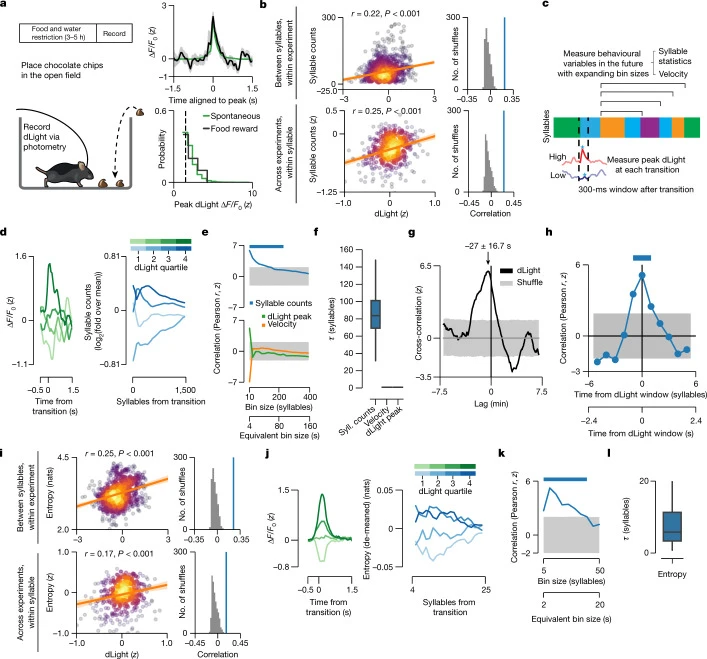

See paper · *Nature* · 2023  
[Spontaneous behaviour is structured by reinforcement without explicit reward](https://pmc.ncbi.nlm.nih.gov/articles/PMC9892006/#Fig2) · [原始图片](https://cdn.ncbi.nlm.nih.gov/pmc/blobs/9efd/9892006/88781288c9d2/41586_2022_5611_Fig2_HTML.jpg) · [CC BY 4.0](https://creativecommons.org/licenses/by/4.0/)

## Fig. 2 · LH and MB output neurons promote wind navigation behavior but encode odor independent of wind direction.

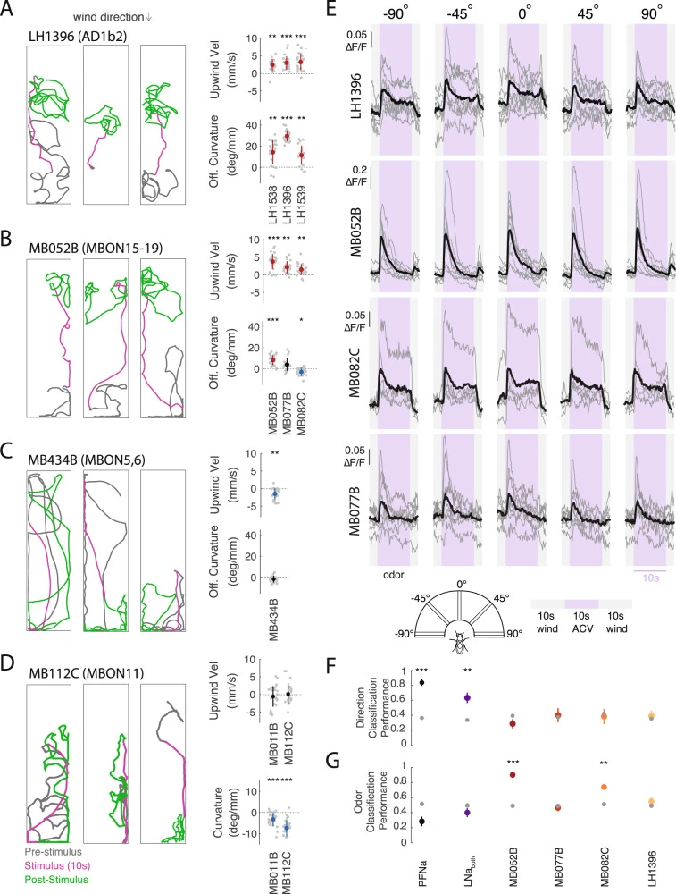

Matheson et al. · *Nature Communications* · 2022  
[A neural circuit for wind-guided olfactory navigation](https://pmc.ncbi.nlm.nih.gov/articles/PMC9360402/#Fig2) · [原始图片](https://cdn.ncbi.nlm.nih.gov/pmc/blobs/5975/9360402/770a5c1e4e28/41467_2022_32247_Fig2_HTML.jpg) · [CC BY 4.0](https://creativecommons.org/licenses/by/4.0/)

## Fig. 2 · Behavioral performance modulated by training.

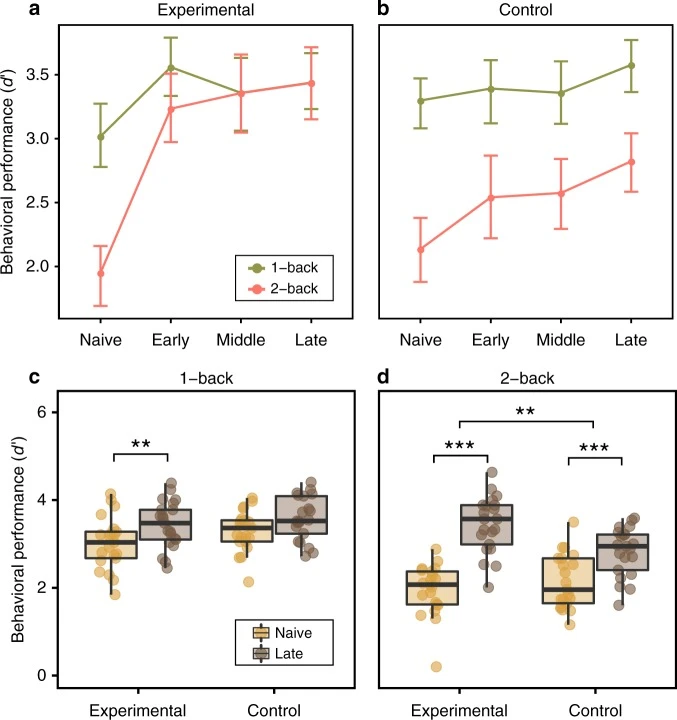

See paper · *Nature Communications* · 2020  
[Dynamic reconfiguration of functional brain networks during working memory training](https://pmc.ncbi.nlm.nih.gov/articles/PMC7229188/#Fig2) · [原始图片](https://cdn.ncbi.nlm.nih.gov/pmc/blobs/3ba0/7229188/39d3ce4170de/41467_2020_15631_Fig2_HTML.jpg) · [CC BY 4.0](https://creativecommons.org/licenses/by/4.0/)

## Fig. 2 · Structure of dynamical model. a Illustration of the influence of attractors on color memory. Attractors (dashed line) cause memories to drift over time (black arrow), introducing b

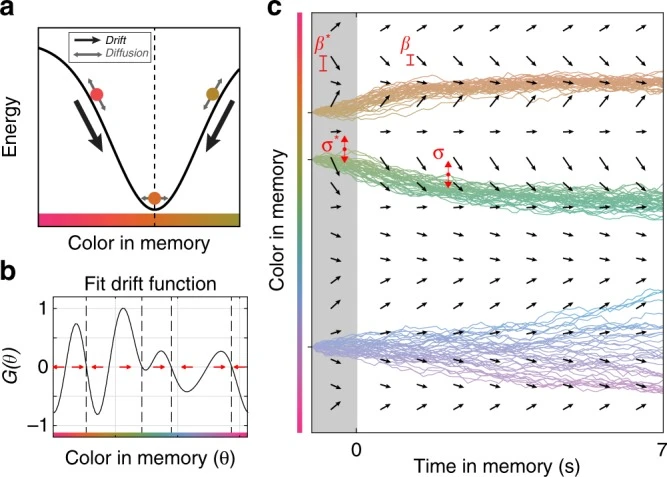

See paper · *Nature Communications* · 2019  
[Error-correcting dynamics in visual working memory](https://pmc.ncbi.nlm.nih.gov/articles/PMC6662698/#Fig2) · [原始图片](https://cdn.ncbi.nlm.nih.gov/pmc/blobs/9581/6662698/a966723c7749/41467_2019_11298_Fig2_HTML.jpg) · [CC BY 4.0](https://creativecommons.org/licenses/by/4.0/)

## Fig. 2 · Demixed principal component analysis (dPCA) of gamma and spiking.

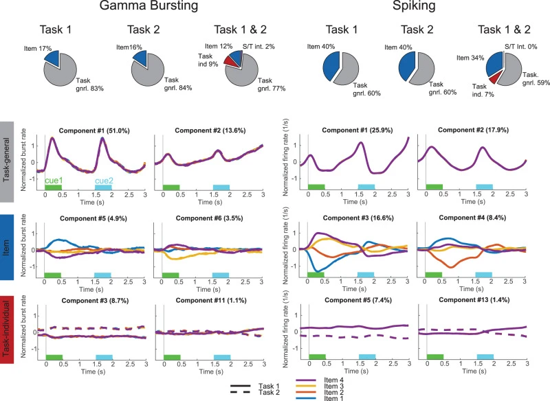

See paper · *Nature Communications* · 2023  
[Working memory control dynamics follow principles of spatial computing](https://pmc.ncbi.nlm.nih.gov/articles/PMC10015009/#Fig2) · [原始图片](https://cdn.ncbi.nlm.nih.gov/pmc/blobs/33c9/10015009/e8675923e67b/41467_2023_36555_Fig2_HTML.jpg) · [CC BY 4.0](https://creativecommons.org/licenses/by/4.0/)

## Fig. 2 · Performance quantification across multiple temporal resolutions with novel machine learning algorithms.

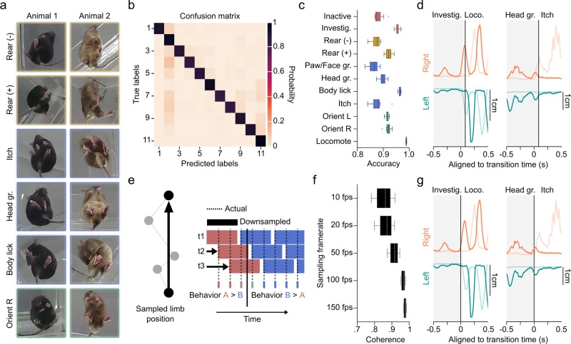

Hsu et al. · *Nature Communications* · 2021  
[B-SOiD, an open-source unsupervised algorithm for identification and fast prediction of behaviors](https://pmc.ncbi.nlm.nih.gov/articles/PMC8408193/#Fig2) · [原始图片](https://cdn.ncbi.nlm.nih.gov/pmc/blobs/2cd9/8408193/78498e53c008/41467_2021_25420_Fig2_HTML.jpg) · [CC BY 4.0](https://creativecommons.org/licenses/by/4.0/)

## Fig. 3 · Accumulation of visual evidence as a behavioural strategy and its neural implementation across the brain.

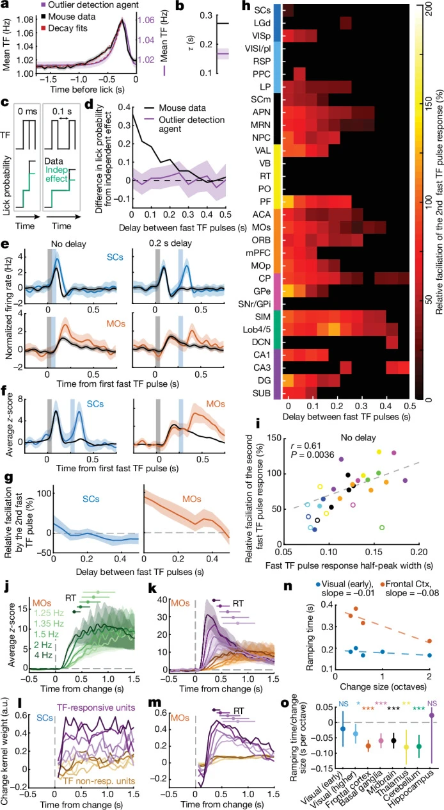

See paper · *Nature* · 2024  
[Brain-wide dynamics linking sensation to action during decision-making](https://pmc.ncbi.nlm.nih.gov/articles/PMC11499283/#Fig3) · [原始图片](https://cdn.ncbi.nlm.nih.gov/pmc/blobs/87a4/11499283/6815ac49aaac/41586_2024_7908_Fig3_HTML.jpg) · [CC BY 4.0](https://creativecommons.org/licenses/by/4.0/)

## Fig. 3 · Backpropagation-trained RNNs explore a subset of possible solutions, whereas engineered RNNs span the full solution space, matching heterogeneity in experimental data.

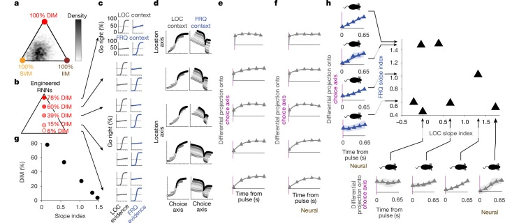

Pagan et al. · *Nature* · 2024  
[Individual variability of neural computations underlying flexible decisions](https://pmc.ncbi.nlm.nih.gov/articles/PMC11903320/#Fig3) · [原始图片](https://cdn.ncbi.nlm.nih.gov/pmc/blobs/6c42/11903320/7cbce5815214/41586_2024_8433_Fig3_HTML.jpg) · [CC BY 4.0](https://creativecommons.org/licenses/by/4.0/)

## Fig. 3 · Encoding of the prior across the brain during the post-stimulus period.

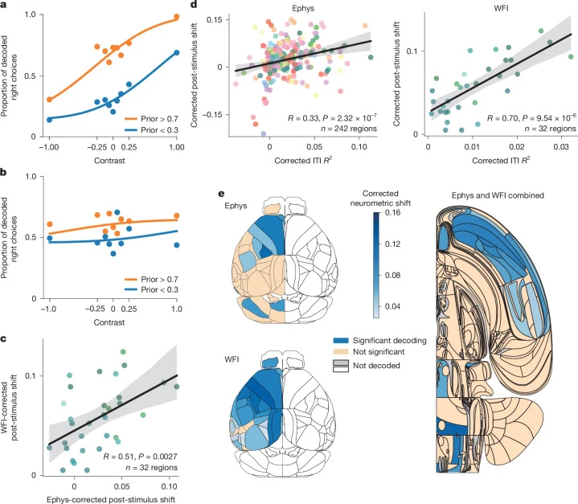

See paper · *Nature* · 2025  
[Brain-wide representations of prior information in mouse decision-making](https://pmc.ncbi.nlm.nih.gov/articles/PMC12408363/#Fig3) · [原始图片](https://cdn.ncbi.nlm.nih.gov/pmc/blobs/7180/12408363/f54e69326e82/41586_2025_9226_Fig3_HTML.jpg) · [CC BY 4.0](https://creativecommons.org/licenses/by/4.0/)

## Fig. 3 · Illustration of neural analyses.

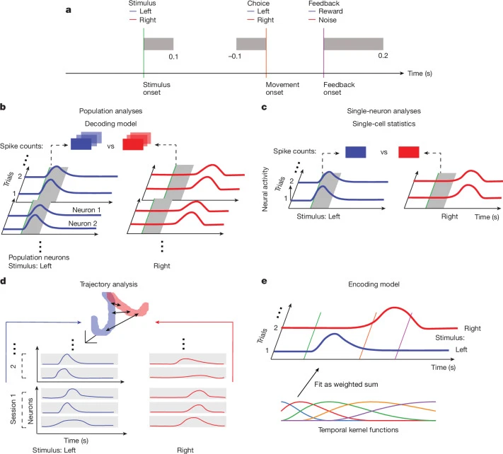

See paper · *Nature* · 2025  
[A brain-wide map of neural activity during complex behaviour](https://pmc.ncbi.nlm.nih.gov/articles/PMC12408349/#Fig3) · [原始图片](https://cdn.ncbi.nlm.nih.gov/pmc/blobs/eb24/12408349/a81cb51f34c2/41586_2025_9235_Fig3_HTML.jpg) · [CC BY 4.0](https://creativecommons.org/licenses/by/4.0/)

## Fig. 3 · Forelimb movement behaviour in a primate.

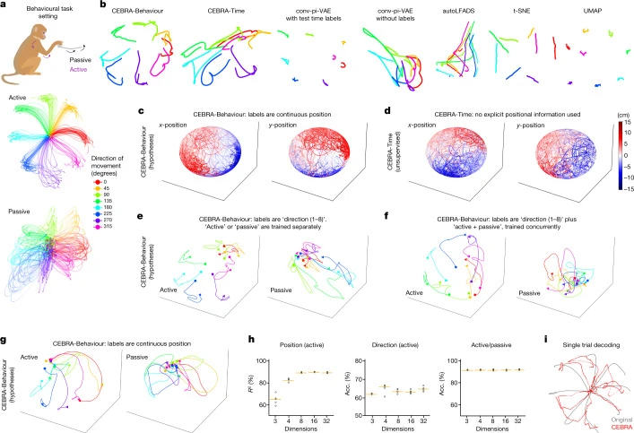

Schneider et al. · *Nature* · 2023  
[Learnable latent embeddings for joint behavioural and neural analysis](https://pmc.ncbi.nlm.nih.gov/articles/PMC10172131/#Fig3) · [原始图片](https://cdn.ncbi.nlm.nih.gov/pmc/blobs/b640/10172131/b46bef99ae21/41586_2023_6031_Fig3_HTML.jpg) · [CC BY 4.0](https://creativecommons.org/licenses/by/4.0/)

## Fig. 3 · Preserved latent dynamics in a sequential reaching task with higher behavioural complexity.

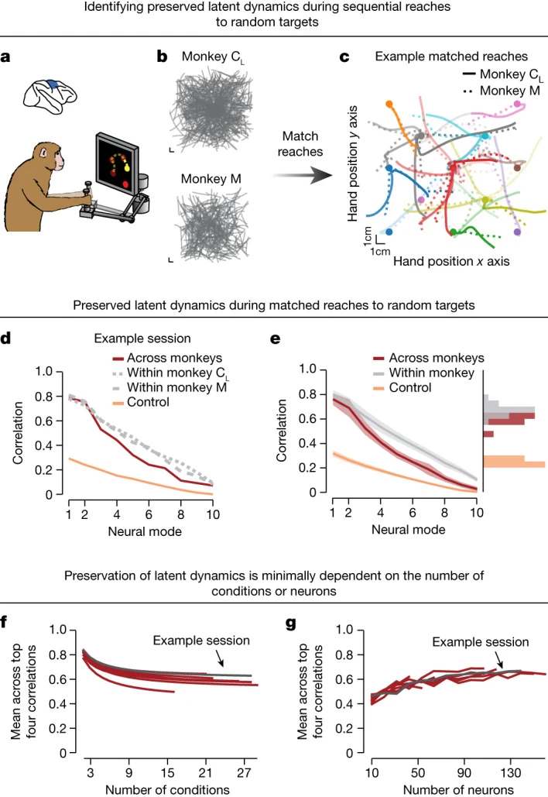

See paper · *Nature* · 2023  
[Preserved neural dynamics across animals performing similar behaviour](https://pmc.ncbi.nlm.nih.gov/articles/PMC10665198/#Fig3) · [原始图片](https://cdn.ncbi.nlm.nih.gov/pmc/blobs/60c6/10665198/7d295dd2f394/41586_2023_6714_Fig3_HTML.jpg) · [CC BY 4.0](https://creativecommons.org/licenses/by/4.0/)

## Fig. 3 · Optogenetically evoked dopamine release in DLS reinforces syllable use and increases sequence variability.

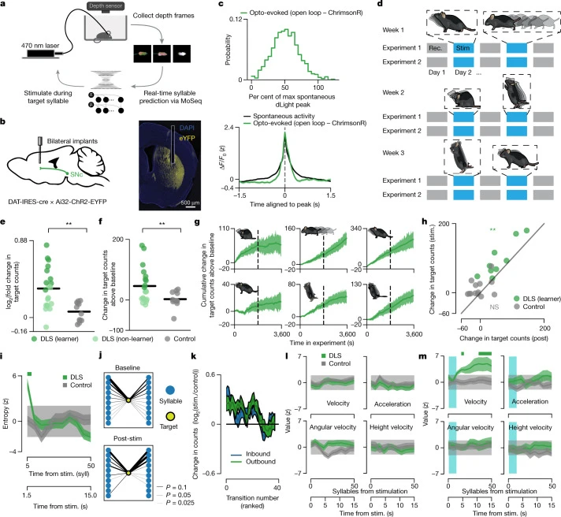

See paper · *Nature* · 2023  
[Spontaneous behaviour is structured by reinforcement without explicit reward](https://pmc.ncbi.nlm.nih.gov/articles/PMC9892006/#Fig3) · [原始图片](https://cdn.ncbi.nlm.nih.gov/pmc/blobs/9efd/9892006/f393fe6a3dc3/41586_2022_5611_Fig3_HTML.jpg) · [CC BY 4.0](https://creativecommons.org/licenses/by/4.0/)

## Fig. 3 · A set of FB tangential inputs promote wind navigation behavior.

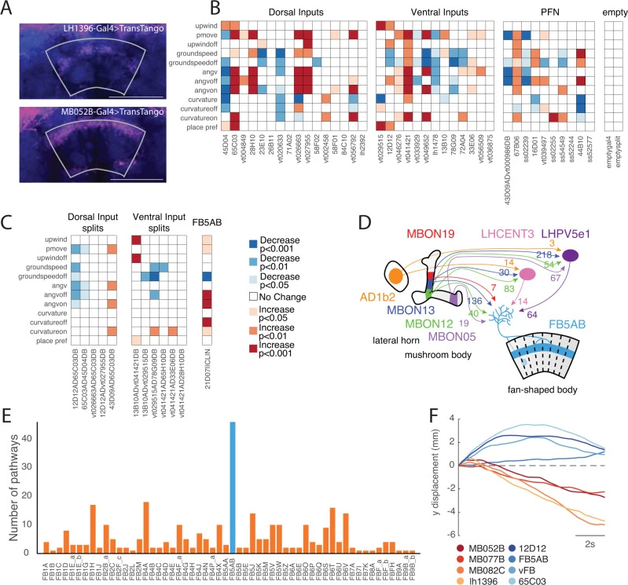

Matheson et al. · *Nature Communications* · 2022  
[A neural circuit for wind-guided olfactory navigation](https://pmc.ncbi.nlm.nih.gov/articles/PMC9360402/#Fig3) · [原始图片](https://cdn.ncbi.nlm.nih.gov/pmc/blobs/5975/9360402/3d664b3fdc29/41467_2022_32247_Fig3_HTML.jpg) · [CC BY 4.0](https://creativecommons.org/licenses/by/4.0/)

## Fig. 3 · Modularity differences between resting and dual n-back task conditions in “Naive” session.

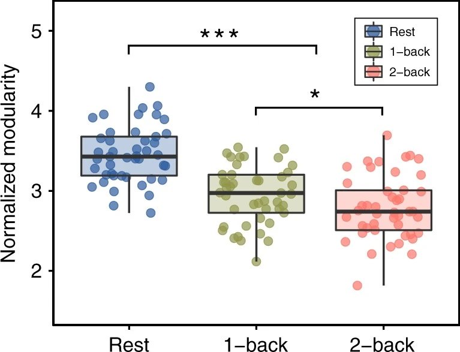

See paper · *Nature Communications* · 2020  
[Dynamic reconfiguration of functional brain networks during working memory training](https://pmc.ncbi.nlm.nih.gov/articles/PMC7229188/#Fig3) · [原始图片](https://cdn.ncbi.nlm.nih.gov/pmc/blobs/3ba0/7229188/4993482b9526/41467_2020_15631_Fig3_HTML.jpg) · [CC BY 4.0](https://creativecommons.org/licenses/by/4.0/)

## Fig. 3 · Behavior is best explained by attractor dynamics during encoding and memory. a Simulated memory trajectories from the best-fitting model for one subject. Left: The full dynamical m

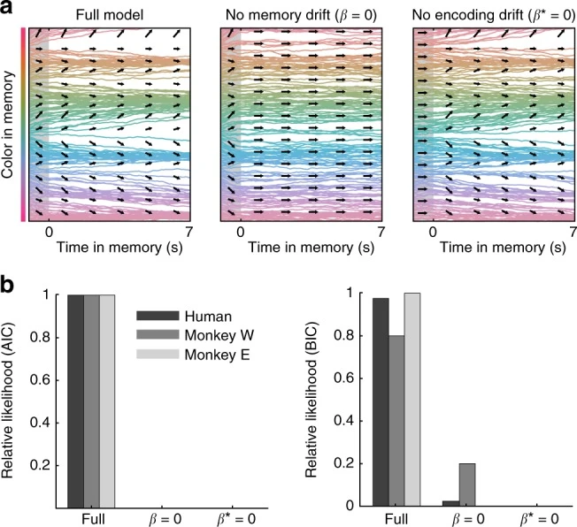

See paper · *Nature Communications* · 2019  
[Error-correcting dynamics in visual working memory](https://pmc.ncbi.nlm.nih.gov/articles/PMC6662698/#Fig3) · [原始图片](https://cdn.ncbi.nlm.nih.gov/pmc/blobs/9581/6662698/f4998b022ee2/41467_2019_11298_Fig3_HTML.jpg) · [CC BY 4.0](https://creativecommons.org/licenses/by/4.0/)

## Fig. 3 · Task 3.

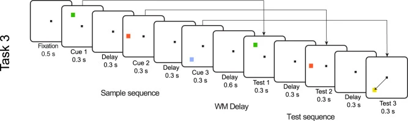

See paper · *Nature Communications* · 2023  
[Working memory control dynamics follow principles of spatial computing](https://pmc.ncbi.nlm.nih.gov/articles/PMC10015009/#Fig3) · [原始图片](https://cdn.ncbi.nlm.nih.gov/pmc/blobs/33c9/10015009/8c701c4fb858/41467_2023_36555_Fig3_HTML.jpg) · [CC BY 4.0](https://creativecommons.org/licenses/by/4.0/)

## Fig. 3 · Frameshifted high-temporal resolution improves identification of neural signatures at behavioral initiation.

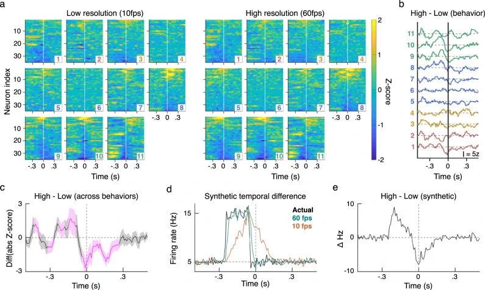

Hsu et al. · *Nature Communications* · 2021  
[B-SOiD, an open-source unsupervised algorithm for identification and fast prediction of behaviors](https://pmc.ncbi.nlm.nih.gov/articles/PMC8408193/#Fig3) · [原始图片](https://cdn.ncbi.nlm.nih.gov/pmc/blobs/2cd9/8408193/23b805e77766/41467_2021_25420_Fig3_HTML.jpg) · [CC BY 4.0](https://creativecommons.org/licenses/by/4.0/)

## Fig. 4 · Representation and integration of visual evidence in association and premotor areas emerges with learning.

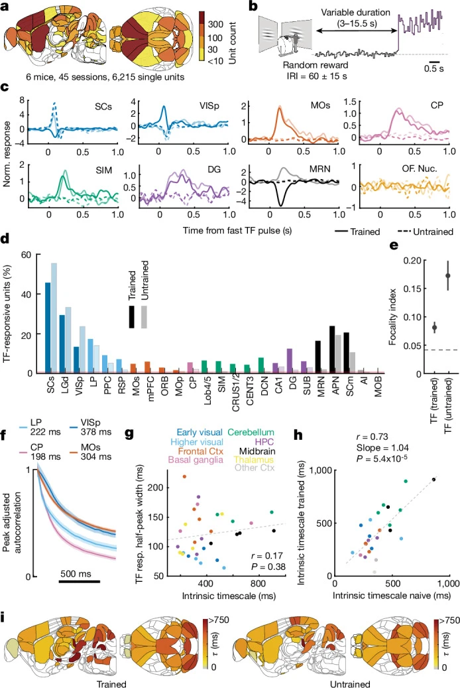

See paper · *Nature* · 2024  
[Brain-wide dynamics linking sensation to action during decision-making](https://pmc.ncbi.nlm.nih.gov/articles/PMC11499283/#Fig4) · [原始图片](https://cdn.ncbi.nlm.nih.gov/pmc/blobs/87a4/11499283/a26bfb23700f/41586_2024_7908_Fig4_HTML.jpg) · [CC BY 4.0](https://creativecommons.org/licenses/by/4.0/)

## Fig. 4 · Differential behavioural kernels show substantial heterogeneity across and within subjects, even when all subjects perform the task well.

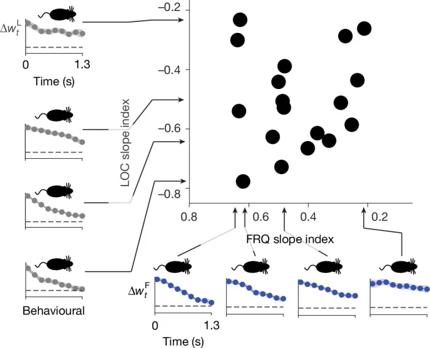

Pagan et al. · *Nature* · 2024  
[Individual variability of neural computations underlying flexible decisions](https://pmc.ncbi.nlm.nih.gov/articles/PMC11903320/#Fig4) · [原始图片](https://cdn.ncbi.nlm.nih.gov/pmc/blobs/6c42/11903320/49799b046f83/41586_2024_8433_Fig4_HTML.jpg) · [CC BY 4.0](https://creativecommons.org/licenses/by/4.0/)

## Fig. 4 · Action kernel prior.

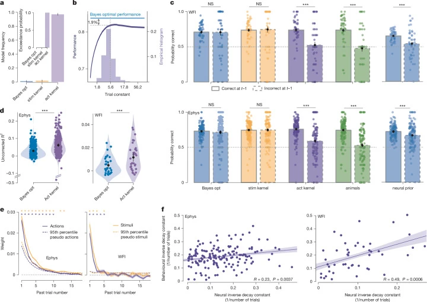

See paper · *Nature* · 2025  
[Brain-wide representations of prior information in mouse decision-making](https://pmc.ncbi.nlm.nih.gov/articles/PMC12408363/#Fig4) · [原始图片](https://cdn.ncbi.nlm.nih.gov/pmc/blobs/7180/12408363/22293fda2078/41586_2025_9226_Fig4_HTML.jpg) · [CC BY 4.0](https://creativecommons.org/licenses/by/4.0/)

## Fig. 4 · Representation of the visual stimulus.

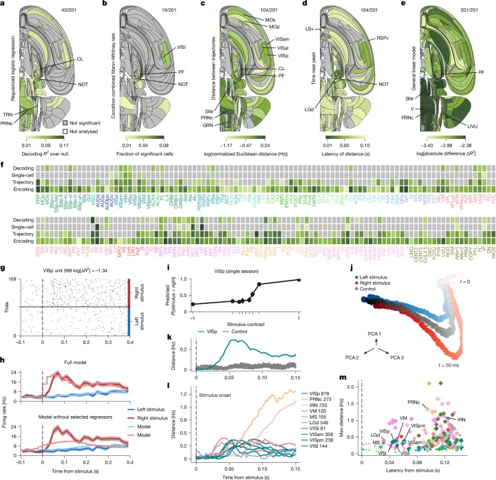

See paper · *Nature* · 2025  
[A brain-wide map of neural activity during complex behaviour](https://pmc.ncbi.nlm.nih.gov/articles/PMC12408349/#Fig4) · [原始图片](https://cdn.ncbi.nlm.nih.gov/pmc/blobs/eb24/12408349/882097bf2c9e/41586_2025_9235_Fig4_HTML.jpg) · [CC BY 4.0](https://creativecommons.org/licenses/by/4.0/)

## Fig. 4 · Spikes and calcium signalling show similar CEBRA embeddings.

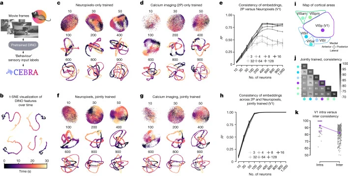

Schneider et al. · *Nature* · 2023  
[Learnable latent embeddings for joint behavioural and neural analysis](https://pmc.ncbi.nlm.nih.gov/articles/PMC10172131/#Fig4) · [原始图片](https://cdn.ncbi.nlm.nih.gov/pmc/blobs/b640/10172131/378862e28cad/41586_2023_6031_Fig4_HTML.jpg) · [CC BY 4.0](https://creativecommons.org/licenses/by/4.0/)

## Fig. 4 · Preserved latent dynamics in the basal ganglia and during covert behaviour.

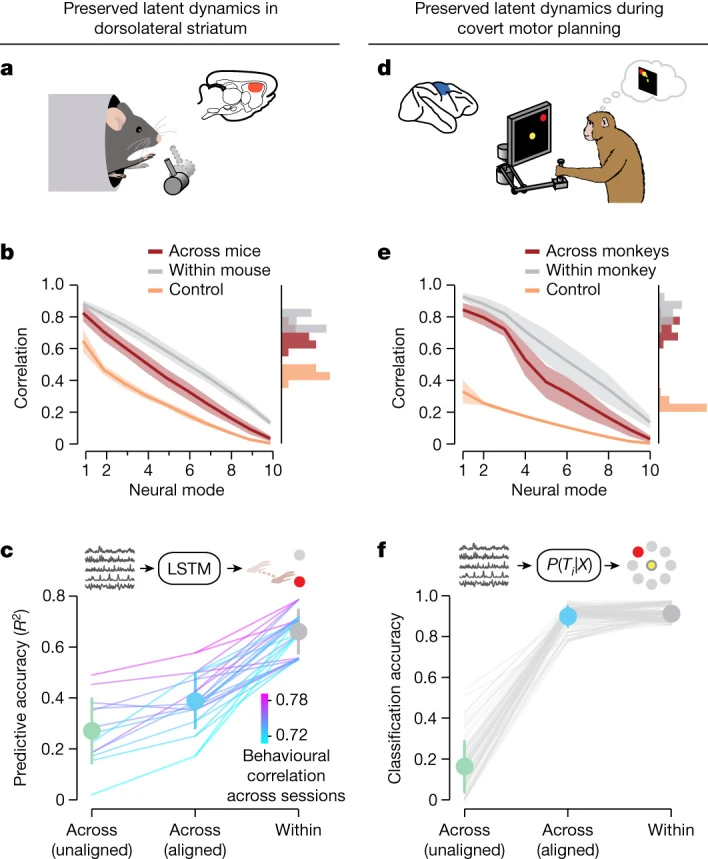

See paper · *Nature* · 2023  
[Preserved neural dynamics across animals performing similar behaviour](https://pmc.ncbi.nlm.nih.gov/articles/PMC10665198/#Fig4) · [原始图片](https://cdn.ncbi.nlm.nih.gov/pmc/blobs/60c6/10665198/def5863f7629/41586_2023_6714_Fig4_HTML.jpg) · [CC BY 4.0](https://creativecommons.org/licenses/by/4.0/)

## Fig. 4 · Optogenetic syllable reinforcement varies predictably across mice and syllables.

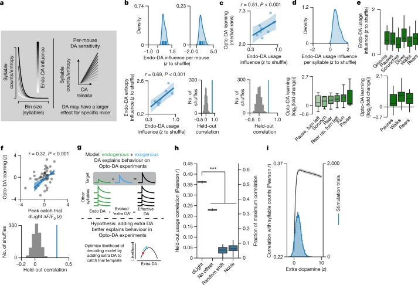

See paper · *Nature* · 2023  
[Spontaneous behaviour is structured by reinforcement without explicit reward](https://pmc.ncbi.nlm.nih.gov/articles/PMC9892006/#Fig4) · [原始图片](https://cdn.ncbi.nlm.nih.gov/pmc/blobs/9efd/9892006/954d1cc3c767/41586_2022_5611_Fig4_HTML.jpg) · [CC BY 4.0](https://creativecommons.org/licenses/by/4.0/)

## Fig. 4 · Multiple FB tangential inputs respond to attractive odor and drive upwind movement.

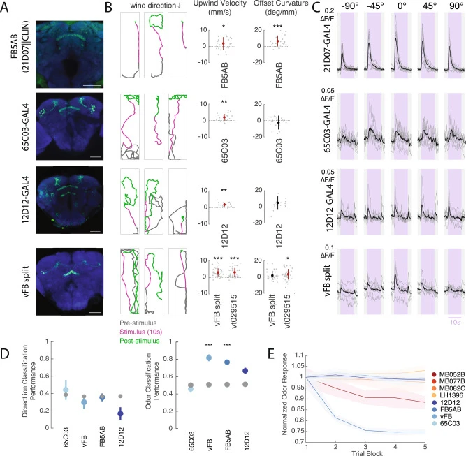

Matheson et al. · *Nature Communications* · 2022  
[A neural circuit for wind-guided olfactory navigation](https://pmc.ncbi.nlm.nih.gov/articles/PMC9360402/#Fig4) · [原始图片](https://cdn.ncbi.nlm.nih.gov/pmc/blobs/5975/9360402/64f12c2b434d/41467_2022_32247_Fig4_HTML.jpg) · [CC BY 4.0](https://creativecommons.org/licenses/by/4.0/)

## Fig. 4 · Modularity differences across the task, sessions, and groups.

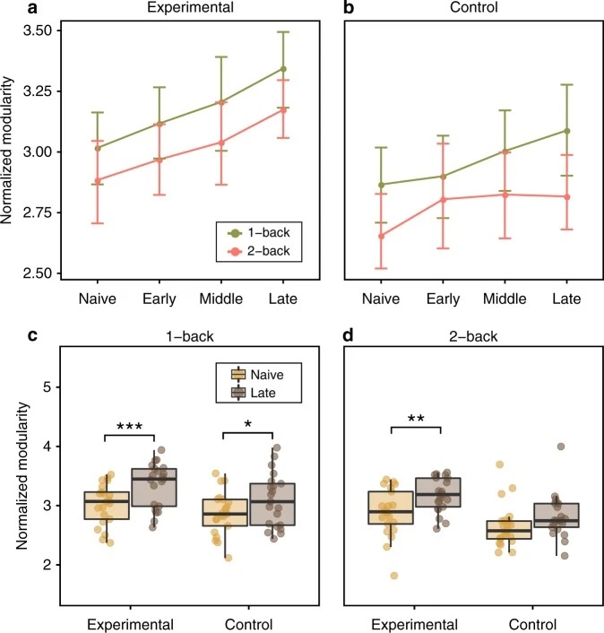

See paper · *Nature Communications* · 2020  
[Dynamic reconfiguration of functional brain networks during working memory training](https://pmc.ncbi.nlm.nih.gov/articles/PMC7229188/#Fig4) · [原始图片](https://cdn.ncbi.nlm.nih.gov/pmc/blobs/3ba0/7229188/b8818dc7e1ea/41467_2020_15631_Fig4_HTML.jpg) · [CC BY 4.0](https://creativecommons.org/licenses/by/4.0/)

## Fig. 4 · Attractors explain the distribution, bias, and precision of working memory reports. a Observed distribution of memory reports around fit attractors (red dashed line). X-axis: degre

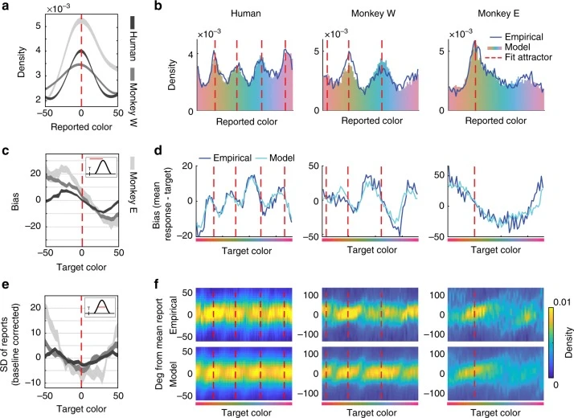

See paper · *Nature Communications* · 2019  
[Error-correcting dynamics in visual working memory](https://pmc.ncbi.nlm.nih.gov/articles/PMC6662698/#Fig4) · [原始图片](https://cdn.ncbi.nlm.nih.gov/pmc/blobs/9581/6662698/726b888dc8cc/41467_2019_11298_Fig4_HTML.jpg) · [CC BY 4.0](https://creativecommons.org/licenses/by/4.0/)

## Fig. 4 · Comparison of top-down to bottom-up camera angles.

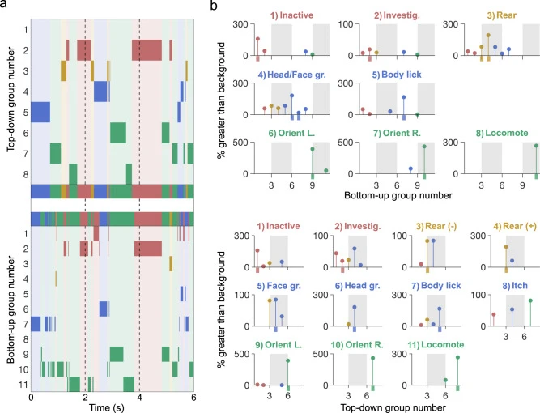

Hsu et al. · *Nature Communications* · 2021  
[B-SOiD, an open-source unsupervised algorithm for identification and fast prediction of behaviors](https://pmc.ncbi.nlm.nih.gov/articles/PMC8408193/#Fig4) · [原始图片](https://cdn.ncbi.nlm.nih.gov/pmc/blobs/2cd9/8408193/dd01faeded1e/41467_2021_25420_Fig4_HTML.jpg) · [CC BY 4.0](https://creativecommons.org/licenses/by/4.0/)

## Fig. 5 · Preparatory activity is led by TF-responsive subpopulations.

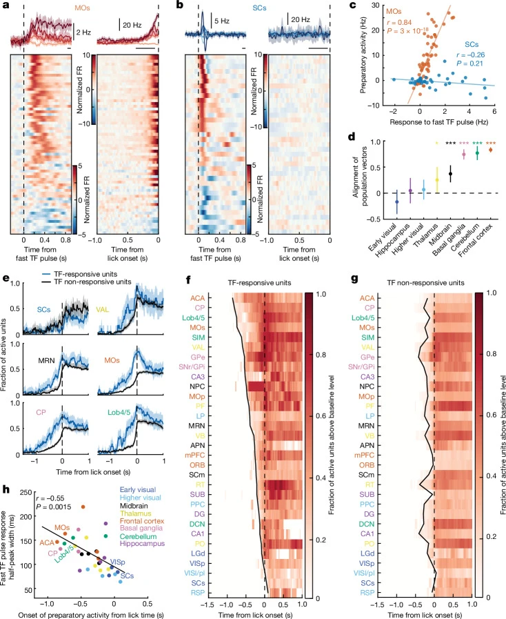

See paper · *Nature* · 2024  
[Brain-wide dynamics linking sensation to action during decision-making](https://pmc.ncbi.nlm.nih.gov/articles/PMC11499283/#Fig5) · [原始图片](https://cdn.ncbi.nlm.nih.gov/pmc/blobs/87a4/11499283/500195fc9f0c/41586_2024_7908_Fig5_HTML.jpg) · [CC BY 4.0](https://creativecommons.org/licenses/by/4.0/)

## Fig. 5 · Theory predicts and experimental data confirm that variability in the neural slope index should explain variability in the behavioural slope index.

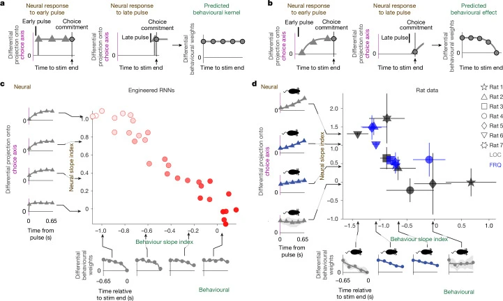

Pagan et al. · *Nature* · 2024  
[Individual variability of neural computations underlying flexible decisions](https://pmc.ncbi.nlm.nih.gov/articles/PMC11903320/#Fig5) · [原始图片](https://cdn.ncbi.nlm.nih.gov/pmc/blobs/6c42/11903320/57f0376363b7/41586_2024_8433_Fig5_HTML.jpg) · [CC BY 4.0](https://creativecommons.org/licenses/by/4.0/)

## Fig. 5 · Representation of choice.

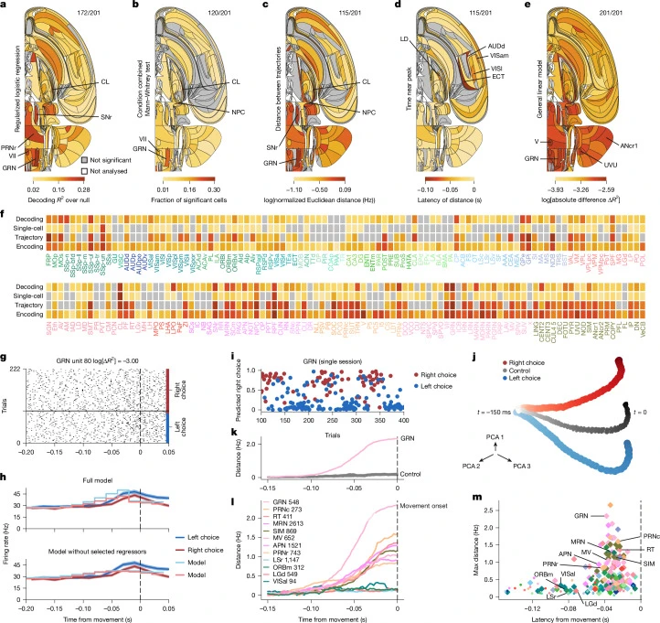

See paper · *Nature* · 2025  
[A brain-wide map of neural activity during complex behaviour](https://pmc.ncbi.nlm.nih.gov/articles/PMC12408349/#Fig5) · [原始图片](https://cdn.ncbi.nlm.nih.gov/pmc/blobs/eb24/12408349/3e5bffde104d/41586_2025_9235_Fig5_HTML.jpg) · [CC BY 4.0](https://creativecommons.org/licenses/by/4.0/)

## Fig. 5 · Decoding of natural video features from mouse visual cortical areas.

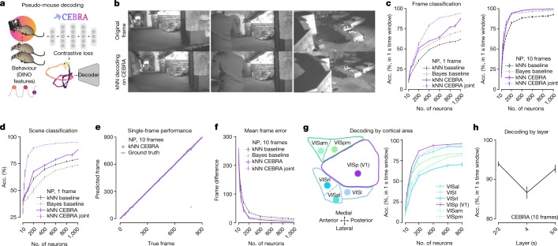

Schneider et al. · *Nature* · 2023  
[Learnable latent embeddings for joint behavioural and neural analysis](https://pmc.ncbi.nlm.nih.gov/articles/PMC10172131/#Fig5) · [原始图片](https://cdn.ncbi.nlm.nih.gov/pmc/blobs/b640/10172131/d80e14f24ca7/41586_2023_6031_Fig5_HTML.jpg) · [CC BY 4.0](https://creativecommons.org/licenses/by/4.0/)

## Fig. 5 · Similar behavioural output is necessary but not sufficient for the preservation of latent dynamics.

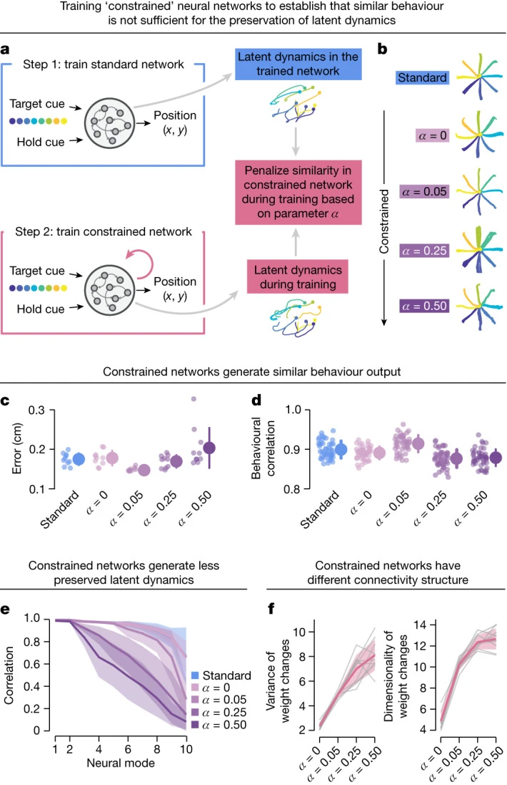

See paper · *Nature* · 2023  
[Preserved neural dynamics across animals performing similar behaviour](https://pmc.ncbi.nlm.nih.gov/articles/PMC10665198/#Fig5) · [原始图片](https://cdn.ncbi.nlm.nih.gov/pmc/blobs/60c6/10665198/c03124eac779/41586_2023_6714_Fig5_HTML.jpg) · [CC BY 4.0](https://creativecommons.org/licenses/by/4.0/)

## Fig. 5 · RL models suggest that mice attempt to maximize dopamine during spontaneous behaviour.

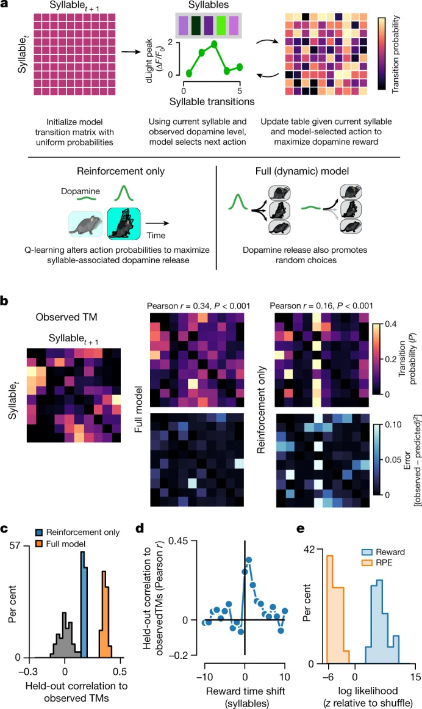

See paper · *Nature* · 2023  
[Spontaneous behaviour is structured by reinforcement without explicit reward](https://pmc.ncbi.nlm.nih.gov/articles/PMC9892006/#Fig5) · [原始图片](https://cdn.ncbi.nlm.nih.gov/pmc/blobs/9efd/9892006/5b2800753823/41586_2022_5611_Fig5_HTML.jpg) · [CC BY 4.0](https://creativecommons.org/licenses/by/4.0/)

## Fig. 5 · h∆C neurons exhibit odor-modulated wind direction tuning.

Matheson et al. · *Nature Communications* · 2022  
[A neural circuit for wind-guided olfactory navigation](https://pmc.ncbi.nlm.nih.gov/articles/PMC9360402/#Fig5) · [原始图片](https://cdn.ncbi.nlm.nih.gov/pmc/blobs/5975/9360402/5826ab3f021e/41467_2022_32247_Fig5_HTML.jpg) · [CC BY 4.0](https://creativecommons.org/licenses/by/4.0/)

## Fig. 5 · Changes in module allegiance of the frontoparietal (FP) and default-mode (DM) systems.

See paper · *Nature Communications* · 2020  
[Dynamic reconfiguration of functional brain networks during working memory training](https://pmc.ncbi.nlm.nih.gov/articles/PMC7229188/#Fig5) · [原始图片](https://cdn.ncbi.nlm.nih.gov/pmc/blobs/3ba0/7229188/2cac65176c29/41467_2020_15631_Fig5_HTML.jpg) · [CC BY 4.0](https://creativecommons.org/licenses/by/4.0/)

## Fig. 5 · Memories near attractors are more stable. a If discrete attractors underlie working memory, then memories of different target colors will accumulate error at different rates over t

See paper · *Nature Communications* · 2019  
[Error-correcting dynamics in visual working memory](https://pmc.ncbi.nlm.nih.gov/articles/PMC6662698/#Fig5) · [原始图片](https://cdn.ncbi.nlm.nih.gov/pmc/blobs/9581/6662698/3ae2f878de8d/41467_2019_11298_Fig5_HTML.jpg) · [CC BY 4.0](https://creativecommons.org/licenses/by/4.0/)

## Fig. 5 · Quantification of unsupervised segmentation algorithms.

Hsu et al. · *Nature Communications* · 2021  
[B-SOiD, an open-source unsupervised algorithm for identification and fast prediction of behaviors](https://pmc.ncbi.nlm.nih.gov/articles/PMC8408193/#Fig5) · [原始图片](https://cdn.ncbi.nlm.nih.gov/pmc/blobs/2cd9/8408193/d5373efae23b/41467_2021_25420_Fig5_HTML.jpg) · [CC BY 4.0](https://creativecommons.org/licenses/by/4.0/)

## Fig. 6 · Preparatory activity occupies movement-null subspace, is dominated by TF-responsive subpopulation and is aligned with responses to pulses of sensory evidence.

See paper · *Nature* · 2024  
[Brain-wide dynamics linking sensation to action during decision-making](https://pmc.ncbi.nlm.nih.gov/articles/PMC11499283/#Fig6) · [原始图片](https://cdn.ncbi.nlm.nih.gov/pmc/blobs/87a4/11499283/15a6693987f1/41586_2024_7908_Fig6_HTML.jpg) · [CC BY 4.0](https://creativecommons.org/licenses/by/4.0/)

## Fig. 6 · Representation of feedback.

See paper · *Nature* · 2025  
[A brain-wide map of neural activity during complex behaviour](https://pmc.ncbi.nlm.nih.gov/articles/PMC12408349/#Fig6) · [原始图片](https://cdn.ncbi.nlm.nih.gov/pmc/blobs/eb24/12408349/dc5fac04ac23/41586_2025_9235_Fig6_HTML.jpg) · [CC BY 4.0](https://creativecommons.org/licenses/by/4.0/)

## Fig. 6 · Role of h∆C neurons in navigation behavior.

Matheson et al. · *Nature Communications* · 2022  
[A neural circuit for wind-guided olfactory navigation](https://pmc.ncbi.nlm.nih.gov/articles/PMC9360402/#Fig6) · [原始图片](https://cdn.ncbi.nlm.nih.gov/pmc/blobs/5975/9360402/8b6681e2349e/41467_2022_32247_Fig6_HTML.jpg) · [CC BY 4.0](https://creativecommons.org/licenses/by/4.0/)

## Fig. 6 · Changes of the recruitment and integration of large-scale systems.

See paper · *Nature Communications* · 2020  
[Dynamic reconfiguration of functional brain networks during working memory training](https://pmc.ncbi.nlm.nih.gov/articles/PMC7229188/#Fig6) · [原始图片](https://cdn.ncbi.nlm.nih.gov/pmc/blobs/3ba0/7229188/6e615a3758ca/41467_2020_15631_Fig6_HTML.jpg) · [CC BY 4.0](https://creativecommons.org/licenses/by/4.0/)

## Fig. 6 · Drift and diffusion increase with memory load. Experiment 1a maximum likelihood parameter fits for the diffusion (a, b) and drift (c, d) scaling parameters during memory and encodi

See paper · *Nature Communications* · 2019  
[Error-correcting dynamics in visual working memory](https://pmc.ncbi.nlm.nih.gov/articles/PMC6662698/#Fig6) · [原始图片](https://cdn.ncbi.nlm.nih.gov/pmc/blobs/9581/6662698/c347191250c3/41467_2019_11298_Fig6_HTML.jpg) · [CC BY 4.0](https://creativecommons.org/licenses/by/4.0/)

## Fig. 6 · Control-related (task demand dependent) selectivity arising from time-varying excitation.

See paper · *Nature Communications* · 2023  
[Working memory control dynamics follow principles of spatial computing](https://pmc.ncbi.nlm.nih.gov/articles/PMC10015009/#Fig6) · [原始图片](https://cdn.ncbi.nlm.nih.gov/pmc/blobs/33c9/10015009/1ba69e85f92f/41467_2023_36555_Fig6_HTML.jpg) · [CC BY 4.0](https://creativecommons.org/licenses/by/4.0/)

## Fig. 6 · Detection of robust, hard to detect kinematic changes in grooming behavior following cell-type specific lesion.

Hsu et al. · *Nature Communications* · 2021  
[B-SOiD, an open-source unsupervised algorithm for identification and fast prediction of behaviors](https://pmc.ncbi.nlm.nih.gov/articles/PMC8408193/#Fig6) · [原始图片](https://cdn.ncbi.nlm.nih.gov/pmc/blobs/2cd9/8408193/94b8f8c600aa/41467_2021_25420_Fig6_HTML.jpg) · [CC BY 4.0](https://creativecommons.org/licenses/by/4.0/)

## Fig. 7 · Representation of wheel movement.

See paper · *Nature* · 2025  
[A brain-wide map of neural activity during complex behaviour](https://pmc.ncbi.nlm.nih.gov/articles/PMC12408349/#Fig7) · [原始图片](https://cdn.ncbi.nlm.nih.gov/pmc/blobs/eb24/12408349/40420de5f850/41586_2025_9235_Fig7_HTML.jpg) · [CC BY 4.0](https://creativecommons.org/licenses/by/4.0/)

## Fig. 7 · A model of FB circuitry that translates h∆C activity into goal-directed walking.

Matheson et al. · *Nature Communications* · 2022  
[A neural circuit for wind-guided olfactory navigation](https://pmc.ncbi.nlm.nih.gov/articles/PMC9360402/#Fig7) · [原始图片](https://cdn.ncbi.nlm.nih.gov/pmc/blobs/5975/9360402/0dabd4d504a6/41467_2022_32247_Fig7_HTML.jpg) · [CC BY 4.0](https://creativecommons.org/licenses/by/4.0/)

## Fig. 7 · Relationship between the change in network dynamics and the change in behavior.

See paper · *Nature Communications* · 2020  
[Dynamic reconfiguration of functional brain networks during working memory training](https://pmc.ncbi.nlm.nih.gov/articles/PMC7229188/#Fig7) · [原始图片](https://cdn.ncbi.nlm.nih.gov/pmc/blobs/3ba0/7229188/d512a98ba953/41467_2020_15631_Fig7_HTML.jpg) · [CC BY 4.0](https://creativecommons.org/licenses/by/4.0/)

## Fig. 7 · Attractor dynamics adapt to the context. a Simulated mean absolute error in the representation of the target color over time. The best-fitting discrete attractor model in Experimen

See paper · *Nature Communications* · 2019  
[Error-correcting dynamics in visual working memory](https://pmc.ncbi.nlm.nih.gov/articles/PMC6662698/#Fig7) · [原始图片](https://cdn.ncbi.nlm.nih.gov/pmc/blobs/9581/6662698/da5a349fac04/41467_2019_11298_Fig7_HTML.jpg) · [CC BY 4.0](https://creativecommons.org/licenses/by/4.0/)

## Fig. 8 · Conceptual model of sensory integration for olfactory navigation in the Drosophila central brain.

Matheson et al. · *Nature Communications* · 2022  
[A neural circuit for wind-guided olfactory navigation](https://pmc.ncbi.nlm.nih.gov/articles/PMC9360402/#Fig8) · [原始图片](https://cdn.ncbi.nlm.nih.gov/pmc/blobs/5975/9360402/1b1d654c1ff5/41467_2022_32247_Fig8_HTML.jpg) · [CC BY 4.0](https://creativecommons.org/licenses/by/4.0/)

## Fig. 8 · Schematic summarizing the main changes in recruitment and integration of large-scale systems observed over the course of working memory training.

See paper · *Nature Communications* · 2020  
[Dynamic reconfiguration of functional brain networks during working memory training](https://pmc.ncbi.nlm.nih.gov/articles/PMC7229188/#Fig8) · [原始图片](https://cdn.ncbi.nlm.nih.gov/pmc/blobs/3ba0/7229188/40b383f4094e/41467_2020_15631_Fig8_HTML.jpg) · [CC BY 4.0](https://creativecommons.org/licenses/by/4.0/)

## Extended Data Fig. 1 · Summary of recordings in trained mice.

See paper · *Nature* · 2024  
[Brain-wide dynamics linking sensation to action during decision-making](https://pmc.ncbi.nlm.nih.gov/articles/PMC11499283/#Fig7) · [原始图片](https://cdn.ncbi.nlm.nih.gov/pmc/blobs/87a4/11499283/1fee11b139b3/41586_2024_7908_Fig7_ESM.jpg) · [CC BY 4.0](https://creativecommons.org/licenses/by/4.0/)

## Extended Data Fig. 1 · Bar plots of the decay constant (τ), amplitude (A) and asymptote (B) of the zero contrast reversal curves across all mice.

See paper · *Nature* · 2025  
[Brain-wide representations of prior information in mouse decision-making](https://pmc.ncbi.nlm.nih.gov/articles/PMC12408363/#Fig5) · [原始图片](https://cdn.ncbi.nlm.nih.gov/pmc/blobs/7180/12408363/e7ec26f642a7/41586_2025_9226_Fig5_ESM.jpg) · [CC BY 4.0](https://creativecommons.org/licenses/by/4.0/)

## Extended Data Fig. 1 · 2d-brain slices maps annotated with region acronyms.

See paper · *Nature* · 2025  
[A brain-wide map of neural activity during complex behaviour](https://pmc.ncbi.nlm.nih.gov/articles/PMC12408349/#Fig8) · [原始图片](https://cdn.ncbi.nlm.nih.gov/pmc/blobs/eb24/12408349/ae6c50c70311/41586_2025_9235_Fig8_ESM.jpg) · [CC BY 4.0](https://creativecommons.org/licenses/by/4.0/)

## Extended Data Fig. 1 · Behavioural and neural data from monkeys performing a centre-out reaching task.

See paper · *Nature* · 2023  
[Preserved neural dynamics across animals performing similar behaviour](https://pmc.ncbi.nlm.nih.gov/articles/PMC10665198/#Fig6) · [原始图片](https://cdn.ncbi.nlm.nih.gov/pmc/blobs/60c6/10665198/da8f1f69080c/41586_2023_6714_Fig6_ESM.jpg) · [CC BY 4.0](https://creativecommons.org/licenses/by/4.0/)

## Extended Data Fig. 1 · dLight validation, photometry setup and motion artifact removal.

See paper · *Nature* · 2023  
[Spontaneous behaviour is structured by reinforcement without explicit reward](https://pmc.ncbi.nlm.nih.gov/articles/PMC9892006/#Fig6) · [原始图片](https://cdn.ncbi.nlm.nih.gov/pmc/blobs/9efd/9892006/93fc5035dd0d/41586_2022_5611_Fig6_ESM.jpg) · [CC BY 4.0](https://creativecommons.org/licenses/by/4.0/)

## Extended Data Fig. 2 · GLM Performance.

See paper · *Nature* · 2024  
[Brain-wide dynamics linking sensation to action during decision-making](https://pmc.ncbi.nlm.nih.gov/articles/PMC11499283/#Fig8) · [原始图片](https://cdn.ncbi.nlm.nih.gov/pmc/blobs/87a4/11499283/94eac2293d05/41586_2024_7908_Fig8_ESM.jpg) · [CC BY 4.0](https://creativecommons.org/licenses/by/4.0/)

## Extended Data Fig. 2 · Average wheel speed averaged across sessions before and after stimulus onset.

See paper · *Nature* · 2025  
[Brain-wide representations of prior information in mouse decision-making](https://pmc.ncbi.nlm.nih.gov/articles/PMC12408363/#Fig6) · [原始图片](https://cdn.ncbi.nlm.nih.gov/pmc/blobs/7180/12408363/5e16492fa1ff/41586_2025_9226_Fig6_ESM.jpg) · [CC BY 4.0](https://creativecommons.org/licenses/by/4.0/)

## Extended Data Fig. 2 · Comparison of effect sizes across task variables.

See paper · *Nature* · 2025  
[A brain-wide map of neural activity during complex behaviour](https://pmc.ncbi.nlm.nih.gov/articles/PMC12408349/#Fig9) · [原始图片](https://cdn.ncbi.nlm.nih.gov/pmc/blobs/eb24/12408349/216399e2bf37/41586_2025_9235_Fig9_ESM.jpg) · [CC BY 4.0](https://creativecommons.org/licenses/by/4.0/)

## Extended Data Fig. 2 · Additional verification of preserved latent dynamics.

See paper · *Nature* · 2023  
[Preserved neural dynamics across animals performing similar behaviour](https://pmc.ncbi.nlm.nih.gov/articles/PMC10665198/#Fig7) · [原始图片](https://cdn.ncbi.nlm.nih.gov/pmc/blobs/60c6/10665198/14565b3f2a00/41586_2023_6714_Fig7_ESM.jpg) · [CC BY 4.0](https://creativecommons.org/licenses/by/4.0/)

## Extended Data Fig. 2 · MoSeq captures subsecond structure in spontaneous mouse behaviour.

See paper · *Nature* · 2023  
[Spontaneous behaviour is structured by reinforcement without explicit reward](https://pmc.ncbi.nlm.nih.gov/articles/PMC9892006/#Fig7) · [原始图片](https://cdn.ncbi.nlm.nih.gov/pmc/blobs/9efd/9892006/aa5c77d55100/41586_2022_5611_Fig7_ESM.jpg) · [CC BY 4.0](https://creativecommons.org/licenses/by/4.0/)

## Extended Data Fig. 3 · Encoding of temporal frequency fluctuations, lick preparation and lick execution across brain areas.

See paper · *Nature* · 2024  
[Brain-wide dynamics linking sensation to action during decision-making](https://pmc.ncbi.nlm.nih.gov/articles/PMC11499283/#Fig9) · [原始图片](https://cdn.ncbi.nlm.nih.gov/pmc/blobs/87a4/11499283/e85d8c63c817/41586_2024_7908_Fig9_ESM.jpg) · [CC BY 4.0](https://creativecommons.org/licenses/by/4.0/)

## Extended Data Fig. 3 · Encoding of the prior across the brain during the inter-trial interval.

See paper · *Nature* · 2025  
[Brain-wide representations of prior information in mouse decision-making](https://pmc.ncbi.nlm.nih.gov/articles/PMC12408363/#Fig7) · [原始图片](https://cdn.ncbi.nlm.nih.gov/pmc/blobs/7180/12408363/03c9eafed699/41586_2025_9226_Fig7_ESM.jpg) · [CC BY 4.0](https://creativecommons.org/licenses/by/4.0/)

## Extended Data Fig. 3 · Amplitudes of analysis pairs for the three main variables.

See paper · *Nature* · 2025  
[A brain-wide map of neural activity during complex behaviour](https://pmc.ncbi.nlm.nih.gov/articles/PMC12408349/#Fig10) · [原始图片](https://cdn.ncbi.nlm.nih.gov/pmc/blobs/eb24/12408349/89e5fc252d09/41586_2025_9235_Fig10_ESM.jpg) · [CC BY 4.0](https://creativecommons.org/licenses/by/4.0/)

## Extended Data Fig. 3 · Additional examples of canonical correlations and preserved latent dynamics between pairs of sessions from two different monkeys and mice.

See paper · *Nature* · 2023  
[Preserved neural dynamics across animals performing similar behaviour](https://pmc.ncbi.nlm.nih.gov/articles/PMC10665198/#Fig8) · [原始图片](https://cdn.ncbi.nlm.nih.gov/pmc/blobs/60c6/10665198/005f4474152d/41586_2023_6714_Fig8_ESM.jpg) · [CC BY 4.0](https://creativecommons.org/licenses/by/4.0/)

## Extended Data Fig. 3 · Validating correlations to kinematic variables through multi-camera keypoint tracking.

See paper · *Nature* · 2023  
[Spontaneous behaviour is structured by reinforcement without explicit reward](https://pmc.ncbi.nlm.nih.gov/articles/PMC9892006/#Fig8) · [原始图片](https://cdn.ncbi.nlm.nih.gov/pmc/blobs/9efd/9892006/f6f83786c153/41586_2022_5611_Fig8_ESM.jpg) · [CC BY 4.0](https://creativecommons.org/licenses/by/4.0/)

## Extended Data Fig. 4 · Responses of TF responsive neurons across the brain to fast or slow TF pulses and early licks.

See paper · *Nature* · 2024  
[Brain-wide dynamics linking sensation to action during decision-making](https://pmc.ncbi.nlm.nih.gov/articles/PMC11499283/#Fig10) · [原始图片](https://cdn.ncbi.nlm.nih.gov/pmc/blobs/87a4/11499283/083b9456c1f4/41586_2024_7908_Fig10_ESM.jpg) · [CC BY 4.0](https://creativecommons.org/licenses/by/4.0/)

## Extended Data Fig. 4 · Six examples of neurons significantly encoding the Bayes-optimal prior (***p < 0.001, **p < 0.01, *p < 0.05).

See paper · *Nature* · 2025  
[Brain-wide representations of prior information in mouse decision-making](https://pmc.ncbi.nlm.nih.gov/articles/PMC12408363/#Fig8) · [原始图片](https://cdn.ncbi.nlm.nih.gov/pmc/blobs/7180/12408363/dde4ca034393/41586_2025_9226_Fig8_ESM.jpg) · [CC BY 4.0](https://creativecommons.org/licenses/by/4.0/)

## Extended Data Fig. 4 · Granger scores for simultaneously recorded region pairs.

See paper · *Nature* · 2025  
[A brain-wide map of neural activity during complex behaviour](https://pmc.ncbi.nlm.nih.gov/articles/PMC12408349/#Fig11) · [原始图片](https://cdn.ncbi.nlm.nih.gov/pmc/blobs/eb24/12408349/6bca39b4f36e/41586_2025_9235_Fig11_ESM.jpg) · [CC BY 4.0](https://creativecommons.org/licenses/by/4.0/)

## Extended Data Fig. 4 · Preserved latent dynamics across monkeys are behaviourally relevant.

See paper · *Nature* · 2023  
[Preserved neural dynamics across animals performing similar behaviour](https://pmc.ncbi.nlm.nih.gov/articles/PMC10665198/#Fig9) · [原始图片](https://cdn.ncbi.nlm.nih.gov/pmc/blobs/60c6/10665198/4fef73292374/41586_2023_6714_Fig9_ESM.jpg) · [CC BY 4.0](https://creativecommons.org/licenses/by/4.0/)

## Extended Data Fig. 4 · Variability of syllable-specific dLight waveforms across mice and experiments.

See paper · *Nature* · 2023  
[Spontaneous behaviour is structured by reinforcement without explicit reward](https://pmc.ncbi.nlm.nih.gov/articles/PMC9892006/#Fig9) · [原始图片](https://cdn.ncbi.nlm.nih.gov/pmc/blobs/9efd/9892006/de3b2ca06171/41586_2022_5611_Fig9_ESM.jpg) · [CC BY 4.0](https://creativecommons.org/licenses/by/4.0/)

## Extended Data Fig. 5 · Properties of responses to a single fast TF pulse from PSTHs and GLM + Relative facilitation by the second fast TF pulse as a function of delay from the first one.

See paper · *Nature* · 2024  
[Brain-wide dynamics linking sensation to action during decision-making](https://pmc.ncbi.nlm.nih.gov/articles/PMC11499283/#Fig11) · [原始图片](https://cdn.ncbi.nlm.nih.gov/pmc/blobs/87a4/11499283/3a28e0cdc6dc/41586_2024_7908_Fig11_ESM.jpg) · [CC BY 4.0](https://creativecommons.org/licenses/by/4.0/)

## Extended Data Fig. 5 · a. Swanson map colour-coded to indicate distinct anatomical regions (Cosmos level). b. Dorsal brain slice recorded with widefield imaging, utilizing the same colour scheme for regi

See paper · *Nature* · 2025  
[Brain-wide representations of prior information in mouse decision-making](https://pmc.ncbi.nlm.nih.gov/articles/PMC12408363/#Fig9) · [原始图片](https://cdn.ncbi.nlm.nih.gov/pmc/blobs/7180/12408363/d28af236a761/41586_2025_9226_Fig9_ESM.jpg) · [CC BY 4.0](https://creativecommons.org/licenses/by/4.0/)

## Extended Data Fig. 5 · Decoding performance per region with per session results.

See paper · *Nature* · 2025  
[A brain-wide map of neural activity during complex behaviour](https://pmc.ncbi.nlm.nih.gov/articles/PMC12408349/#Fig12) · [原始图片](https://cdn.ncbi.nlm.nih.gov/pmc/blobs/eb24/12408349/de3c94716fb9/41586_2025_9235_Fig12_ESM.jpg) · [CC BY 4.0](https://creativecommons.org/licenses/by/4.0/)

## Extended Data Fig. 5 · Behaviour and neural activity for mice performing a grasping and pulling task.

See paper · *Nature* · 2023  
[Preserved neural dynamics across animals performing similar behaviour](https://pmc.ncbi.nlm.nih.gov/articles/PMC10665198/#Fig10) · [原始图片](https://cdn.ncbi.nlm.nih.gov/pmc/blobs/60c6/10665198/620d15ed2a9d/41586_2023_6714_Fig10_ESM.jpg) · [CC BY 4.0](https://creativecommons.org/licenses/by/4.0/)

## Extended Data Fig. 5 · Querying different possible sources of variability in dLight waveforms.

See paper · *Nature* · 2023  
[Spontaneous behaviour is structured by reinforcement without explicit reward](https://pmc.ncbi.nlm.nih.gov/articles/PMC9892006/#Fig10) · [原始图片](https://cdn.ncbi.nlm.nih.gov/pmc/blobs/9efd/9892006/7e9fef5b4fb6/41586_2022_5611_Fig10_ESM.jpg) · [CC BY 4.0](https://creativecommons.org/licenses/by/4.0/)

## Extended Data Fig. 6 · Effect of magnitude and timing of TF pulses on probability of early licks.

See paper · *Nature* · 2024  
[Brain-wide dynamics linking sensation to action during decision-making](https://pmc.ncbi.nlm.nih.gov/articles/PMC11499283/#Fig12) · [原始图片](https://cdn.ncbi.nlm.nih.gov/pmc/blobs/87a4/11499283/0d87ec17cb95/41586_2024_7908_Fig12_ESM.jpg) · [CC BY 4.0](https://creativecommons.org/licenses/by/4.0/)

## Extended Data Fig. 6 · a. Swanson maps showing corrected decoding R2 values for various decoding priors. From left to right: True block prior, log odds ratio of the Bayes-optimal prior, Bayes-optimal pri

See paper · *Nature* · 2025  
[Brain-wide representations of prior information in mouse decision-making](https://pmc.ncbi.nlm.nih.gov/articles/PMC12408363/#Fig10) · [原始图片](https://cdn.ncbi.nlm.nih.gov/pmc/blobs/7180/12408363/0f52d23852ed/41586_2025_9226_Fig10_ESM.jpg) · [CC BY 4.0](https://creativecommons.org/licenses/by/4.0/)

## Extended Data Fig. 6 · Representation of the stimulus variable.

See paper · *Nature* · 2025  
[A brain-wide map of neural activity during complex behaviour](https://pmc.ncbi.nlm.nih.gov/articles/PMC12408349/#Fig13) · [原始图片](https://cdn.ncbi.nlm.nih.gov/pmc/blobs/eb24/12408349/65cac0dbc8ae/41586_2025_9235_Fig13_ESM.jpg) · [CC BY 4.0](https://creativecommons.org/licenses/by/4.0/)

## Extended Data Fig. 6 · Dopamine predicts future syllable choices, and behaviour predicts prior dopamine dynamics.

See paper · *Nature* · 2023  
[Spontaneous behaviour is structured by reinforcement without explicit reward](https://pmc.ncbi.nlm.nih.gov/articles/PMC9892006/#Fig11) · [原始图片](https://cdn.ncbi.nlm.nih.gov/pmc/blobs/9efd/9892006/2cbb7192a0f8/41586_2022_5611_Fig11_ESM.jpg) · [CC BY 4.0](https://creativecommons.org/licenses/by/4.0/)

## Extended Data Fig. 7 · A simple two parameter leaky integrator model supports behavioural evidence integration + GLM change kernels across individual areas and large area groupings.

See paper · *Nature* · 2024  
[Brain-wide dynamics linking sensation to action during decision-making](https://pmc.ncbi.nlm.nih.gov/articles/PMC11499283/#Fig13) · [原始图片](https://cdn.ncbi.nlm.nih.gov/pmc/blobs/87a4/11499283/ff2b22421652/41586_2024_7908_Fig13_ESM.jpg) · [CC BY 4.0](https://creativecommons.org/licenses/by/4.0/)

## Extended Data Fig. 7 · a. Number of significant sessions for each region represented on the dorsal map for WFI and the Swanson map for Ephys. b. Histograms representing the distribution of the number of 

See paper · *Nature* · 2025  
[Brain-wide representations of prior information in mouse decision-making](https://pmc.ncbi.nlm.nih.gov/articles/PMC12408363/#Fig11) · [原始图片](https://cdn.ncbi.nlm.nih.gov/pmc/blobs/7180/12408363/bf1b71648254/41586_2025_9226_Fig11_ESM.jpg) · [CC BY 4.0](https://creativecommons.org/licenses/by/4.0/)

## Extended Data Fig. 7 · Fraction of significant cells per region in single-cell analysis.

See paper · *Nature* · 2025  
[A brain-wide map of neural activity during complex behaviour](https://pmc.ncbi.nlm.nih.gov/articles/PMC12408349/#Fig14) · [原始图片](https://cdn.ncbi.nlm.nih.gov/pmc/blobs/eb24/12408349/4dfad3f64654/41586_2025_9235_Fig14_ESM.jpg) · [CC BY 4.0](https://creativecommons.org/licenses/by/4.0/)

## Extended Data Fig. 7 · Aligning the topological organization of the neural data is not sufficient to uncover preserved latent dynamics across individuals.

See paper · *Nature* · 2023  
[Preserved neural dynamics across animals performing similar behaviour](https://pmc.ncbi.nlm.nih.gov/articles/PMC10665198/#Fig12) · [原始图片](https://cdn.ncbi.nlm.nih.gov/pmc/blobs/60c6/10665198/f1557f483772/41586_2023_6714_Fig12_ESM.jpg) · [CC BY 4.0](https://creativecommons.org/licenses/by/4.0/)

## Extended Data Fig. 7 · DMS dopamine does not correlate with syllable usage or entropy.

See paper · *Nature* · 2023  
[Spontaneous behaviour is structured by reinforcement without explicit reward](https://pmc.ncbi.nlm.nih.gov/articles/PMC9892006/#Fig12) · [原始图片](https://cdn.ncbi.nlm.nih.gov/pmc/blobs/9efd/9892006/f1c647064cde/41586_2022_5611_Fig12_ESM.jpg) · [CC BY 4.0](https://creativecommons.org/licenses/by/4.0/)

## Extended Data Fig. 8 · Intrinsic vs learned TF pulse response properties.

See paper · *Nature* · 2024  
[Brain-wide dynamics linking sensation to action during decision-making](https://pmc.ncbi.nlm.nih.gov/articles/PMC11499283/#Fig14) · [原始图片](https://cdn.ncbi.nlm.nih.gov/pmc/blobs/87a4/11499283/77e5354b1f33/41586_2024_7908_Fig14_ESM.jpg) · [CC BY 4.0](https://creativecommons.org/licenses/by/4.0/)

## Extended Data Fig. 8 · a. Null distribution of the slopes for the proportion of right choice vs decoded prior on zero contrast trials. Slopes were estimated using logistic regression to predict the choic

See paper · *Nature* · 2025  
[Brain-wide representations of prior information in mouse decision-making](https://pmc.ncbi.nlm.nih.gov/articles/PMC12408363/#Fig12) · [原始图片](https://cdn.ncbi.nlm.nih.gov/pmc/blobs/7180/12408363/87314e61a053/41586_2025_9226_Fig12_ESM.jpg) · [CC BY 4.0](https://creativecommons.org/licenses/by/4.0/)

## Extended Data Fig. 8 · Example of significant receptive fields of single neurons in auditory areas, hindbrain, and midbrain.

See paper · *Nature* · 2025  
[A brain-wide map of neural activity during complex behaviour](https://pmc.ncbi.nlm.nih.gov/articles/PMC12408349/#Fig15) · [原始图片](https://cdn.ncbi.nlm.nih.gov/pmc/blobs/eb24/12408349/00aba8b11954/41586_2025_9235_Fig15_ESM.jpg) · [CC BY 4.0](https://creativecommons.org/licenses/by/4.0/)

## Extended Data Fig. 8 · Behaviour, neural data and preservation of latent dynamics for monkeys performing a sequential reaching task.

See paper · *Nature* · 2023  
[Preserved neural dynamics across animals performing similar behaviour](https://pmc.ncbi.nlm.nih.gov/articles/PMC10665198/#Fig13) · [原始图片](https://cdn.ncbi.nlm.nih.gov/pmc/blobs/60c6/10665198/f43cb04592d9/41586_2023_6714_Fig13_ESM.jpg) · [CC BY 4.0](https://creativecommons.org/licenses/by/4.0/)

## Extended Data Fig. 8 · Closed-loop Motion Sequencing.

See paper · *Nature* · 2023  
[Spontaneous behaviour is structured by reinforcement without explicit reward](https://pmc.ncbi.nlm.nih.gov/articles/PMC9892006/#Fig13) · [原始图片](https://cdn.ncbi.nlm.nih.gov/pmc/blobs/9efd/9892006/2fdbaa6ec480/41586_2022_5611_Fig13_ESM.jpg) · [CC BY 4.0](https://creativecommons.org/licenses/by/4.0/)

## Extended Data Fig. 9 · Differences in timing of preparatory activity between TF responsive and TF non-responsive populations.

See paper · *Nature* · 2024  
[Brain-wide dynamics linking sensation to action during decision-making](https://pmc.ncbi.nlm.nih.gov/articles/PMC11499283/#Fig15) · [原始图片](https://cdn.ncbi.nlm.nih.gov/pmc/blobs/87a4/11499283/04059cdb6725/41586_2024_7908_Fig15_ESM.jpg) · [CC BY 4.0](https://creativecommons.org/licenses/by/4.0/)

## Extended Data Fig. 9 · a. The decoding R2 for the Bayes-optimal prior from neural activity is significantly correlated with the decoding R2 for the Bayes-optimal prior from DLC features (Pearson correlat

See paper · *Nature* · 2025  
[Brain-wide representations of prior information in mouse decision-making](https://pmc.ncbi.nlm.nih.gov/articles/PMC12408363/#Fig13) · [原始图片](https://cdn.ncbi.nlm.nih.gov/pmc/blobs/7180/12408363/b48bae9e3fc6/41586_2025_9226_Fig13_ESM.jpg) · [CC BY 4.0](https://creativecommons.org/licenses/by/4.0/)

## Extended Data Fig. 9 · Variance explained by stimulus and choice kernels in GLMs fit to early (below median), late (above median), and all RT trials.

See paper · *Nature* · 2025  
[A brain-wide map of neural activity during complex behaviour](https://pmc.ncbi.nlm.nih.gov/articles/PMC12408349/#Fig16) · [原始图片](https://cdn.ncbi.nlm.nih.gov/pmc/blobs/eb24/12408349/ede87f438773/41586_2025_9235_Fig16_ESM.jpg) · [CC BY 4.0](https://creativecommons.org/licenses/by/4.0/)

## Extended Data Fig. 9 · Closed-loop reinforcement of targeted syllables.

See paper · *Nature* · 2023  
[Spontaneous behaviour is structured by reinforcement without explicit reward](https://pmc.ncbi.nlm.nih.gov/articles/PMC9892006/#Fig14) · [原始图片](https://cdn.ncbi.nlm.nih.gov/pmc/blobs/9efd/9892006/33bee2069d4f/41586_2022_5611_Fig14_ESM.jpg) · [CC BY 4.0](https://creativecommons.org/licenses/by/4.0/)

## Extended Data Fig. 10 · Definition of movement and movement-null subspaces.

See paper · *Nature* · 2024  
[Brain-wide dynamics linking sensation to action during decision-making](https://pmc.ncbi.nlm.nih.gov/articles/PMC11499283/#Fig16) · [原始图片](https://cdn.ncbi.nlm.nih.gov/pmc/blobs/87a4/11499283/0679e4edaf24/41586_2024_7908_Fig16_ESM.jpg) · [CC BY 4.0](https://creativecommons.org/licenses/by/4.0/)

## Extended Data Fig. 10 · Granger causality analysis.

See paper · *Nature* · 2025  
[Brain-wide representations of prior information in mouse decision-making](https://pmc.ncbi.nlm.nih.gov/articles/PMC12408363/#Fig14) · [原始图片](https://cdn.ncbi.nlm.nih.gov/pmc/blobs/7180/12408363/4b394bcb7174/41586_2025_9226_Fig14_ESM.jpg) · [CC BY 4.0](https://creativecommons.org/licenses/by/4.0/)

## Extended Data Fig. 10 · Population trajectories across the brain on the full dataset.

See paper · *Nature* · 2025  
[A brain-wide map of neural activity during complex behaviour](https://pmc.ncbi.nlm.nih.gov/articles/PMC12408349/#Fig17) · [原始图片](https://cdn.ncbi.nlm.nih.gov/pmc/blobs/eb24/12408349/68d50e13792f/41586_2025_9235_Fig17_ESM.jpg) · [CC BY 4.0](https://creativecommons.org/licenses/by/4.0/)

## Extended Data Fig. 10 · Additional data on recurrent neural network models.

See paper · *Nature* · 2023  
[Preserved neural dynamics across animals performing similar behaviour](https://pmc.ncbi.nlm.nih.gov/articles/PMC10665198/#Fig15) · [原始图片](https://cdn.ncbi.nlm.nih.gov/pmc/blobs/60c6/10665198/9a68ac9f35d3/41586_2023_6714_Fig15_ESM.jpg) · [CC BY 4.0](https://creativecommons.org/licenses/by/4.0/)

## Extended Data Fig. 10 · Reinforcement of the target syllable is spatiotemporally precise.

See paper · *Nature* · 2023  
[Spontaneous behaviour is structured by reinforcement without explicit reward](https://pmc.ncbi.nlm.nih.gov/articles/PMC9892006/#Fig15) · [原始图片](https://cdn.ncbi.nlm.nih.gov/pmc/blobs/9efd/9892006/99c920b0fd02/41586_2022_5611_Fig15_ESM.jpg) · [CC BY 4.0](https://creativecommons.org/licenses/by/4.0/)

## Extended Data Fig. 11 · Occupancy of movement and movement-null subspaces and contribution of TF-responsive subpopulation within them.

See paper · *Nature* · 2024  
[Brain-wide dynamics linking sensation to action during decision-making](https://pmc.ncbi.nlm.nih.gov/articles/PMC11499283/#Fig17) · [原始图片](https://cdn.ncbi.nlm.nih.gov/pmc/blobs/87a4/11499283/336985123d41/41586_2024_7908_Fig17_ESM.jpg) · [CC BY 4.0](https://creativecommons.org/licenses/by/4.0/)

## Extended Data Fig. 11 · a. The average slope of the neurometric curves is significantly different from 0 during the post stimulus period (2-tailed signed-rank Wilcoxon test, t = 9833, P = 1.2 × 10–5, N = 

See paper · *Nature* · 2025  
[Brain-wide representations of prior information in mouse decision-making](https://pmc.ncbi.nlm.nih.gov/articles/PMC12408363/#Fig15) · [原始图片](https://cdn.ncbi.nlm.nih.gov/pmc/blobs/7180/12408363/2be389a2ebf7/41586_2025_9226_Fig15_ESM.jpg) · [CC BY 4.0](https://creativecommons.org/licenses/by/4.0/)

## Extended Data Fig. 11 · Representation of the choice variable.

See paper · *Nature* · 2025  
[A brain-wide map of neural activity during complex behaviour](https://pmc.ncbi.nlm.nih.gov/articles/PMC12408349/#Fig18) · [原始图片](https://cdn.ncbi.nlm.nih.gov/pmc/blobs/eb24/12408349/6348b619c21f/41586_2025_9235_Fig18_ESM.jpg) · [CC BY 4.0](https://creativecommons.org/licenses/by/4.0/)

## Extended Data Fig. 12 · Alignment and scaling of TF pulse response projections on movement and movement-null dimensions.

See paper · *Nature* · 2024  
[Brain-wide dynamics linking sensation to action during decision-making](https://pmc.ncbi.nlm.nih.gov/articles/PMC11499283/#Fig18) · [原始图片](https://cdn.ncbi.nlm.nih.gov/pmc/blobs/87a4/11499283/6df2d8e57787/41586_2024_7908_Fig18_ESM.jpg) · [CC BY 4.0](https://creativecommons.org/licenses/by/4.0/)

## Extended Data Fig. 12 · a. The neural decoding R2 for the stimulus side and the Bayes-optimal prior are significantly correlated across brain regions (Spearman correlation R = 0.29, P = 2.4 × 10–5). b. Sw

See paper · *Nature* · 2025  
[Brain-wide representations of prior information in mouse decision-making](https://pmc.ncbi.nlm.nih.gov/articles/PMC12408363/#Fig16) · [原始图片](https://cdn.ncbi.nlm.nih.gov/pmc/blobs/7180/12408363/9649cd234a60/41586_2025_9226_Fig16_ESM.jpg) · [CC BY 4.0](https://creativecommons.org/licenses/by/4.0/)

## Extended Data Fig. 12 · Neural correlates of licking.

See paper · *Nature* · 2025  
[A brain-wide map of neural activity during complex behaviour](https://pmc.ncbi.nlm.nih.gov/articles/PMC12408349/#Fig19) · [原始图片](https://cdn.ncbi.nlm.nih.gov/pmc/blobs/eb24/12408349/3ae1d4ce75a5/41586_2025_9235_Fig19_ESM.jpg) · [CC BY 4.0](https://creativecommons.org/licenses/by/4.0/)

## Extended Data Fig. 13 · Breakdown of projections on main principal components by contributions from TF responsive and TF-nonresponsive units.

See paper · *Nature* · 2024  
[Brain-wide dynamics linking sensation to action during decision-making](https://pmc.ncbi.nlm.nih.gov/articles/PMC11499283/#Fig19) · [原始图片](https://cdn.ncbi.nlm.nih.gov/pmc/blobs/87a4/11499283/7e83f387c402/41586_2024_7908_Fig19_ESM.jpg) · [CC BY 4.0](https://creativecommons.org/licenses/by/4.0/)

## Extended Data Fig. 13 · a. Bayesian model comparison for 11 behavioural models, considering the possibility of one step repetition bias (i.e. a tendency to repeat the previous choice), multi-step repetiti

See paper · *Nature* · 2025  
[Brain-wide representations of prior information in mouse decision-making](https://pmc.ncbi.nlm.nih.gov/articles/PMC12408363/#Fig17) · [原始图片](https://cdn.ncbi.nlm.nih.gov/pmc/blobs/7180/12408363/c4bf17779d81/41586_2025_9226_Fig17_ESM.jpg) · [CC BY 4.0](https://creativecommons.org/licenses/by/4.0/)

## Extended Data Fig. 13 · Regressor windows and variance explained in linear encoding model and neural correlates of the task across the brain.

See paper · *Nature* · 2025  
[A brain-wide map of neural activity during complex behaviour](https://pmc.ncbi.nlm.nih.gov/articles/PMC12408349/#Fig20) · [原始图片](https://cdn.ncbi.nlm.nih.gov/pmc/blobs/eb24/12408349/8bb7a087a180/41586_2025_9235_Fig20_ESM.jpg) · [CC BY 4.0](https://creativecommons.org/licenses/by/4.0/)

## Extended Data Fig. 14 · Same analysis as in Fig. 4c,e, but for three specific brain regions using Ephys (SCm, CP, VPM) or WFI data (right column, MOp, VISp, MOs) (*p < 0.05, **p < 0.01, ***p < 0.001).

See paper · *Nature* · 2025  
[Brain-wide representations of prior information in mouse decision-making](https://pmc.ncbi.nlm.nih.gov/articles/PMC12408363/#Fig18) · [原始图片](https://cdn.ncbi.nlm.nih.gov/pmc/blobs/7180/12408363/fc9f3f0a5152/41586_2025_9226_Fig18_ESM.jpg) · [CC BY 4.0](https://creativecommons.org/licenses/by/4.0/)

## Extended Data Fig. 14 · Representation of the feedback variable.

See paper · *Nature* · 2025  
[A brain-wide map of neural activity during complex behaviour](https://pmc.ncbi.nlm.nih.gov/articles/PMC12408349/#Fig21) · [原始图片](https://cdn.ncbi.nlm.nih.gov/pmc/blobs/eb24/12408349/c3dd0ca6b494/41586_2025_9235_Fig21_ESM.jpg) · [CC BY 4.0](https://creativecommons.org/licenses/by/4.0/)

## Extended Data Fig. 15 · a. Behavioural inverse decay constants, obtained by fitting the stimulus kernel model to the behaviour, as a function of the neural inverse decay constants, obtained by estimating 

See paper · *Nature* · 2025  
[Brain-wide representations of prior information in mouse decision-making](https://pmc.ncbi.nlm.nih.gov/articles/PMC12408363/#Fig19) · [原始图片](https://cdn.ncbi.nlm.nih.gov/pmc/blobs/7180/12408363/1588447ab350/41586_2025_9226_Fig19_ESM.jpg) · [CC BY 4.0](https://creativecommons.org/licenses/by/4.0/)

## Extended Data Fig. 15 · The behavioural correlates of single-neuron activity across the brain.

See paper · *Nature* · 2025  
[A brain-wide map of neural activity during complex behaviour](https://pmc.ncbi.nlm.nih.gov/articles/PMC12408349/#Fig22) · [原始图片](https://cdn.ncbi.nlm.nih.gov/pmc/blobs/eb24/12408349/08456528c183/41586_2025_9235_Fig22_ESM.jpg) · [CC BY 4.0](https://creativecommons.org/licenses/by/4.0/)

