# 脑启发与计算模型

> 共 41 张。图片是按原图缩放的本地预览；查看原文可获取完整图注和高清版本。

## Fig. 1 · Reservoir computing.

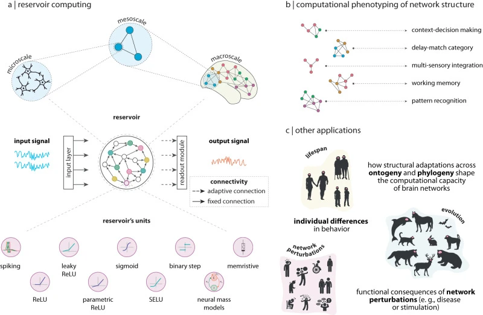

Suárez et al. · *Nature Communications* · 2024  
[Connectome-based reservoir computing with the conn2res toolbox](https://pmc.ncbi.nlm.nih.gov/articles/PMC10803782/#Fig1) · [原始图片](https://cdn.ncbi.nlm.nih.gov/pmc/blobs/0f30/10803782/a0cca255d0fa/41467_2024_44900_Fig1_HTML.jpg) · [CC BY 4.0](https://creativecommons.org/licenses/by/4.0/)

## Fig. 1 · A traditional RC is implicit in an NG-RC.

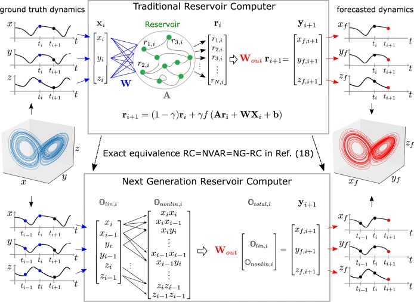

See paper · *Nature Communications* · 2021  
[Next generation reservoir computing](https://pmc.ncbi.nlm.nih.gov/articles/PMC8455577/#Fig1) · [原始图片](https://cdn.ncbi.nlm.nih.gov/pmc/blobs/28f5/8455577/15a2edb2c0ec/41467_2021_25801_Fig1_HTML.jpg) · [CC BY 4.0](https://creativecommons.org/licenses/by/4.0/)

## Fig. 1 · Schematic of how current approaches of adding replay to an artificial neural network could be to mapped onto the brain.

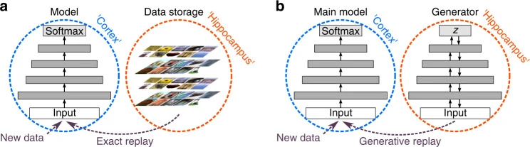

See paper · *Nature Communications* · 2020  
[Brain-inspired replay for continual learning with artificial neural networks](https://pmc.ncbi.nlm.nih.gov/articles/PMC7426273/#Fig1) · [原始图片](https://cdn.ncbi.nlm.nih.gov/pmc/blobs/be47/7426273/64f5fafb5728/41467_2020_17866_Fig1_HTML.jpg) · [CC BY 4.0](https://creativecommons.org/licenses/by/4.0/)

## Fig. 1 · Schemes for BPTT and e-prop.

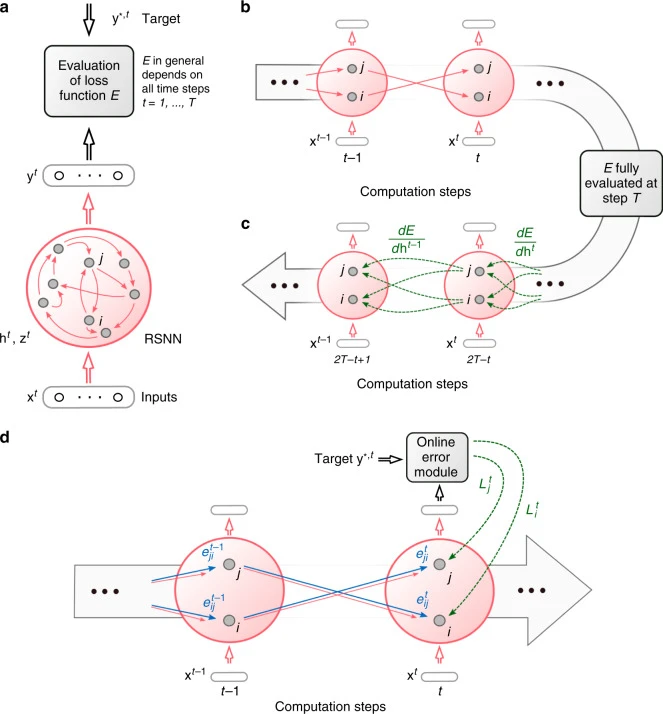

Bellec et al. · *Nature Communications* · 2020  
[A solution to the learning dilemma for recurrent networks of spiking neurons](https://pmc.ncbi.nlm.nih.gov/articles/PMC7367848/#Fig1) · [原始图片](https://cdn.ncbi.nlm.nih.gov/pmc/blobs/d771/7367848/a4a64ce0a90d/41467_2020_17236_Fig1_HTML.jpg) · [CC BY 4.0](https://creativecommons.org/licenses/by/4.0/)

## Fig. 1 · Selected research milestones of RC encompassing system and algorithm designs, representing theory, experimental realizations as well as applications.

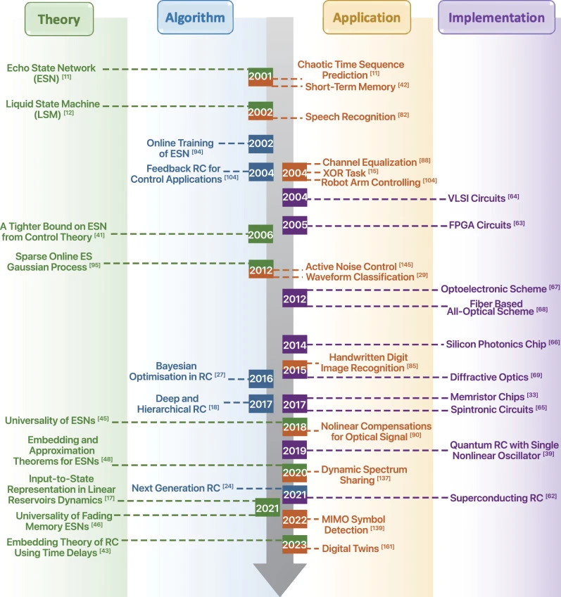

Yan et al. · *Nature Communications* · 2024  
[Emerging opportunities and challenges for the future of reservoir computing](https://pmc.ncbi.nlm.nih.gov/articles/PMC10917819/#Fig1) · [原始图片](https://cdn.ncbi.nlm.nih.gov/pmc/blobs/2752/10917819/ceca73c3a73c/41467_2024_45187_Fig1_HTML.jpg) · [CC BY 4.0](https://creativecommons.org/licenses/by/4.0/)

## Fig. 1 · The NequIP network architecture.

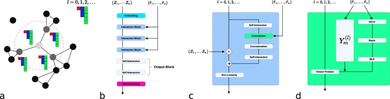

See paper · *Nature Communications* · 2022  
[E(3)-equivariant graph neural networks for data-efficient and accurate interatomic potentials](https://pmc.ncbi.nlm.nih.gov/articles/PMC9068614/#Fig1) · [原始图片](https://cdn.ncbi.nlm.nih.gov/pmc/blobs/0a61/9068614/4773619900ba/41467_2022_29939_Fig1_HTML.jpg) · [CC BY 4.0](https://creativecommons.org/licenses/by/4.0/)

## Fig. 1 · Device characteristics of dynamic memristor.

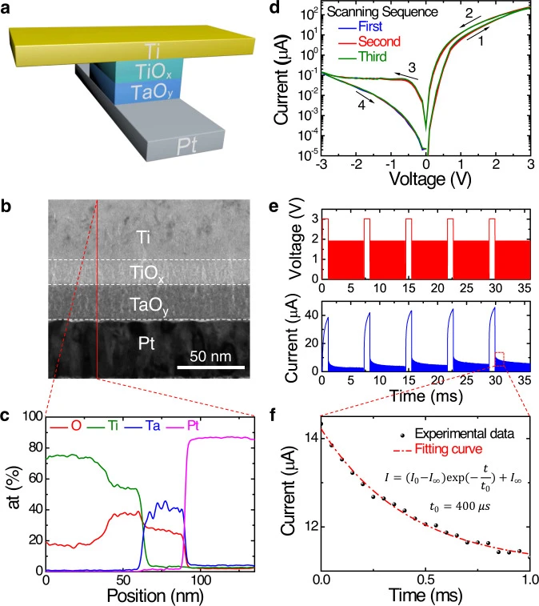

See paper · *Nature Communications* · 2021  
[Dynamic memristor-based reservoir computing for high-efficiency temporal signal processing](https://pmc.ncbi.nlm.nih.gov/articles/PMC7814066/#Fig1) · [原始图片](https://cdn.ncbi.nlm.nih.gov/pmc/blobs/d76e/7814066/b1a92beba6d2/41467_2020_20692_Fig1_HTML.jpg) · [CC BY 4.0](https://creativecommons.org/licenses/by/4.0/)

## Fig. 1 · Introduction to PNNs.

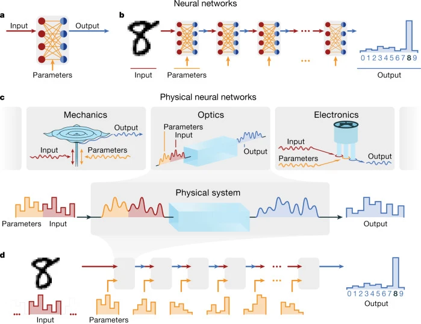

See paper · *Nature* · 2022  
[Deep physical neural networks trained with backpropagation](https://pmc.ncbi.nlm.nih.gov/articles/PMC8791835/#Fig1) · [原始图片](https://cdn.ncbi.nlm.nih.gov/pmc/blobs/e61c/8791835/0c223f1a3022/41586_2021_4223_Fig1_HTML.jpg) · [CC BY 4.0](https://creativecommons.org/licenses/by/4.0/)

## Fig. 2 · The evolution of reservoir computing.

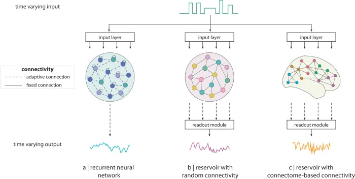

Suárez et al. · *Nature Communications* · 2024  
[Connectome-based reservoir computing with the conn2res toolbox](https://pmc.ncbi.nlm.nih.gov/articles/PMC10803782/#Fig2) · [原始图片](https://cdn.ncbi.nlm.nih.gov/pmc/blobs/0f30/10803782/081c3599dcaa/41467_2024_44900_Fig2_HTML.jpg) · [CC BY 4.0](https://creativecommons.org/licenses/by/4.0/)

## Fig. 2 · Forecasting a dynamical system using the NG-RC.

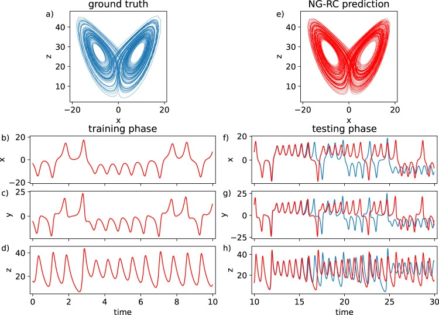

See paper · *Nature Communications* · 2021  
[Next generation reservoir computing](https://pmc.ncbi.nlm.nih.gov/articles/PMC8455577/#Fig2) · [原始图片](https://cdn.ncbi.nlm.nih.gov/pmc/blobs/28f5/8455577/034655818237/41467_2021_25801_Fig2_HTML.jpg) · [CC BY 4.0](https://creativecommons.org/licenses/by/4.0/)

## Fig. 2 · Protocol for training artificial neural networks with generative replay.

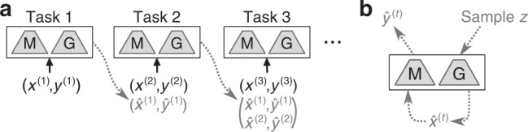

See paper · *Nature Communications* · 2020  
[Brain-inspired replay for continual learning with artificial neural networks](https://pmc.ncbi.nlm.nih.gov/articles/PMC7426273/#Fig2) · [原始图片](https://cdn.ncbi.nlm.nih.gov/pmc/blobs/be47/7426273/42ac926d12fc/41467_2020_17866_Fig2_HTML.jpg) · [CC BY 4.0](https://creativecommons.org/licenses/by/4.0/)

## Fig. 2 · Comparison of BPTT and e-prop for learning phoneme recognition.

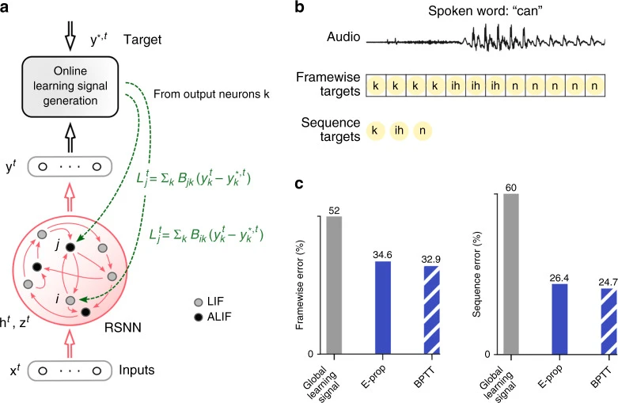

Bellec et al. · *Nature Communications* · 2020  
[A solution to the learning dilemma for recurrent networks of spiking neurons](https://pmc.ncbi.nlm.nih.gov/articles/PMC7367848/#Fig2) · [原始图片](https://cdn.ncbi.nlm.nih.gov/pmc/blobs/d771/7367848/2669e79c178c/41467_2020_17236_Fig2_HTML.jpg) · [CC BY 4.0](https://creativecommons.org/licenses/by/4.0/)

## Fig. 2 · Example applications of RC.

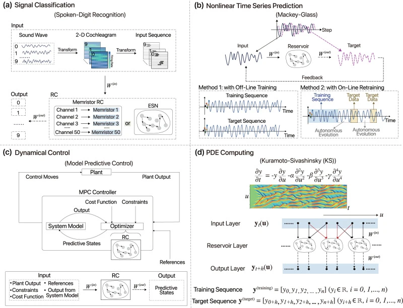

Yan et al. · *Nature Communications* · 2024  
[Emerging opportunities and challenges for the future of reservoir computing](https://pmc.ncbi.nlm.nih.gov/articles/PMC10917819/#Fig2) · [原始图片](https://cdn.ncbi.nlm.nih.gov/pmc/blobs/2752/10917819/e9ed3ef6349a/41467_2024_45187_Fig2_HTML.jpg) · [CC BY 4.0](https://creativecommons.org/licenses/by/4.0/)

## Fig. 2 · Benchmark systems.

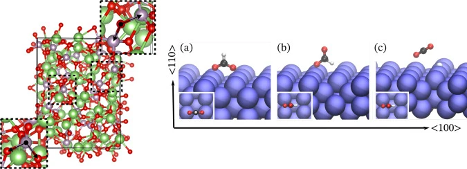

See paper · *Nature Communications* · 2022  
[E(3)-equivariant graph neural networks for data-efficient and accurate interatomic potentials](https://pmc.ncbi.nlm.nih.gov/articles/PMC9068614/#Fig2) · [原始图片](https://cdn.ncbi.nlm.nih.gov/pmc/blobs/0a61/9068614/9b8caa99efee/41467_2022_29939_Fig2_HTML.jpg) · [CC BY 4.0](https://creativecommons.org/licenses/by/4.0/)

## Fig. 2 · RC system architecture and waveform classification demonstration.

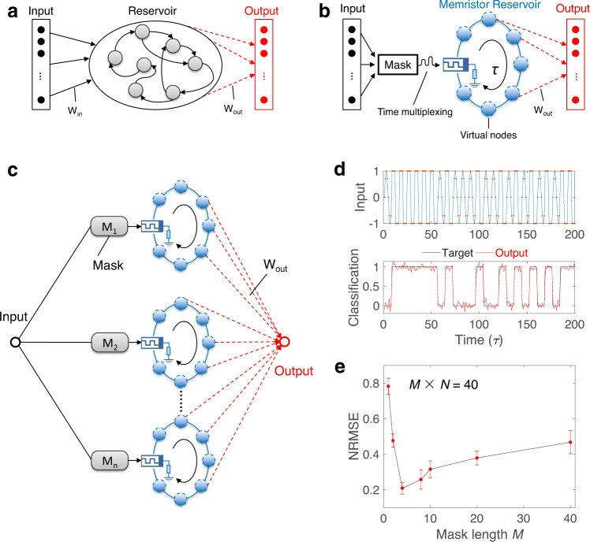

See paper · *Nature Communications* · 2021  
[Dynamic memristor-based reservoir computing for high-efficiency temporal signal processing](https://pmc.ncbi.nlm.nih.gov/articles/PMC7814066/#Fig2) · [原始图片](https://cdn.ncbi.nlm.nih.gov/pmc/blobs/d76e/7814066/f273af87a0ee/41467_2020_20692_Fig2_HTML.jpg) · [CC BY 4.0](https://creativecommons.org/licenses/by/4.0/)

## Fig. 2 · An example PNN, implemented experimentally using broadband optical SHG.

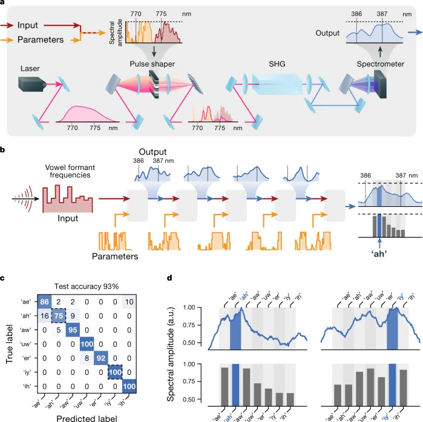

See paper · *Nature* · 2022  
[Deep physical neural networks trained with backpropagation](https://pmc.ncbi.nlm.nih.gov/articles/PMC8791835/#Fig2) · [原始图片](https://cdn.ncbi.nlm.nih.gov/pmc/blobs/e61c/8791835/601edf930991/41586_2021_4223_Fig2_HTML.jpg) · [CC BY 4.0](https://creativecommons.org/licenses/by/4.0/)

## Fig. 3 · conn2res toolbox.

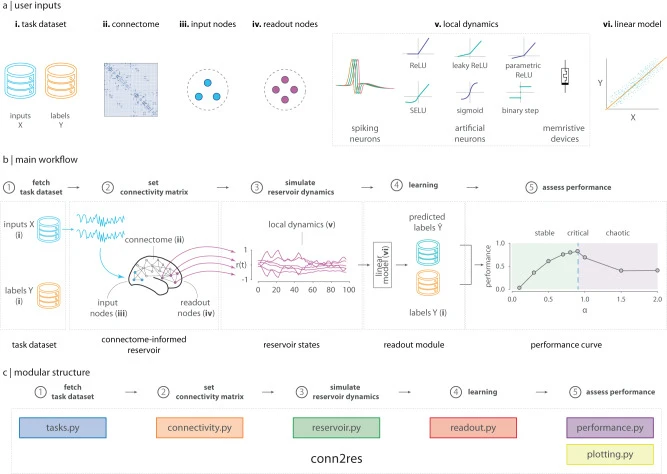

Suárez et al. · *Nature Communications* · 2024  
[Connectome-based reservoir computing with the conn2res toolbox](https://pmc.ncbi.nlm.nih.gov/articles/PMC10803782/#Fig3) · [原始图片](https://cdn.ncbi.nlm.nih.gov/pmc/blobs/0f30/10803782/c32dc4a5c0c7/41467_2024_44900_Fig3_HTML.jpg) · [CC BY 4.0](https://creativecommons.org/licenses/by/4.0/)

## Fig. 3 · Forecasting the double-scroll system using the NG-RC.

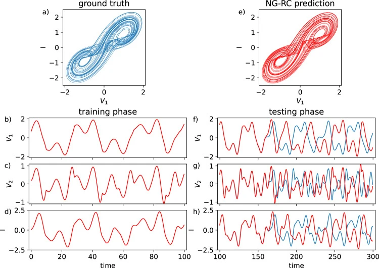

See paper · *Nature Communications* · 2021  
[Next generation reservoir computing](https://pmc.ncbi.nlm.nih.gov/articles/PMC8455577/#Fig3) · [原始图片](https://cdn.ncbi.nlm.nih.gov/pmc/blobs/28f5/8455577/4a7cab3e56a1/41467_2021_25801_Fig3_HTML.jpg) · [CC BY 4.0](https://creativecommons.org/licenses/by/4.0/)

## Fig. 3 · Replay might be required for artificial neural networks to incrementally learn new classes.

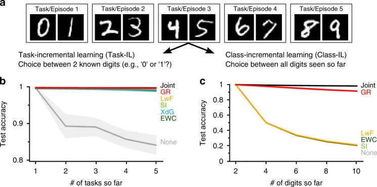

See paper · *Nature Communications* · 2020  
[Brain-inspired replay for continual learning with artificial neural networks](https://pmc.ncbi.nlm.nih.gov/articles/PMC7426273/#Fig3) · [原始图片](https://cdn.ncbi.nlm.nih.gov/pmc/blobs/be47/7426273/02ed8f62ac38/41467_2020_17866_Fig3_HTML.jpg) · [CC BY 4.0](https://creativecommons.org/licenses/by/4.0/)

## Fig. 3 · Solving a task with difficult temporal credit assignment.

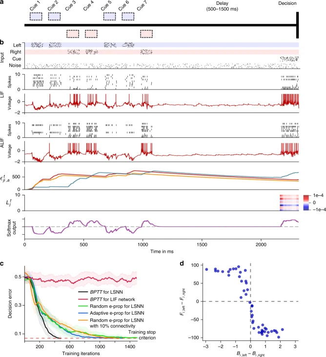

Bellec et al. · *Nature Communications* · 2020  
[A solution to the learning dilemma for recurrent networks of spiking neurons](https://pmc.ncbi.nlm.nih.gov/articles/PMC7367848/#Fig3) · [原始图片](https://cdn.ncbi.nlm.nih.gov/pmc/blobs/d771/7367848/db4e3276cf64/41467_2020_17236_Fig3_HTML.jpg) · [CC BY 4.0](https://creativecommons.org/licenses/by/4.0/)

## Fig. 3 · Trends in RC performance in typical application scenarios.

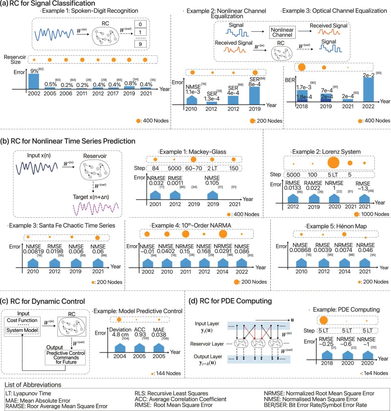

Yan et al. · *Nature Communications* · 2024  
[Emerging opportunities and challenges for the future of reservoir computing](https://pmc.ncbi.nlm.nih.gov/articles/PMC10917819/#Fig3) · [原始图片](https://cdn.ncbi.nlm.nih.gov/pmc/blobs/2752/10917819/0259a7b8fedd/41467_2024_45187_Fig3_HTML.jpg) · [CC BY 4.0](https://creativecommons.org/licenses/by/4.0/)

## Fig. 3 · Structure of Li4P2O7.

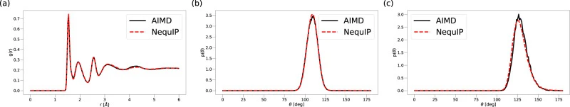

See paper · *Nature Communications* · 2022  
[E(3)-equivariant graph neural networks for data-efficient and accurate interatomic potentials](https://pmc.ncbi.nlm.nih.gov/articles/PMC9068614/#Fig3) · [原始图片](https://cdn.ncbi.nlm.nih.gov/pmc/blobs/0a61/9068614/2dac203b1ea2/41467_2022_29939_Fig3_HTML.jpg) · [CC BY 4.0](https://creativecommons.org/licenses/by/4.0/)

## Fig. 3 · Spoken-digit recognition demonstration.

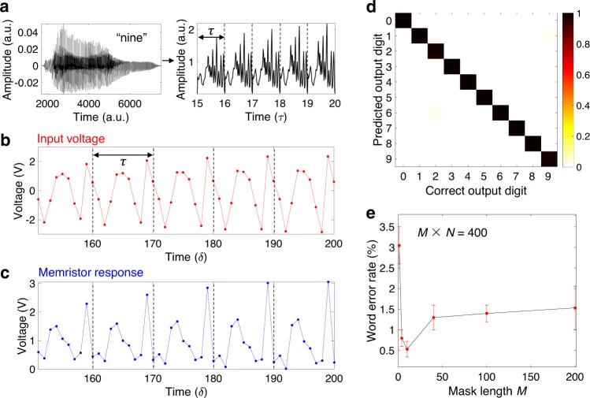

See paper · *Nature Communications* · 2021  
[Dynamic memristor-based reservoir computing for high-efficiency temporal signal processing](https://pmc.ncbi.nlm.nih.gov/articles/PMC7814066/#Fig3) · [原始图片](https://cdn.ncbi.nlm.nih.gov/pmc/blobs/d76e/7814066/4fba6651a878/41467_2020_20692_Fig3_HTML.jpg) · [CC BY 4.0](https://creativecommons.org/licenses/by/4.0/)

## Fig. 3 · Physics-aware training.

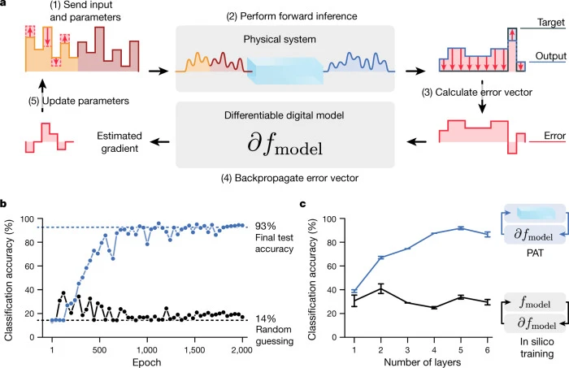

See paper · *Nature* · 2022  
[Deep physical neural networks trained with backpropagation](https://pmc.ncbi.nlm.nih.gov/articles/PMC8791835/#Fig3) · [原始图片](https://cdn.ncbi.nlm.nih.gov/pmc/blobs/e61c/8791835/46c2f3bff374/41586_2021_4223_Fig3_HTML.jpg) · [CC BY 4.0](https://creativecommons.org/licenses/by/4.0/)

## Fig. 4 · Toolbox components.

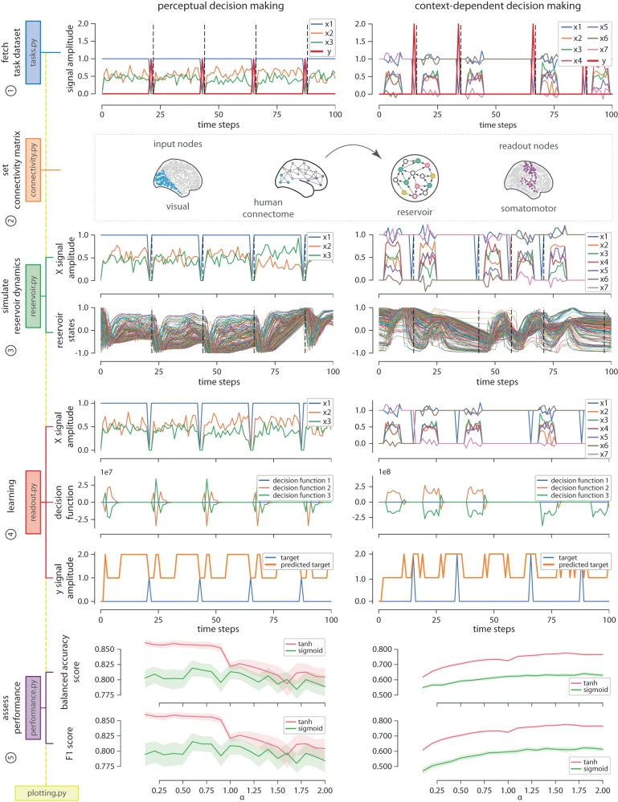

Suárez et al. · *Nature Communications* · 2024  
[Connectome-based reservoir computing with the conn2res toolbox](https://pmc.ncbi.nlm.nih.gov/articles/PMC10803782/#Fig4) · [原始图片](https://cdn.ncbi.nlm.nih.gov/pmc/blobs/0f30/10803782/aa6636b33b88/41467_2024_44900_Fig4_HTML.jpg) · [CC BY 4.0](https://creativecommons.org/licenses/by/4.0/)

## Fig. 4 · Inference using an NG-RC.

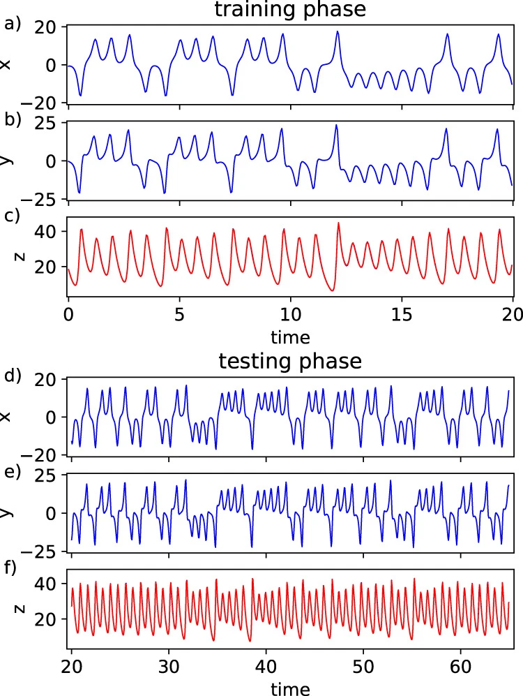

See paper · *Nature Communications* · 2021  
[Next generation reservoir computing](https://pmc.ncbi.nlm.nih.gov/articles/PMC8455577/#Fig4) · [原始图片](https://cdn.ncbi.nlm.nih.gov/pmc/blobs/28f5/8455577/21d2c82bd47b/41467_2021_25801_Fig4_HTML.jpg) · [CC BY 4.0](https://creativecommons.org/licenses/by/4.0/)

## Fig. 4 · Generative replay is remarkably efficient and robust.

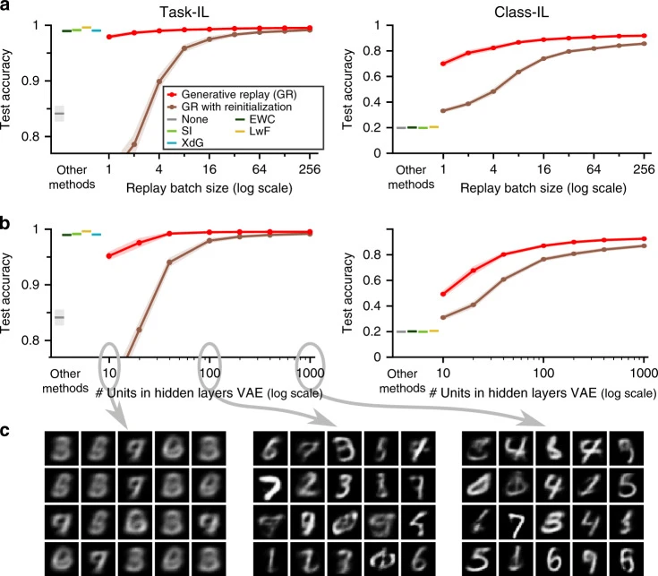

See paper · *Nature Communications* · 2020  
[Brain-inspired replay for continual learning with artificial neural networks](https://pmc.ncbi.nlm.nih.gov/articles/PMC7426273/#Fig4) · [原始图片](https://cdn.ncbi.nlm.nih.gov/pmc/blobs/be47/7426273/6e743a8ce164/41467_2020_17866_Fig4_HTML.jpg) · [CC BY 4.0](https://creativecommons.org/licenses/by/4.0/)

## Fig. 4 · Application of e-prop to the Atari game Pong.

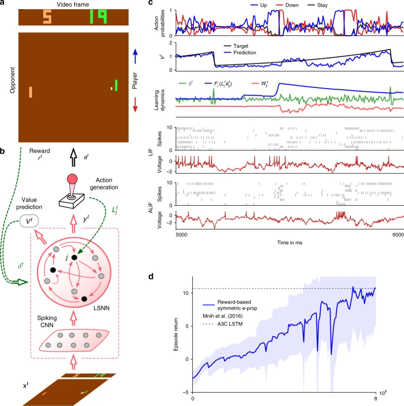

Bellec et al. · *Nature Communications* · 2020  
[A solution to the learning dilemma for recurrent networks of spiking neurons](https://pmc.ncbi.nlm.nih.gov/articles/PMC7367848/#Fig4) · [原始图片](https://cdn.ncbi.nlm.nih.gov/pmc/blobs/d771/7367848/eb08d504f804/41467_2020_17236_Fig4_HTML.jpg) · [CC BY 4.0](https://creativecommons.org/licenses/by/4.0/)

## Fig. 4 · Application domains in which RC potentially can play important roles.

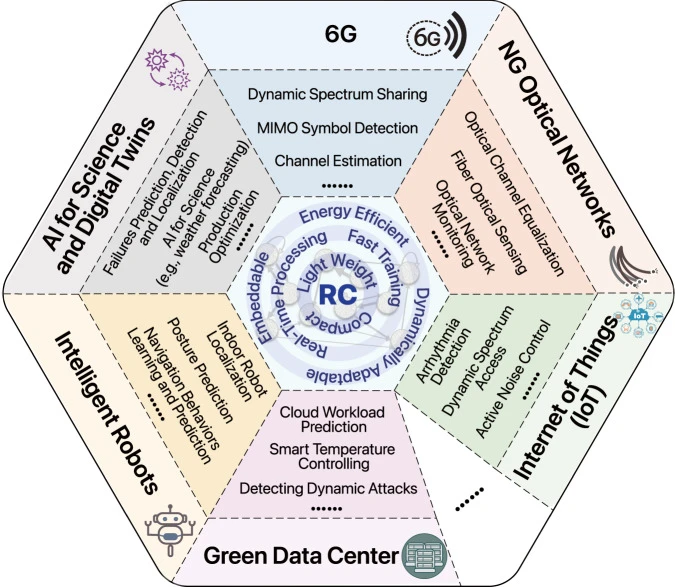

Yan et al. · *Nature Communications* · 2024  
[Emerging opportunities and challenges for the future of reservoir computing](https://pmc.ncbi.nlm.nih.gov/articles/PMC10917819/#Fig4) · [原始图片](https://cdn.ncbi.nlm.nih.gov/pmc/blobs/2752/10917819/8b51cd7503aa/41467_2024_45187_Fig4_HTML.jpg) · [CC BY 4.0](https://creativecommons.org/licenses/by/4.0/)

## Fig. 4 · Lithium Kinetics.

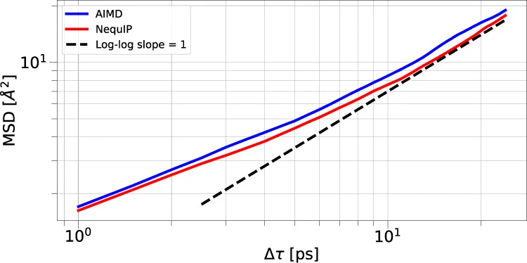

See paper · *Nature Communications* · 2022  
[E(3)-equivariant graph neural networks for data-efficient and accurate interatomic potentials](https://pmc.ncbi.nlm.nih.gov/articles/PMC9068614/#Fig4) · [原始图片](https://cdn.ncbi.nlm.nih.gov/pmc/blobs/0a61/9068614/c819988d08b8/41467_2022_29939_Fig4_HTML.jpg) · [CC BY 4.0](https://creativecommons.org/licenses/by/4.0/)

## Fig. 4 · Demonstration of Hénon map prediction.

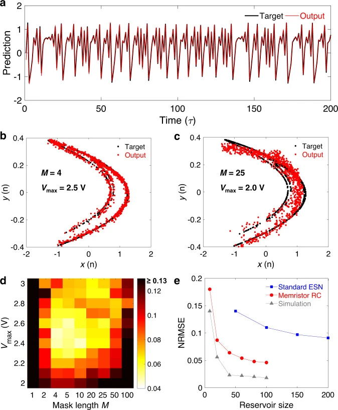

See paper · *Nature Communications* · 2021  
[Dynamic memristor-based reservoir computing for high-efficiency temporal signal processing](https://pmc.ncbi.nlm.nih.gov/articles/PMC7814066/#Fig4) · [原始图片](https://cdn.ncbi.nlm.nih.gov/pmc/blobs/d76e/7814066/d2fd8ac694e9/41467_2020_20692_Fig4_HTML.jpg) · [CC BY 4.0](https://creativecommons.org/licenses/by/4.0/)

## Fig. 4 · Image classification with diverse physical systems.

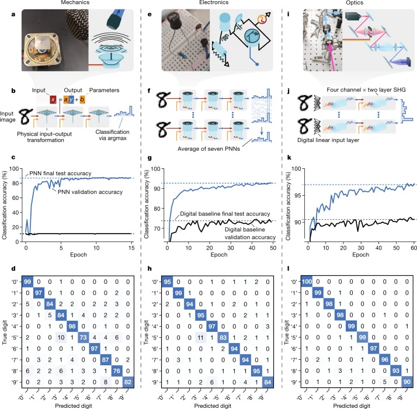

See paper · *Nature* · 2022  
[Deep physical neural networks trained with backpropagation](https://pmc.ncbi.nlm.nih.gov/articles/PMC8791835/#Fig4) · [原始图片](https://cdn.ncbi.nlm.nih.gov/pmc/blobs/e61c/8791835/dce0dbf2e158/41586_2021_4223_Fig4_HTML.jpg) · [CC BY 4.0](https://creativecommons.org/licenses/by/4.0/)

## Fig. 5 · Applied examples.

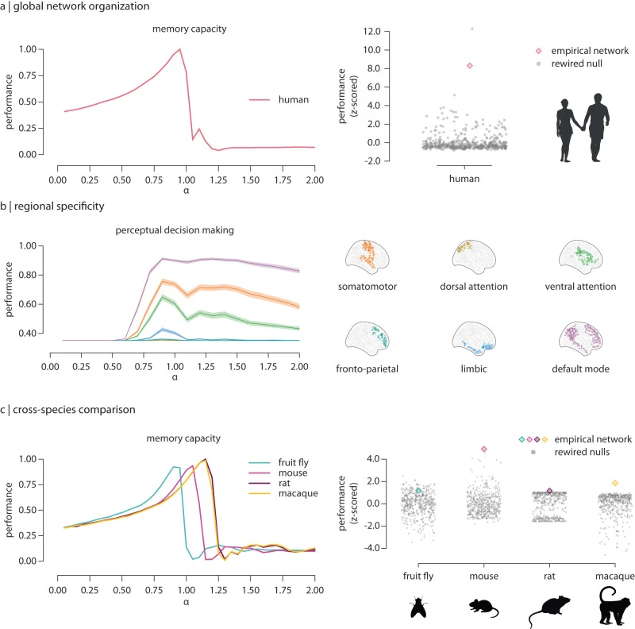

Suárez et al. · *Nature Communications* · 2024  
[Connectome-based reservoir computing with the conn2res toolbox](https://pmc.ncbi.nlm.nih.gov/articles/PMC10803782/#Fig5) · [原始图片](https://cdn.ncbi.nlm.nih.gov/pmc/blobs/0f30/10803782/c2b3e55a464a/41467_2024_44900_Fig5_HTML.jpg) · [CC BY 4.0](https://creativecommons.org/licenses/by/4.0/)

## Fig. 5 · Brain-inspired modifications enable generative replay to scale to problems with many tasks.

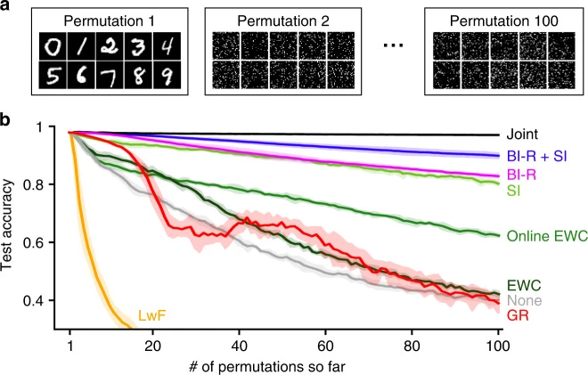

See paper · *Nature Communications* · 2020  
[Brain-inspired replay for continual learning with artificial neural networks](https://pmc.ncbi.nlm.nih.gov/articles/PMC7426273/#Fig5) · [原始图片](https://cdn.ncbi.nlm.nih.gov/pmc/blobs/be47/7426273/0581a9031437/41467_2020_17866_Fig5_HTML.jpg) · [CC BY 4.0](https://creativecommons.org/licenses/by/4.0/)

## Fig. 5 · Application of e-prop to learning to win the Atari game Fishing Derby.

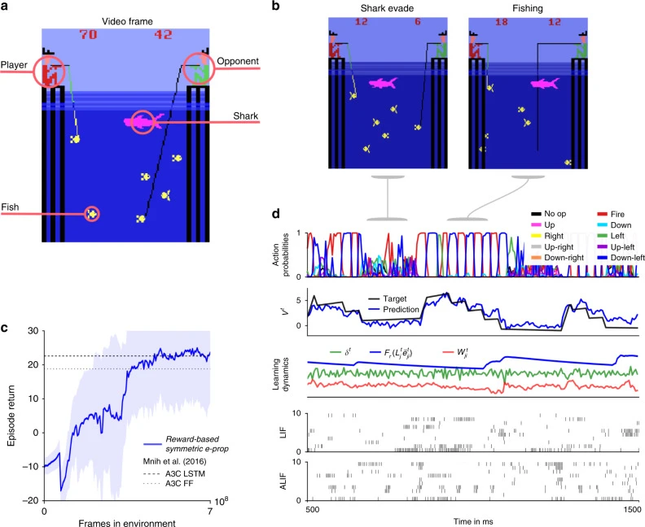

Bellec et al. · *Nature Communications* · 2020  
[A solution to the learning dilemma for recurrent networks of spiking neurons](https://pmc.ncbi.nlm.nih.gov/articles/PMC7367848/#Fig5) · [原始图片](https://cdn.ncbi.nlm.nih.gov/pmc/blobs/d771/7367848/15f05c67f3ce/41467_2020_17236_Fig5_HTML.jpg) · [CC BY 4.0](https://creativecommons.org/licenses/by/4.0/)

## Fig. 5 · Learning curves.

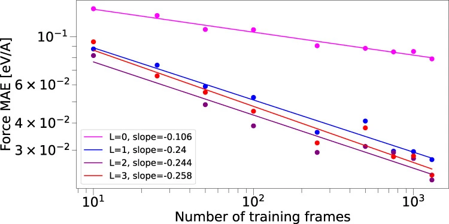

See paper · *Nature Communications* · 2022  
[E(3)-equivariant graph neural networks for data-efficient and accurate interatomic potentials](https://pmc.ncbi.nlm.nih.gov/articles/PMC9068614/#Fig5) · [原始图片](https://cdn.ncbi.nlm.nih.gov/pmc/blobs/0a61/9068614/afd27301af53/41467_2022_29939_Fig5_HTML.jpg) · [CC BY 4.0](https://creativecommons.org/licenses/by/4.0/)

## Fig. 6 · Brain-inspired modifications enable generative replay to scale to problems with complex inputs.

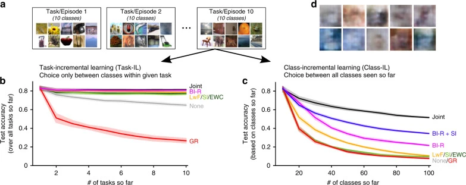

See paper · *Nature Communications* · 2020  
[Brain-inspired replay for continual learning with artificial neural networks](https://pmc.ncbi.nlm.nih.gov/articles/PMC7426273/#Fig6) · [原始图片](https://cdn.ncbi.nlm.nih.gov/pmc/blobs/be47/7426273/af5a4c9e01ef/41467_2020_17866_Fig6_HTML.jpg) · [CC BY 4.0](https://creativecommons.org/licenses/by/4.0/)

## Fig. 6 · Computational graph and gradient propagations.

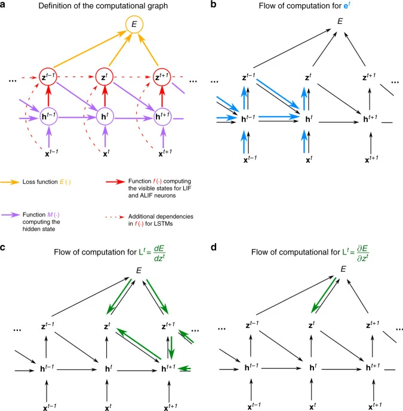

Bellec et al. · *Nature Communications* · 2020  
[A solution to the learning dilemma for recurrent networks of spiking neurons](https://pmc.ncbi.nlm.nih.gov/articles/PMC7367848/#Fig6) · [原始图片](https://cdn.ncbi.nlm.nih.gov/pmc/blobs/d771/7367848/d7d34cbd9549/41467_2020_17236_Fig6_HTML.jpg) · [CC BY 4.0](https://creativecommons.org/licenses/by/4.0/)

## Fig. 7 · The proposed brain-inspired modifications to the standard generative replay framework.

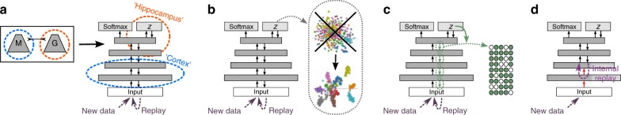

See paper · *Nature Communications* · 2020  
[Brain-inspired replay for continual learning with artificial neural networks](https://pmc.ncbi.nlm.nih.gov/articles/PMC7426273/#Fig7) · [原始图片](https://cdn.ncbi.nlm.nih.gov/pmc/blobs/be47/7426273/e9b15994d809/41467_2020_17866_Fig7_HTML.jpg) · [CC BY 4.0](https://creativecommons.org/licenses/by/4.0/)

## Fig. 8 · Addition- and ablation-experiments to tear apart the contributions of individual modifications.

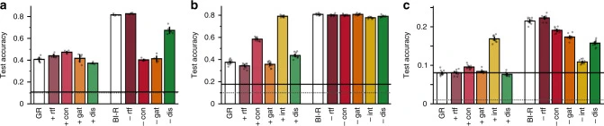

See paper · *Nature Communications* · 2020  
[Brain-inspired replay for continual learning with artificial neural networks](https://pmc.ncbi.nlm.nih.gov/articles/PMC7426273/#Fig8) · [原始图片](https://cdn.ncbi.nlm.nih.gov/pmc/blobs/be47/7426273/4bcb9beaace3/41467_2020_17866_Fig8_HTML.jpg) · [CC BY 4.0](https://creativecommons.org/licenses/by/4.0/)

## Fig. 9 · Quality and diversity of generated samples.

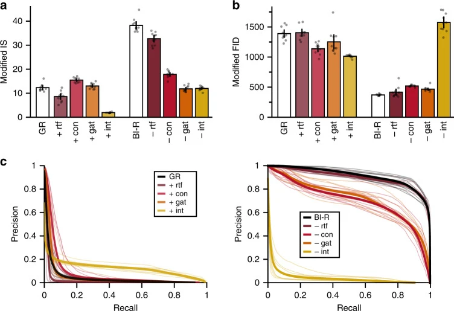

See paper · *Nature Communications* · 2020  
[Brain-inspired replay for continual learning with artificial neural networks](https://pmc.ncbi.nlm.nih.gov/articles/PMC7426273/#Fig9) · [原始图片](https://cdn.ncbi.nlm.nih.gov/pmc/blobs/be47/7426273/e9437a7d698e/41467_2020_17866_Fig9_HTML.jpg) · [CC BY 4.0](https://creativecommons.org/licenses/by/4.0/)

