# 网络与复杂系统

> 共 46 张。图片是按原图缩放的本地预览；查看原文可获取完整图注和高清版本。

## Fig. 1 · Network descriptors measured from noisy networks and their reconstruction.

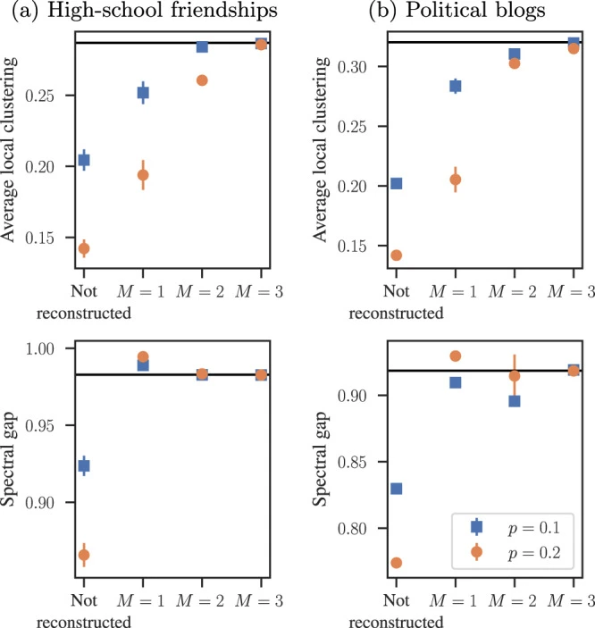

See paper · *Nature Communications* · 2022  
[Statistical inference links data and theory in network science](https://pmc.ncbi.nlm.nih.gov/articles/PMC9649740/#Fig1) · [原始图片](https://cdn.ncbi.nlm.nih.gov/pmc/blobs/d1ec/9649740/5f49777dd119/41467_2022_34267_Fig1_HTML.jpg) · [CC BY 4.0](https://creativecommons.org/licenses/by/4.0/)

## Fig. 1 · Predictions of GNN trained on a Barabási-Albert random network 72 (BA).

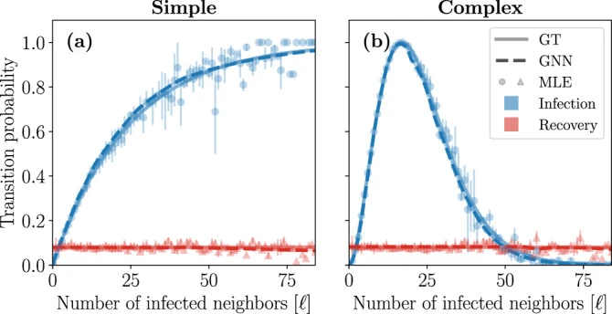

See paper · *Nature Communications* · 2021  
[Deep learning of contagion dynamics on complex networks](https://pmc.ncbi.nlm.nih.gov/articles/PMC8342694/#Fig1) · [原始图片](https://cdn.ncbi.nlm.nih.gov/pmc/blobs/78bf/8342694/580951cf131a/41467_2021_24732_Fig1_HTML.jpg) · [CC BY 4.0](https://creativecommons.org/licenses/by/4.0/)

## Fig. 1 · The effect of model uncertainty in the computation of optimal network controls.

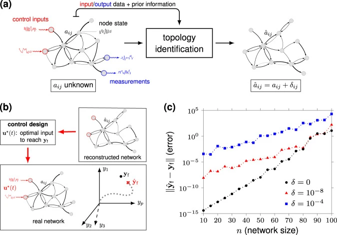

See paper · *Nature Communications* · 2021  
[Data-driven control of complex networks](https://pmc.ncbi.nlm.nih.gov/articles/PMC7930026/#Fig1) · [原始图片](https://cdn.ncbi.nlm.nih.gov/pmc/blobs/e0e4/7930026/641a52b98525/41467_2021_21554_Fig1_HTML.jpg) · [CC BY 4.0](https://creativecommons.org/licenses/by/4.0/)

## Fig. 1 · A motivating example. An illustrative example to show the importance of combined consideration of network model and interventional behavior

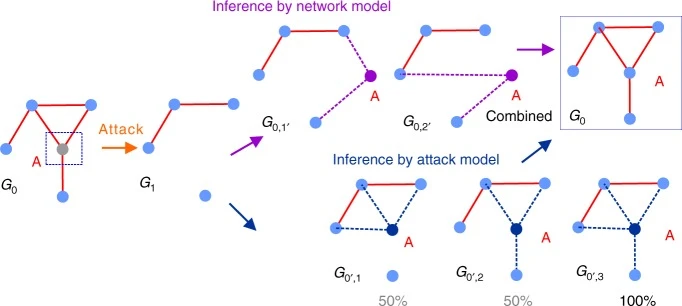

Xue et al. · *Nature Communications* · 2019  
[Reconstructing missing complex networks against adversarial interventions](https://pmc.ncbi.nlm.nih.gov/articles/PMC6465316/#Fig1) · [原始图片](https://cdn.ncbi.nlm.nih.gov/pmc/blobs/e608/6465316/97b86ddd4e48/41467_2019_9774_Fig1_HTML.jpg) · [CC BY 4.0](https://creativecommons.org/licenses/by/4.0/)

## Fig. 1 · Two mechanisms to activate edges. For the first mechanism (type-I), there are two cases in which the state age of an active edge is set to zero: a the event is driven by the genera

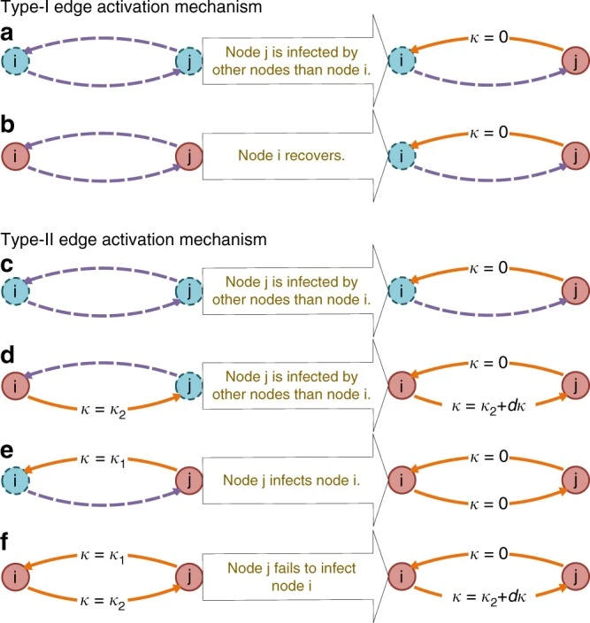

See paper · *Nature Communications* · 2019  
[Equivalence and its invalidation between non-Markovian and Markovian spreading dynamics on complex networks](https://pmc.ncbi.nlm.nih.gov/articles/PMC6707263/#Fig1) · [原始图片](https://cdn.ncbi.nlm.nih.gov/pmc/blobs/cbcd/6707263/4b04dcc93dbf/41467_2019_11763_Fig1_HTML.jpg) · [CC BY 4.0](https://creativecommons.org/licenses/by/4.0/)

## Fig. 1 · Computational cost of DomiRank.

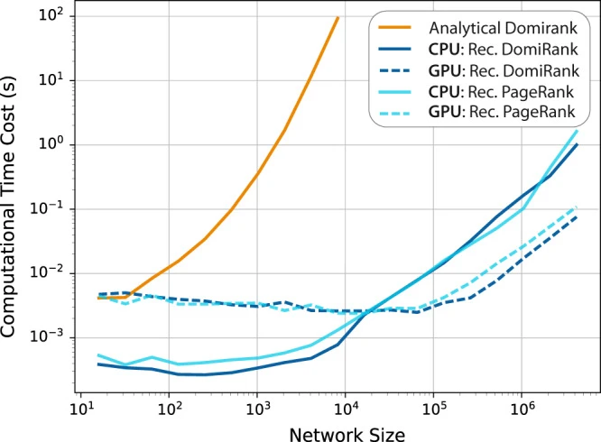

Engsig et al. · *Nature Communications* · 2024  
[DomiRank Centrality reveals structural fragility of complex networks via node dominance](https://pmc.ncbi.nlm.nih.gov/articles/PMC10761873/#Fig1) · [原始图片](https://cdn.ncbi.nlm.nih.gov/pmc/blobs/ec21/10761873/1fb4d4f53d9e/41467_2023_44257_Fig1_HTML.jpg) · [CC BY 4.0](https://creativecommons.org/licenses/by/4.0/)

## Fig. 1 · Different network structures inhibit the spreading of failures in complex networks.

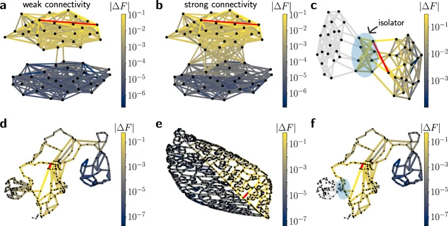

Kaiser et al. · *Nature Communications* · 2021  
[Network isolators inhibit failure spreading in complex networks](https://pmc.ncbi.nlm.nih.gov/articles/PMC8149673/#Fig1) · [原始图片](https://cdn.ncbi.nlm.nih.gov/pmc/blobs/92a5/8149673/45b46c8ca733/41467_2021_23292_Fig1_HTML.jpg) · [CC BY 4.0](https://creativecommons.org/licenses/by/4.0/)

## Fig. 1 · Network-of-networks representation.

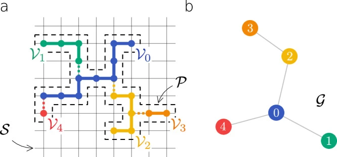

See paper · *Nature Communications* · 2024  
[Physical networks as network-of-networks](https://pmc.ncbi.nlm.nih.gov/articles/PMC11161514/#Fig1) · [原始图片](https://cdn.ncbi.nlm.nih.gov/pmc/blobs/0b47/11161514/43adc5e8f593/41467_2024_49227_Fig1_HTML.jpg) · [CC BY 4.0](https://creativecommons.org/licenses/by/4.0/)

## Fig. 2 · Network reconstruction in action.

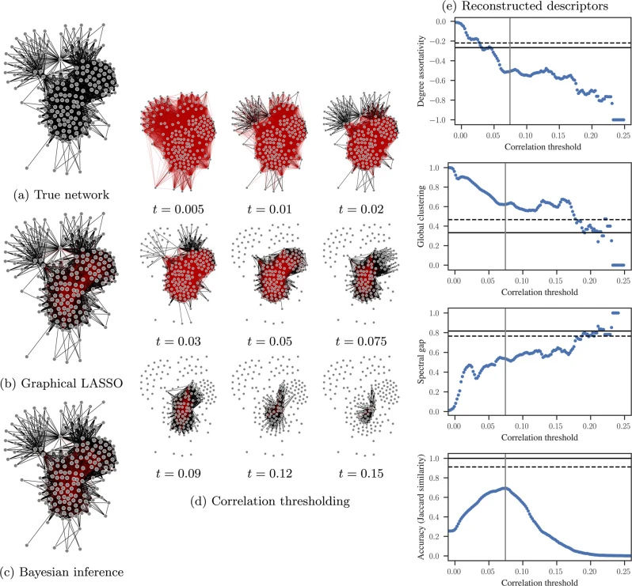

See paper · *Nature Communications* · 2022  
[Statistical inference links data and theory in network science](https://pmc.ncbi.nlm.nih.gov/articles/PMC9649740/#Fig2) · [原始图片](https://cdn.ncbi.nlm.nih.gov/pmc/blobs/d1ec/9649740/f95448aba0ae/41467_2022_34267_Fig2_HTML.jpg) · [CC BY 4.0](https://creativecommons.org/licenses/by/4.0/)

## Fig. 2 · GNN learning performance on different dynamics and structures.

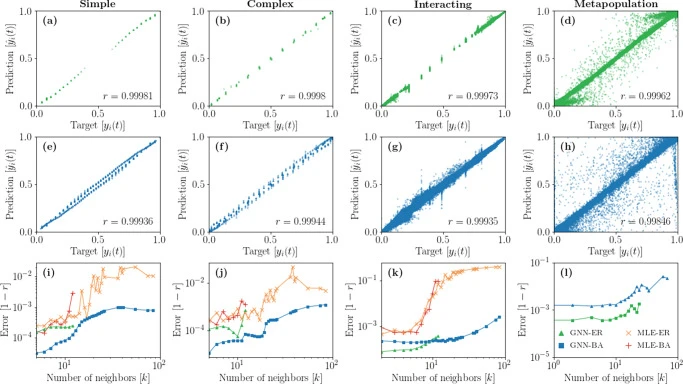

See paper · *Nature Communications* · 2021  
[Deep learning of contagion dynamics on complex networks](https://pmc.ncbi.nlm.nih.gov/articles/PMC8342694/#Fig2) · [原始图片](https://cdn.ncbi.nlm.nih.gov/pmc/blobs/78bf/8342694/ec9c070f0f82/41467_2021_24732_Fig2_HTML.jpg) · [CC BY 4.0](https://creativecommons.org/licenses/by/4.0/)

## Fig. 2 · Experimental setup and optimal data-driven network controls.

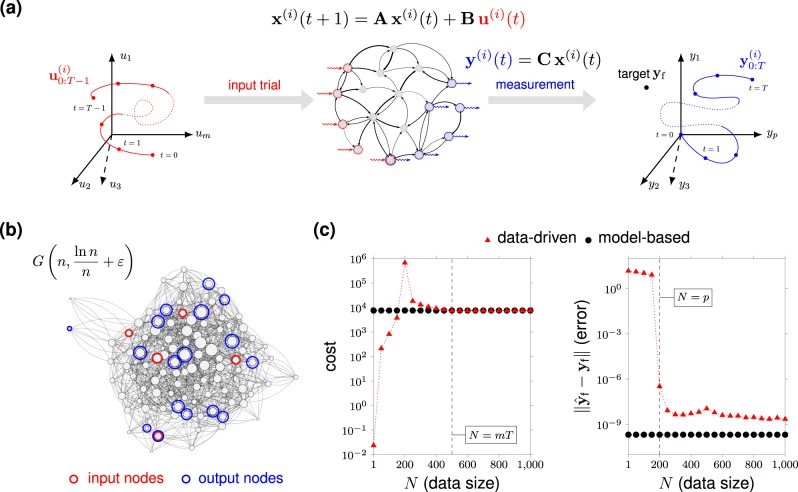

See paper · *Nature Communications* · 2021  
[Data-driven control of complex networks](https://pmc.ncbi.nlm.nih.gov/articles/PMC7930026/#Fig2) · [原始图片](https://cdn.ncbi.nlm.nih.gov/pmc/blobs/e0e4/7930026/b30bc024c9a2/41467_2021_21554_Fig2_HTML.jpg) · [CC BY 4.0](https://creativecommons.org/licenses/by/4.0/)

## Fig. 2 · Quantifying the capability of inferring synthetic networks under varying attack strategies. a, b Estimation error eF as a function of missing network under hub-prioritized (a) and 

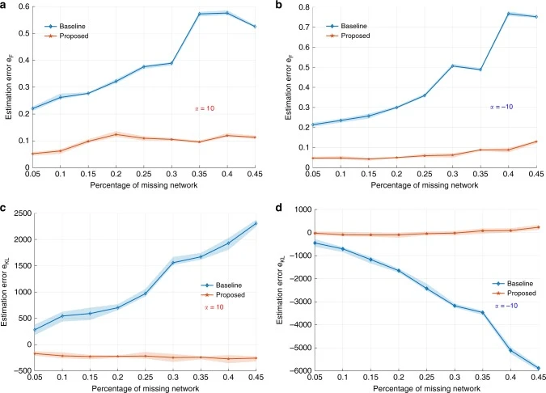

Xue et al. · *Nature Communications* · 2019  
[Reconstructing missing complex networks against adversarial interventions](https://pmc.ncbi.nlm.nih.gov/articles/PMC6465316/#Fig2) · [原始图片](https://cdn.ncbi.nlm.nih.gov/pmc/blobs/e608/6465316/a5c47a96df14/41467_2019_9774_Fig2_HTML.jpg) · [CC BY 4.0](https://creativecommons.org/licenses/by/4.0/)

## Fig. 2 · Schematic representation of probability flows. Each illustration is divided into blocks of width dτ → 0, and the area of each block represents the probability that node i is in the

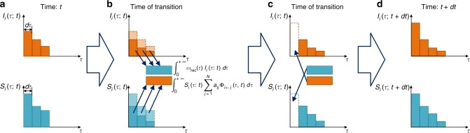

See paper · *Nature Communications* · 2019  
[Equivalence and its invalidation between non-Markovian and Markovian spreading dynamics on complex networks](https://pmc.ncbi.nlm.nih.gov/articles/PMC6707263/#Fig2) · [原始图片](https://cdn.ncbi.nlm.nih.gov/pmc/blobs/cbcd/6707263/313d7080e21d/41467_2019_11763_Fig2_HTML.jpg) · [CC BY 4.0](https://creativecommons.org/licenses/by/4.0/)

## Fig. 2 · DomiRank for different levels of competition (σ).

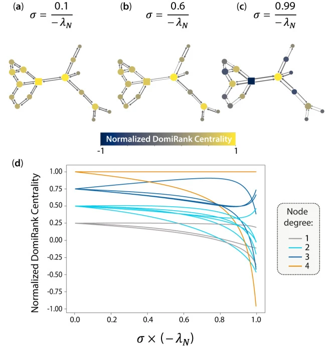

Engsig et al. · *Nature Communications* · 2024  
[DomiRank Centrality reveals structural fragility of complex networks via node dominance](https://pmc.ncbi.nlm.nih.gov/articles/PMC10761873/#Fig2) · [原始图片](https://cdn.ncbi.nlm.nih.gov/pmc/blobs/ec21/10761873/a0191efe3693/41467_2023_44257_Fig2_HTML.jpg) · [CC BY 4.0](https://creativecommons.org/licenses/by/4.0/)

## Fig. 2 · Effectiveness and robustness of shielding network structures.

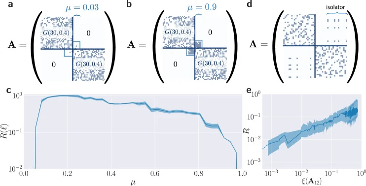

Kaiser et al. · *Nature Communications* · 2021  
[Network isolators inhibit failure spreading in complex networks](https://pmc.ncbi.nlm.nih.gov/articles/PMC8149673/#Fig2) · [原始图片](https://cdn.ncbi.nlm.nih.gov/pmc/blobs/92a5/8149673/79decf885ec2/41467_2021_23292_Fig2_HTML.jpg) · [CC BY 4.0](https://creativecommons.org/licenses/by/4.0/)

## Fig. 2 · Evolution of LERW physical networks.

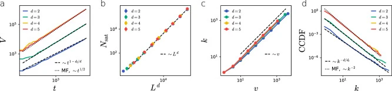

See paper · *Nature Communications* · 2024  
[Physical networks as network-of-networks](https://pmc.ncbi.nlm.nih.gov/articles/PMC11161514/#Fig2) · [原始图片](https://cdn.ncbi.nlm.nih.gov/pmc/blobs/0b47/11161514/b712ada6464f/41467_2024_49227_Fig2_HTML.jpg) · [CC BY 4.0](https://creativecommons.org/licenses/by/4.0/)

## Fig. 3 · Evaluating community structure with null and generative models.

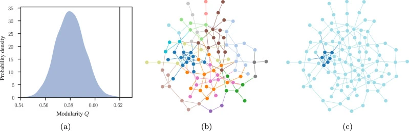

See paper · *Nature Communications* · 2022  
[Statistical inference links data and theory in network science](https://pmc.ncbi.nlm.nih.gov/articles/PMC9649740/#Fig3) · [原始图片](https://cdn.ncbi.nlm.nih.gov/pmc/blobs/d1ec/9649740/5f27fb8cca15/41467_2022_34267_Fig3_HTML.jpg) · [CC BY 4.0](https://creativecommons.org/licenses/by/4.0/)

## Fig. 3 · Bifurcation diagrams of the trained GNN.

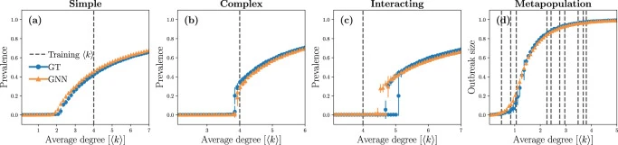

See paper · *Nature Communications* · 2021  
[Deep learning of contagion dynamics on complex networks](https://pmc.ncbi.nlm.nih.gov/articles/PMC8342694/#Fig3) · [原始图片](https://cdn.ncbi.nlm.nih.gov/pmc/blobs/78bf/8342694/d1c9e001124f/41467_2021_24732_Fig3_HTML.jpg) · [CC BY 4.0](https://creativecommons.org/licenses/by/4.0/)

## Fig. 3 · Performance of minimum-energy data-driven network controls.

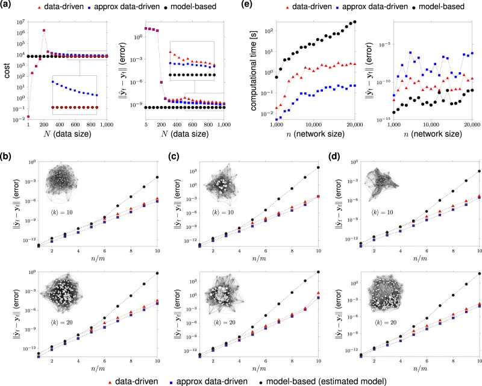

See paper · *Nature Communications* · 2021  
[Data-driven control of complex networks](https://pmc.ncbi.nlm.nih.gov/articles/PMC7930026/#Fig3) · [原始图片](https://cdn.ncbi.nlm.nih.gov/pmc/blobs/e0e4/7930026/dfe3c9418e52/41467_2021_21554_Fig3_HTML.jpg) · [CC BY 4.0](https://creativecommons.org/licenses/by/4.0/)

## Fig. 3 · Degree distribution analysis. a Reshaped degree distribution of the latent network structure. b, c Capability to reconstruct the missing network structure under hub-prioritized int

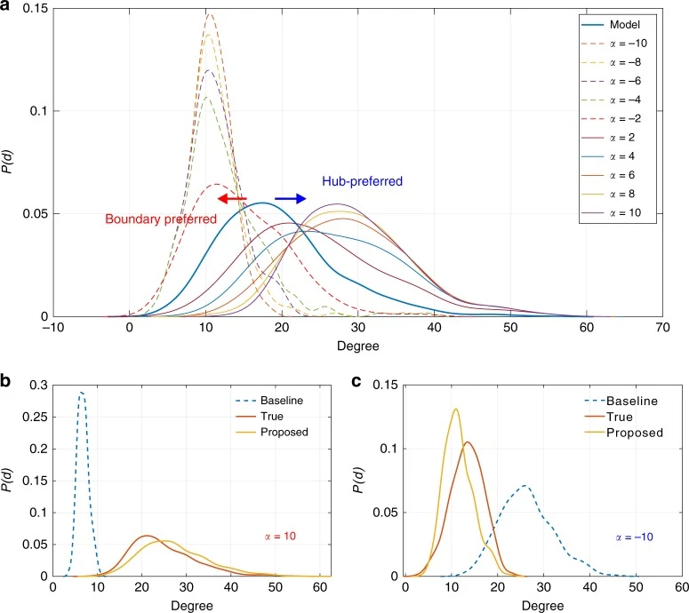

Xue et al. · *Nature Communications* · 2019  
[Reconstructing missing complex networks against adversarial interventions](https://pmc.ncbi.nlm.nih.gov/articles/PMC6465316/#Fig3) · [原始图片](https://cdn.ncbi.nlm.nih.gov/pmc/blobs/e608/6465316/be186f49277d/41467_2019_9774_Fig3_HTML.jpg) · [CC BY 4.0](https://creativecommons.org/licenses/by/4.0/)

## Fig. 3 · (Color online) Comparison of time evolution between simulated and theoretical results. Panels in the first and second rows (a–c and d–f), respectively, are for the type-I and type-

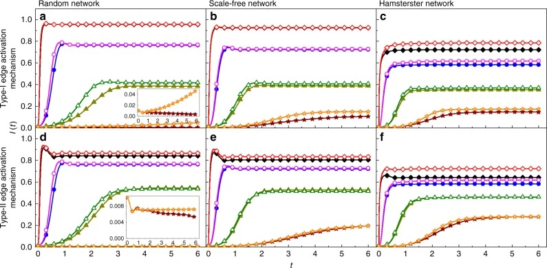

See paper · *Nature Communications* · 2019  
[Equivalence and its invalidation between non-Markovian and Markovian spreading dynamics on complex networks](https://pmc.ncbi.nlm.nih.gov/articles/PMC6707263/#Fig3) · [原始图片](https://cdn.ncbi.nlm.nih.gov/pmc/blobs/cbcd/6707263/e6a310f74572/41467_2019_11763_Fig3_HTML.jpg) · [CC BY 4.0](https://creativecommons.org/licenses/by/4.0/)

## Fig. 3 · The role of σ in setting DomiRank values.

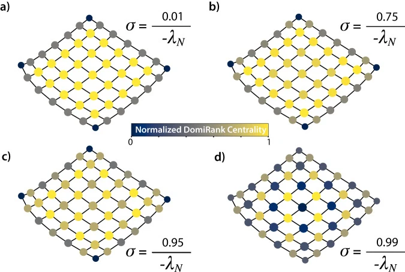

Engsig et al. · *Nature Communications* · 2024  
[DomiRank Centrality reveals structural fragility of complex networks via node dominance](https://pmc.ncbi.nlm.nih.gov/articles/PMC10761873/#Fig3) · [原始图片](https://cdn.ncbi.nlm.nih.gov/pmc/blobs/ec21/10761873/800566b5336a/41467_2023_44257_Fig3_HTML.jpg) · [CC BY 4.0](https://creativecommons.org/licenses/by/4.0/)

## Fig. 3 · Different ways of constructing isolators in real-world power grids.

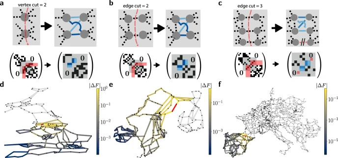

Kaiser et al. · *Nature Communications* · 2021  
[Network isolators inhibit failure spreading in complex networks](https://pmc.ncbi.nlm.nih.gov/articles/PMC8149673/#Fig3) · [原始图片](https://cdn.ncbi.nlm.nih.gov/pmc/blobs/92a5/8149673/ee513b00e965/41467_2021_23292_Fig3_HTML.jpg) · [CC BY 4.0](https://creativecommons.org/licenses/by/4.0/)

## Fig. 3 · Laplacian of LERW physical networks.

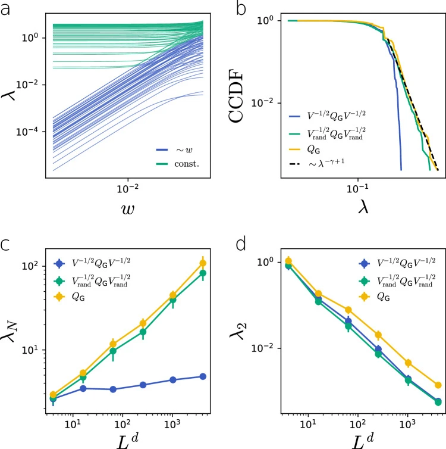

See paper · *Nature Communications* · 2024  
[Physical networks as network-of-networks](https://pmc.ncbi.nlm.nih.gov/articles/PMC11161514/#Fig3) · [原始图片](https://cdn.ncbi.nlm.nih.gov/pmc/blobs/0b47/11161514/da55b4dc1473/41467_2024_49227_Fig3_HTML.jpg) · [CC BY 4.0](https://creativecommons.org/licenses/by/4.0/)

## Fig. 4 · Measuring network descriptors under uncertainty.

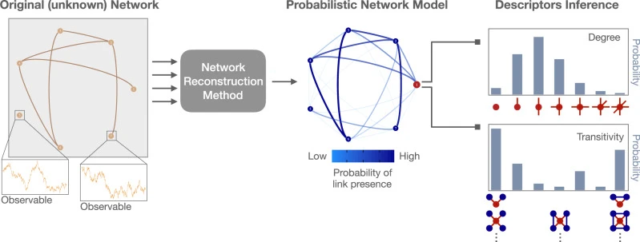

See paper · *Nature Communications* · 2022  
[Statistical inference links data and theory in network science](https://pmc.ncbi.nlm.nih.gov/articles/PMC9649740/#Fig4) · [原始图片](https://cdn.ncbi.nlm.nih.gov/pmc/blobs/d1ec/9649740/876e590b1434/41467_2022_34267_Fig4_HTML.jpg) · [CC BY 4.0](https://creativecommons.org/licenses/by/4.0/)

## Fig. 4 · Spain COVID-19 dataset.

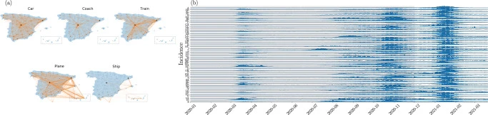

See paper · *Nature Communications* · 2021  
[Deep learning of contagion dynamics on complex networks](https://pmc.ncbi.nlm.nih.gov/articles/PMC8342694/#Fig4) · [原始图片](https://cdn.ncbi.nlm.nih.gov/pmc/blobs/78bf/8342694/3cfa2a001a71/41467_2021_24732_Fig4_HTML.jpg) · [CC BY 4.0](https://creativecommons.org/licenses/by/4.0/)

## Fig. 4 · Data-driven control of synchronized patterns in a ring of Kuramoto oscillators.

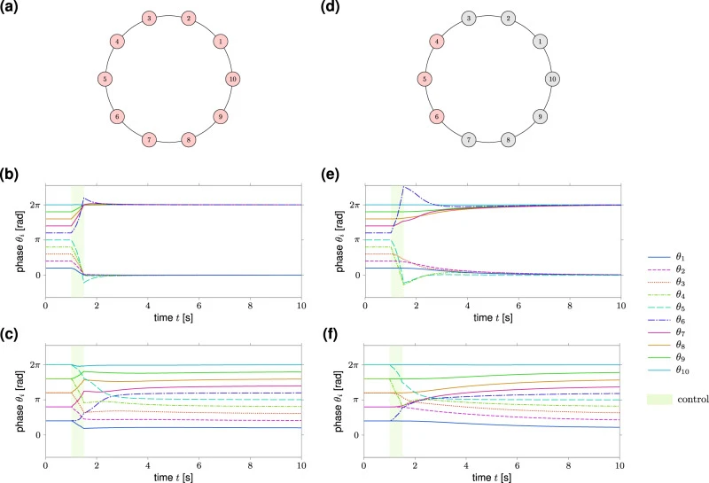

See paper · *Nature Communications* · 2021  
[Data-driven control of complex networks](https://pmc.ncbi.nlm.nih.gov/articles/PMC7930026/#Fig4) · [原始图片](https://cdn.ncbi.nlm.nih.gov/pmc/blobs/e0e4/7930026/84782a74a87e/41467_2021_21554_Fig4_HTML.jpg) · [CC BY 4.0](https://creativecommons.org/licenses/by/4.0/)

## Fig. 4 · Recover the human protein complex interaction network (a–d) and brain consensus connectome (e–h). a, c, e, g Compare the capability to infer the missing network via AUC score. b, f

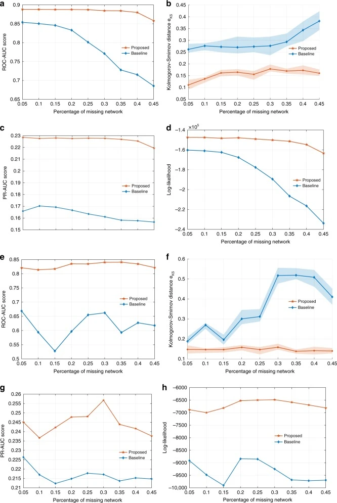

Xue et al. · *Nature Communications* · 2019  
[Reconstructing missing complex networks against adversarial interventions](https://pmc.ncbi.nlm.nih.gov/articles/PMC6465316/#Fig4) · [原始图片](https://cdn.ncbi.nlm.nih.gov/pmc/blobs/e608/6465316/36e6242ae2f9/41467_2019_9774_Fig4_HTML.jpg) · [CC BY 4.0](https://creativecommons.org/licenses/by/4.0/)

## Fig. 4 · Demonstration of equivalence. Comparison of stationary infected density with type-II activation mechanism between non-Markovian and Markovian processes for a random b scale-free, a

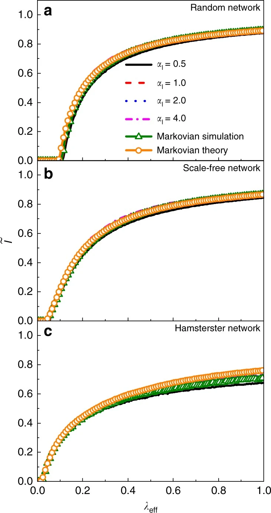

See paper · *Nature Communications* · 2019  
[Equivalence and its invalidation between non-Markovian and Markovian spreading dynamics on complex networks](https://pmc.ncbi.nlm.nih.gov/articles/PMC6707263/#Fig4) · [原始图片](https://cdn.ncbi.nlm.nih.gov/pmc/blobs/cbcd/6707263/fbc708ec99c9/41467_2019_11763_Fig4_HTML.jpg) · [CC BY 4.0](https://creativecommons.org/licenses/by/4.0/)

## Fig. 4 · Comparing DomiRank with other centralities in dismantling toy networks.

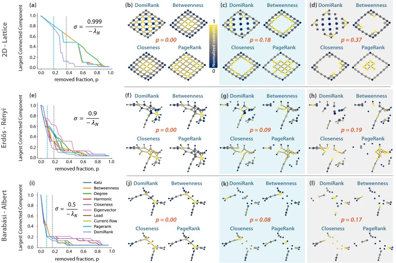

Engsig et al. · *Nature Communications* · 2024  
[DomiRank Centrality reveals structural fragility of complex networks via node dominance](https://pmc.ncbi.nlm.nih.gov/articles/PMC10761873/#Fig4) · [原始图片](https://cdn.ncbi.nlm.nih.gov/pmc/blobs/ec21/10761873/65f6d51dc7f6/41467_2023_44257_Fig4_HTML.jpg) · [CC BY 4.0](https://creativecommons.org/licenses/by/4.0/)

## Fig. 4 · Network isolators can contain cascading failures in power grids.

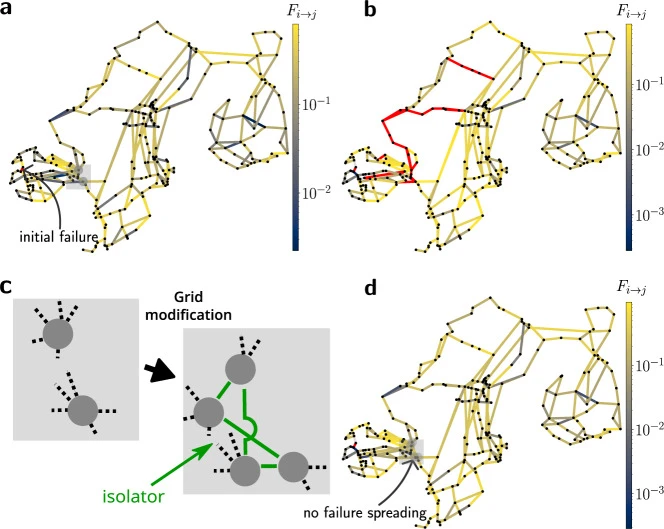

Kaiser et al. · *Nature Communications* · 2021  
[Network isolators inhibit failure spreading in complex networks](https://pmc.ncbi.nlm.nih.gov/articles/PMC8149673/#Fig4) · [原始图片](https://cdn.ncbi.nlm.nih.gov/pmc/blobs/92a5/8149673/16e431723558/41467_2021_23292_Fig4_HTML.jpg) · [CC BY 4.0](https://creativecommons.org/licenses/by/4.0/)

## Fig. 4 · Fruit fly brain network.

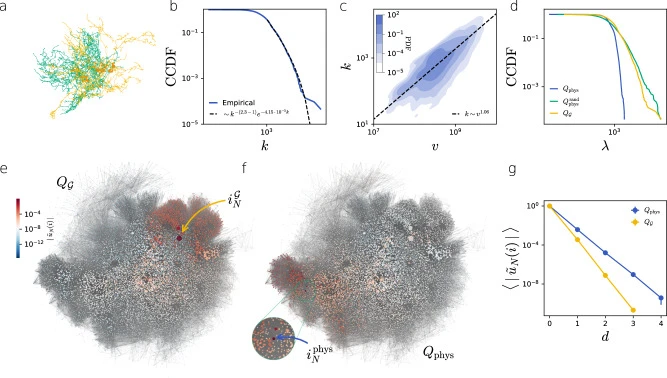

See paper · *Nature Communications* · 2024  
[Physical networks as network-of-networks](https://pmc.ncbi.nlm.nih.gov/articles/PMC11161514/#Fig4) · [原始图片](https://cdn.ncbi.nlm.nih.gov/pmc/blobs/0b47/11161514/d871c38a8fe8/41467_2024_49227_Fig4_HTML.jpg) · [CC BY 4.0](https://creativecommons.org/licenses/by/4.0/)

## Fig. 5 · Learning the Spain COVID-19 dataset.

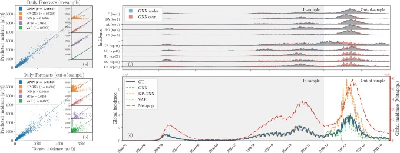

See paper · *Nature Communications* · 2021  
[Deep learning of contagion dynamics on complex networks](https://pmc.ncbi.nlm.nih.gov/articles/PMC8342694/#Fig5) · [原始图片](https://cdn.ncbi.nlm.nih.gov/pmc/blobs/78bf/8342694/2631e8874263/41467_2021_24732_Fig5_HTML.jpg) · [CC BY 4.0](https://creativecommons.org/licenses/by/4.0/)

## Fig. 5 · Data-driven fault recovery in the New England power-grid network.

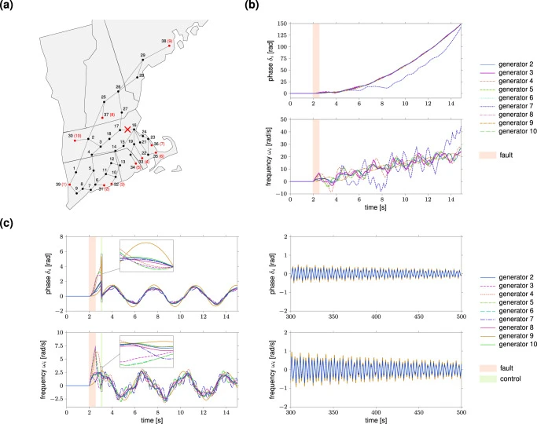

See paper · *Nature Communications* · 2021  
[Data-driven control of complex networks](https://pmc.ncbi.nlm.nih.gov/articles/PMC7930026/#Fig5) · [原始图片](https://cdn.ncbi.nlm.nih.gov/pmc/blobs/e0e4/7930026/6e5fa8b96471/41467_2021_21554_Fig5_HTML.jpg) · [CC BY 4.0](https://creativecommons.org/licenses/by/4.0/)

## Fig. 5 · Coverage as a function of α and share of injected nodes in total network of 4049 nodes

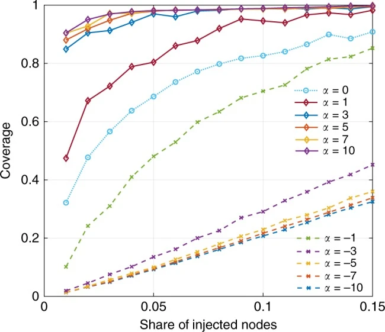

Xue et al. · *Nature Communications* · 2019  
[Reconstructing missing complex networks against adversarial interventions](https://pmc.ncbi.nlm.nih.gov/articles/PMC6465316/#Fig5) · [原始图片](https://cdn.ncbi.nlm.nih.gov/pmc/blobs/e608/6465316/df2b6bf7798b/41467_2019_9774_Fig5_HTML.jpg) · [CC BY 4.0](https://creativecommons.org/licenses/by/4.0/)

## Fig. 5 · Demonstration of approximate equivalence. Shown are the stationary infected density with type-I activation mechanism for a random, b scale-free, and c Hamsterster networks, which a

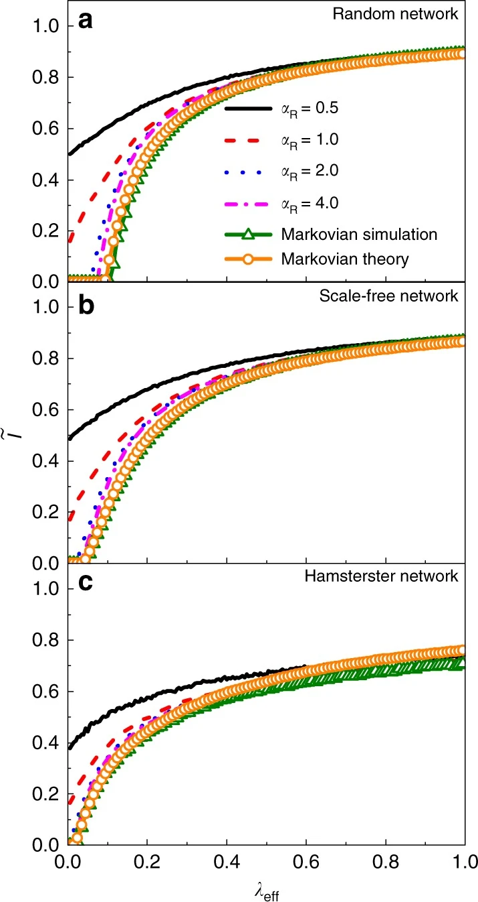

See paper · *Nature Communications* · 2019  
[Equivalence and its invalidation between non-Markovian and Markovian spreading dynamics on complex networks](https://pmc.ncbi.nlm.nih.gov/articles/PMC6707263/#Fig5) · [原始图片](https://cdn.ncbi.nlm.nih.gov/pmc/blobs/cbcd/6707263/d021bbf61ef5/41467_2019_11763_Fig5_HTML.jpg) · [CC BY 4.0](https://creativecommons.org/licenses/by/4.0/)

## Fig. 5 · Centrality-based attacks on synthetic and real-world networks.

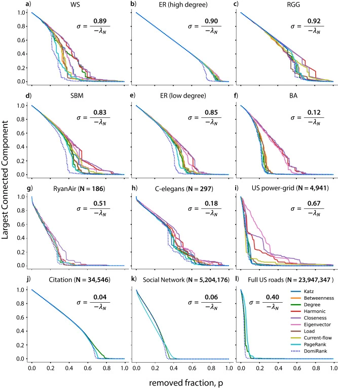

Engsig et al. · *Nature Communications* · 2024  
[DomiRank Centrality reveals structural fragility of complex networks via node dominance](https://pmc.ncbi.nlm.nih.gov/articles/PMC10761873/#Fig5) · [原始图片](https://cdn.ncbi.nlm.nih.gov/pmc/blobs/ec21/10761873/bc8d2127bc27/41467_2023_44257_Fig5_HTML.jpg) · [CC BY 4.0](https://creativecommons.org/licenses/by/4.0/)

## Fig. 5 · Robust design of network isolators in the Kuramoto model.

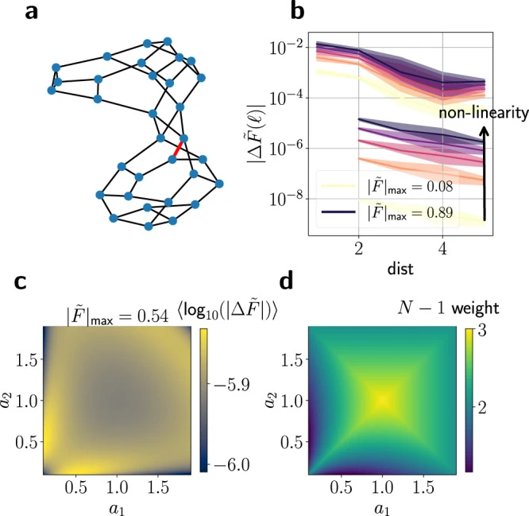

Kaiser et al. · *Nature Communications* · 2021  
[Network isolators inhibit failure spreading in complex networks](https://pmc.ncbi.nlm.nih.gov/articles/PMC8149673/#Fig5) · [原始图片](https://cdn.ncbi.nlm.nih.gov/pmc/blobs/92a5/8149673/80cd81876a86/41467_2021_23292_Fig5_HTML.jpg) · [CC BY 4.0](https://creativecommons.org/licenses/by/4.0/)

## Fig. 6 · Visualization of the GNN architecture.

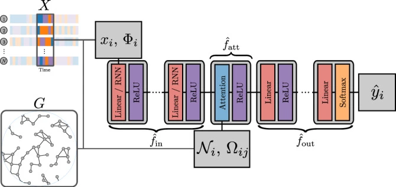

See paper · *Nature Communications* · 2021  
[Deep learning of contagion dynamics on complex networks](https://pmc.ncbi.nlm.nih.gov/articles/PMC8342694/#Fig6) · [原始图片](https://cdn.ncbi.nlm.nih.gov/pmc/blobs/78bf/8342694/6c0c6eb5d46e/41467_2021_24732_Fig6_HTML.jpg) · [CC BY 4.0](https://creativecommons.org/licenses/by/4.0/)

## Fig. 6 · Data-driven control of functional brain networks.

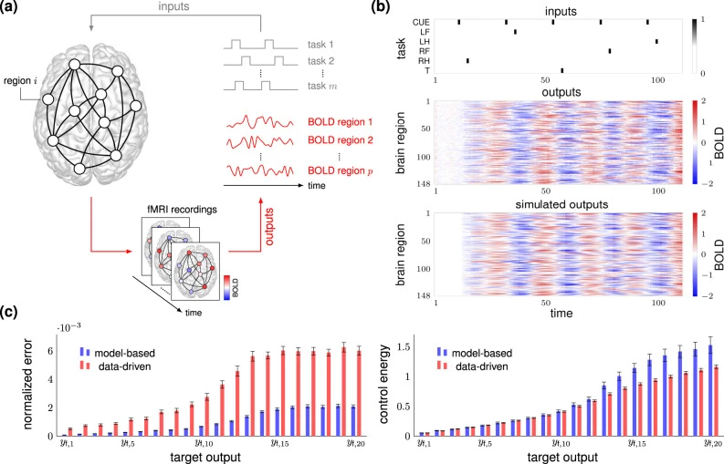

See paper · *Nature Communications* · 2021  
[Data-driven control of complex networks](https://pmc.ncbi.nlm.nih.gov/articles/PMC7930026/#Fig6) · [原始图片](https://cdn.ncbi.nlm.nih.gov/pmc/blobs/e0e4/7930026/146d13425263/41467_2021_21554_Fig6_HTML.jpg) · [CC BY 4.0](https://creativecommons.org/licenses/by/4.0/)

## Fig. 6 · Evaluation of the capability to recover the Facebook social network (α = 1). a, c Compare the capability to infer the missing network via AUC scores. b Goodness-of-the-fit comparis

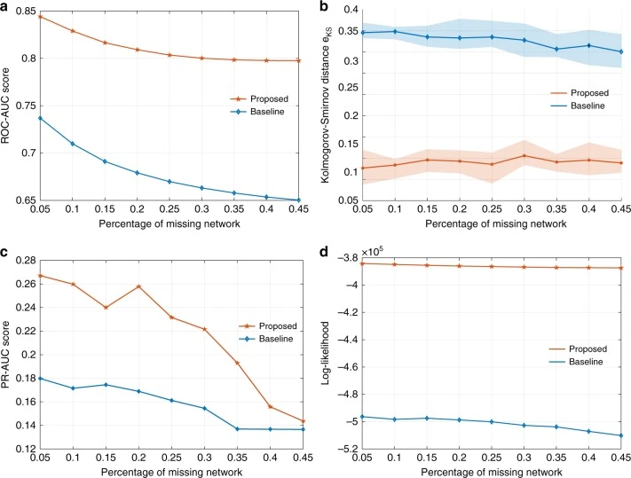

Xue et al. · *Nature Communications* · 2019  
[Reconstructing missing complex networks against adversarial interventions](https://pmc.ncbi.nlm.nih.gov/articles/PMC6465316/#Fig6) · [原始图片](https://cdn.ncbi.nlm.nih.gov/pmc/blobs/e608/6465316/55cc24ead7db/41467_2019_9774_Fig6_HTML.jpg) · [CC BY 4.0](https://creativecommons.org/licenses/by/4.0/)

## Fig. 6 · Assessing the effect of iterative centrality-based attacks and recovery mechanisms on network resilience.

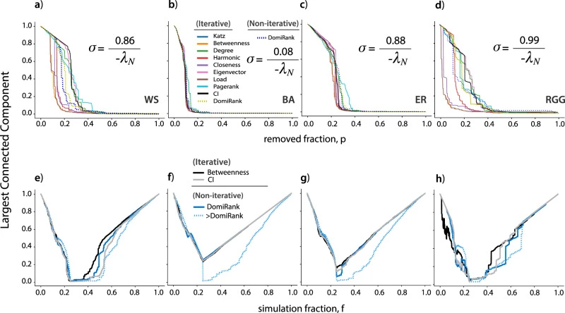

Engsig et al. · *Nature Communications* · 2024  
[DomiRank Centrality reveals structural fragility of complex networks via node dominance](https://pmc.ncbi.nlm.nih.gov/articles/PMC10761873/#Fig6) · [原始图片](https://cdn.ncbi.nlm.nih.gov/pmc/blobs/ec21/10761873/3a21992afa14/41467_2023_44257_Fig6_HTML.jpg) · [CC BY 4.0](https://creativecommons.org/licenses/by/4.0/)

## Fig. 6 · Network isolators suppress failure spreading in full non-linear AC load flow.

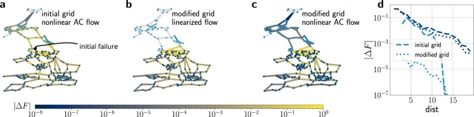

Kaiser et al. · *Nature Communications* · 2021  
[Network isolators inhibit failure spreading in complex networks](https://pmc.ncbi.nlm.nih.gov/articles/PMC8149673/#Fig6) · [原始图片](https://cdn.ncbi.nlm.nih.gov/pmc/blobs/92a5/8149673/2263c1d3c986/41467_2021_23292_Fig6_HTML.jpg) · [CC BY 4.0](https://creativecommons.org/licenses/by/4.0/)

## Fig. 7 · Comparison of capability to estimate affected users (α = 1)

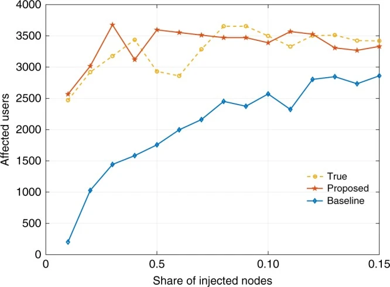

Xue et al. · *Nature Communications* · 2019  
[Reconstructing missing complex networks against adversarial interventions](https://pmc.ncbi.nlm.nih.gov/articles/PMC6465316/#Fig7) · [原始图片](https://cdn.ncbi.nlm.nih.gov/pmc/blobs/e608/6465316/2e4ae3d4b93f/41467_2019_9774_Fig7_HTML.jpg) · [CC BY 4.0](https://creativecommons.org/licenses/by/4.0/)

## Fig. 7 · Functional robustness of synthetic and real-world networks under centrality-based attacks.

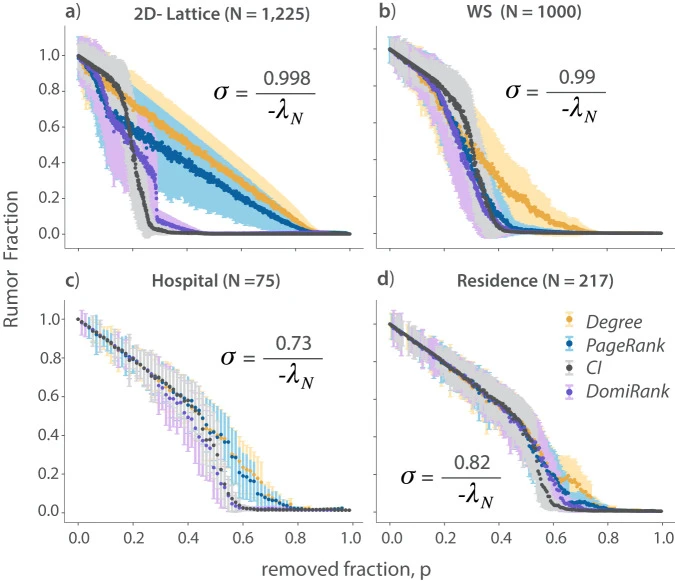

Engsig et al. · *Nature Communications* · 2024  
[DomiRank Centrality reveals structural fragility of complex networks via node dominance](https://pmc.ncbi.nlm.nih.gov/articles/PMC10761873/#Fig7) · [原始图片](https://cdn.ncbi.nlm.nih.gov/pmc/blobs/ec21/10761873/fd33bc53e335/41467_2023_44257_Fig7_HTML.jpg) · [CC BY 4.0](https://creativecommons.org/licenses/by/4.0/)

## Fig. 8 · Inference runtime as a function of missing nodes with a network of size 4049 and 1015

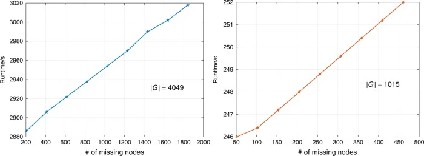

Xue et al. · *Nature Communications* · 2019  
[Reconstructing missing complex networks against adversarial interventions](https://pmc.ncbi.nlm.nih.gov/articles/PMC6465316/#Fig8) · [原始图片](https://cdn.ncbi.nlm.nih.gov/pmc/blobs/e608/6465316/2ed5ab7d65cc/41467_2019_9774_Fig8_HTML.jpg) · [CC BY 4.0](https://creativecommons.org/licenses/by/4.0/)

