# 群体行为与动力学

> 共 17 张。图片是按原图缩放的本地预览；查看原文可获取完整图注和高清版本。

## Fig. 1 · Group structure depends on visual interactions and develops with age.

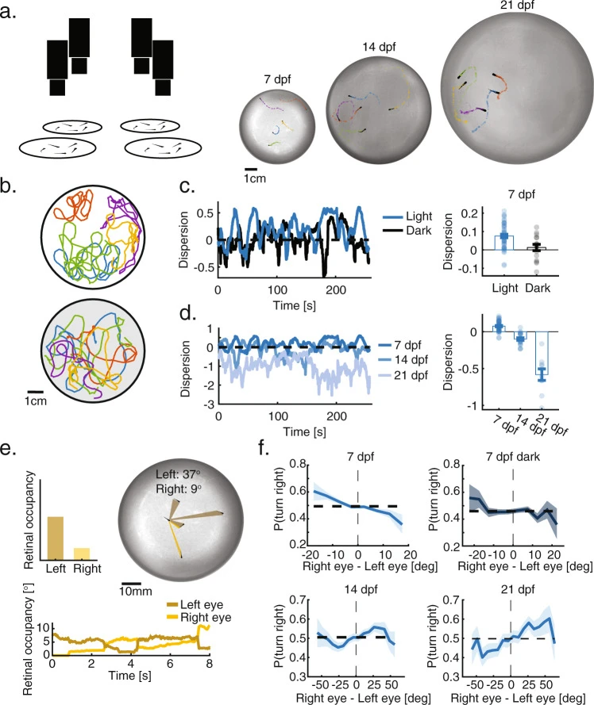

Harpaz et al. · *Nature Communications* · 2021  
[Precise visuomotor transformations underlying collective behavior in larval zebrafish](https://pmc.ncbi.nlm.nih.gov/articles/PMC8590009/#Fig1) · [原始图片](https://cdn.ncbi.nlm.nih.gov/pmc/blobs/740d/8590009/464046e70ff2/41467_2021_26748_Fig1_HTML.jpg) · [CC BY 4.0](https://creativecommons.org/licenses/by/4.0/)

## Fig. 1 · Predictors of responsiveness to the stimulus.

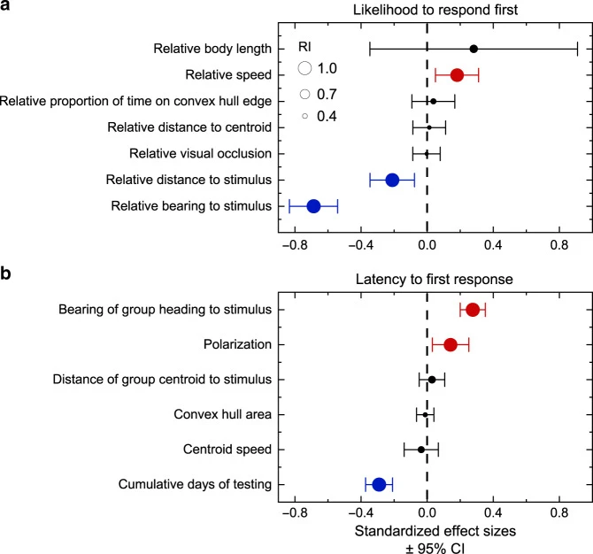

See paper · *Nature Communications* · 2020  
[Information can explain the dynamics of group order in animal collective behaviour](https://pmc.ncbi.nlm.nih.gov/articles/PMC7264142/#Fig1) · [原始图片](https://cdn.ncbi.nlm.nih.gov/pmc/blobs/9d07/7264142/27495751d782/41467_2020_16578_Fig1_HTML.jpg) · [CC BY 4.0](https://creativecommons.org/licenses/by/4.0/)

## Fig. 1 · The light-driven fuel-free micro-swimmers display distinct behaviours at different densities.

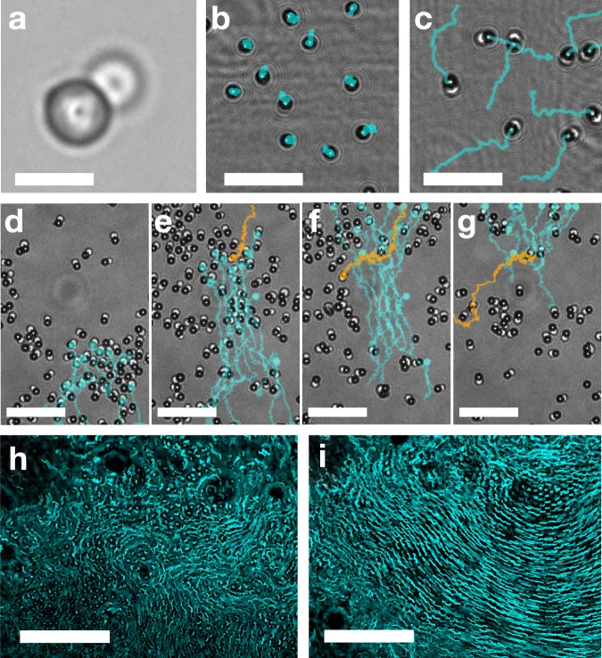

See paper · *Nature Communications* · 2022  
[Cooperation in a fluid swarm of fuel-free micro-swimmers](https://pmc.ncbi.nlm.nih.gov/articles/PMC8748659/#Fig1) · [原始图片](https://cdn.ncbi.nlm.nih.gov/pmc/blobs/93b8/8748659/03e3bc769052/41467_2021_27870_Fig1_HTML.jpg) · [CC BY 4.0](https://creativecommons.org/licenses/by/4.0/)

## Fig. 1 · Qualitative sketch of linear vs. marginal speed-restoring force.

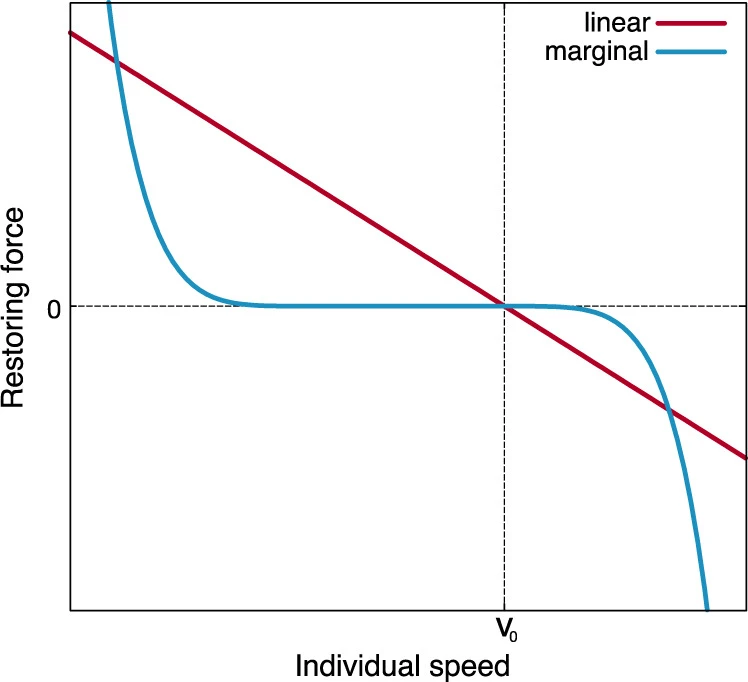

See paper · *Nature Communications* · 2022  
[Marginal speed confinement resolves the conflict between correlation and control in collective behaviour](https://pmc.ncbi.nlm.nih.gov/articles/PMC9090766/#Fig1) · [原始图片](https://cdn.ncbi.nlm.nih.gov/pmc/blobs/3317/9090766/585923662704/41467_2022_29883_Fig1_HTML.jpg) · [CC BY 4.0](https://creativecommons.org/licenses/by/4.0/)

## Fig. 2 · Virtual reality reveals the algorithms fish use to integrate visual social information.

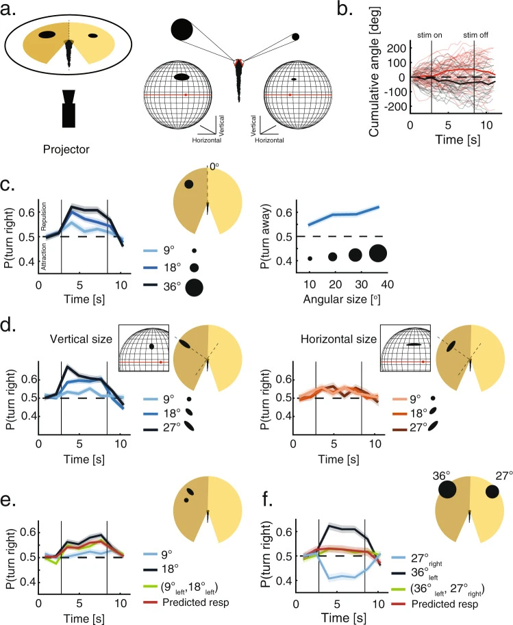

Harpaz et al. · *Nature Communications* · 2021  
[Precise visuomotor transformations underlying collective behavior in larval zebrafish](https://pmc.ncbi.nlm.nih.gov/articles/PMC8590009/#Fig2) · [原始图片](https://cdn.ncbi.nlm.nih.gov/pmc/blobs/740d/8590009/d699f40b1384/41467_2021_26748_Fig2_HTML.jpg) · [CC BY 4.0](https://creativecommons.org/licenses/by/4.0/)

## Fig. 2 · Variation in collective order affects the latency to first respond to the stimulus.

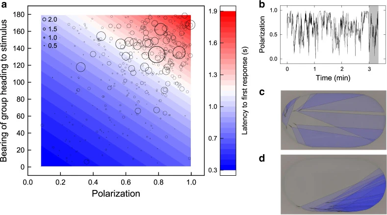

See paper · *Nature Communications* · 2020  
[Information can explain the dynamics of group order in animal collective behaviour](https://pmc.ncbi.nlm.nih.gov/articles/PMC7264142/#Fig2) · [原始图片](https://cdn.ncbi.nlm.nih.gov/pmc/blobs/9d07/7264142/1a6227d08264/41467_2020_16578_Fig2_HTML.jpg) · [CC BY 4.0](https://creativecommons.org/licenses/by/4.0/)

## Fig. 2 · The internal drive of the fluid micro-swimmers relies on light-activated thermo-capillary action, independent from a chemical fuel in the surrounding bath.

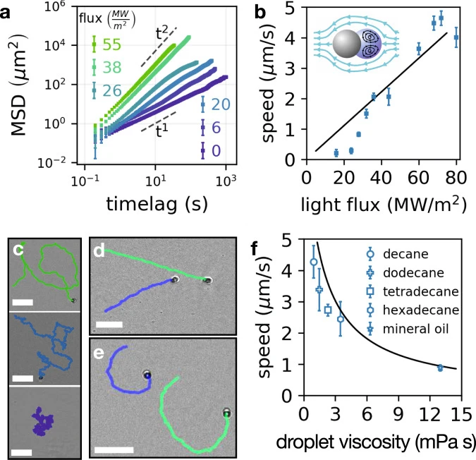

See paper · *Nature Communications* · 2022  
[Cooperation in a fluid swarm of fuel-free micro-swimmers](https://pmc.ncbi.nlm.nih.gov/articles/PMC8748659/#Fig2) · [原始图片](https://cdn.ncbi.nlm.nih.gov/pmc/blobs/93b8/8748659/1fa7953183b8/41467_2021_27870_Fig2_HTML.jpg) · [CC BY 4.0](https://creativecommons.org/licenses/by/4.0/)

## Fig. 2 · Experimental evidence on starling flocks.

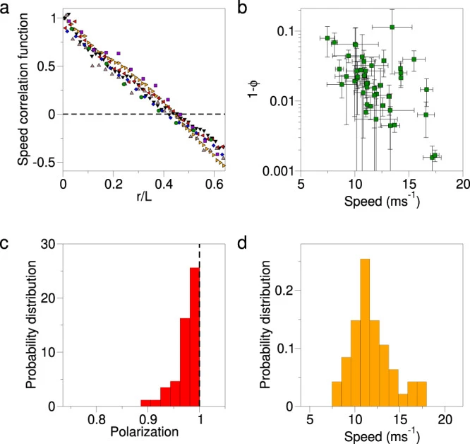

See paper · *Nature Communications* · 2022  
[Marginal speed confinement resolves the conflict between correlation and control in collective behaviour](https://pmc.ncbi.nlm.nih.gov/articles/PMC9090766/#Fig2) · [原始图片](https://cdn.ncbi.nlm.nih.gov/pmc/blobs/3317/9090766/193eac4aabc5/41467_2022_29883_Fig2_HTML.jpg) · [CC BY 4.0](https://creativecommons.org/licenses/by/4.0/)

## Fig. 3 · Older larvae use similar algorithms to integrate visual social information.

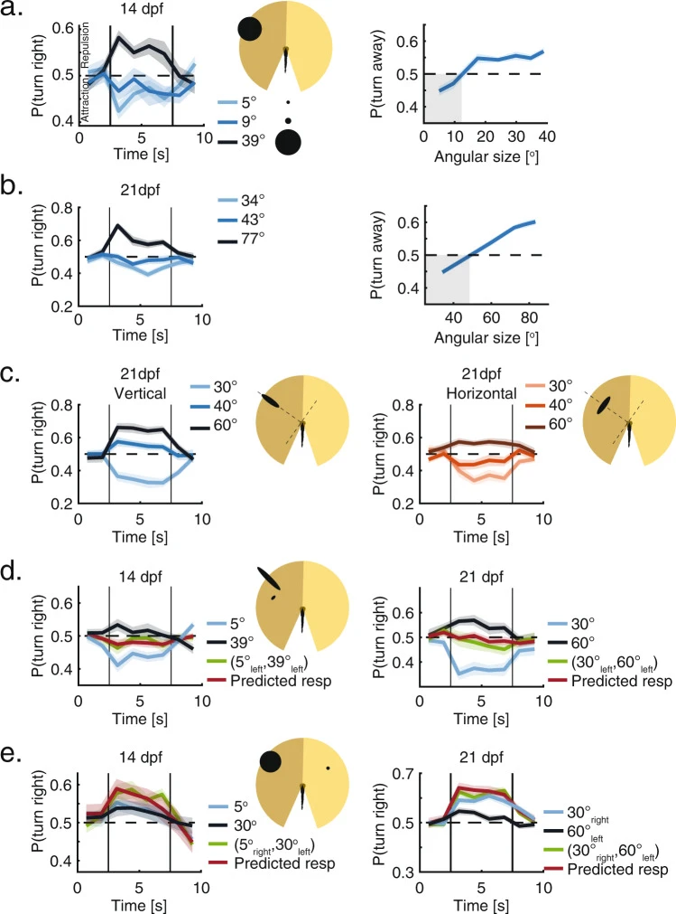

Harpaz et al. · *Nature Communications* · 2021  
[Precise visuomotor transformations underlying collective behavior in larval zebrafish](https://pmc.ncbi.nlm.nih.gov/articles/PMC8590009/#Fig3) · [原始图片](https://cdn.ncbi.nlm.nih.gov/pmc/blobs/740d/8590009/f5f6ec1bef67/41467_2021_26748_Fig3_HTML.jpg) · [CC BY 4.0](https://creativecommons.org/licenses/by/4.0/)

## Fig. 3 · Variation in collective order affects the latency to arrive at the stimulus.

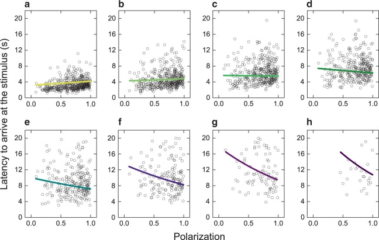

See paper · *Nature Communications* · 2020  
[Information can explain the dynamics of group order in animal collective behaviour](https://pmc.ncbi.nlm.nih.gov/articles/PMC7264142/#Fig3) · [原始图片](https://cdn.ncbi.nlm.nih.gov/pmc/blobs/9d07/7264142/c95c082ea669/41467_2020_16578_Fig3_HTML.jpg) · [CC BY 4.0](https://creativecommons.org/licenses/by/4.0/)

## Fig. 3 · At sufficiently high average area fraction, ϕ0, the swimmer population segregates into a long-lived state of dilute and dense fluids.

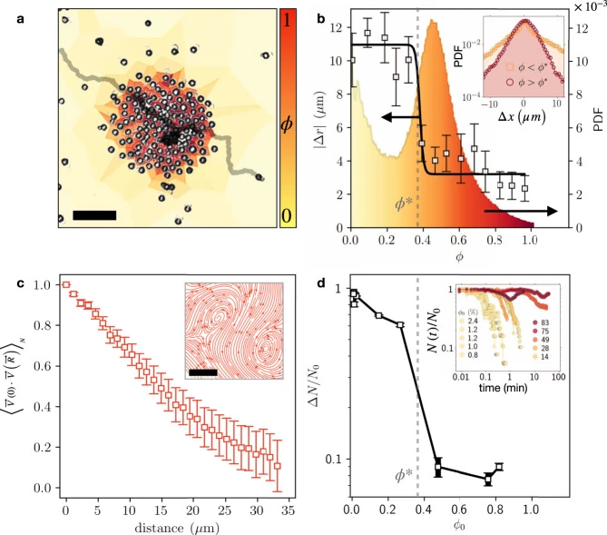

See paper · *Nature Communications* · 2022  
[Cooperation in a fluid swarm of fuel-free micro-swimmers](https://pmc.ncbi.nlm.nih.gov/articles/PMC8748659/#Fig3) · [原始图片](https://cdn.ncbi.nlm.nih.gov/pmc/blobs/93b8/8748659/453236111a51/41467_2021_27870_Fig3_HTML.jpg) · [CC BY 4.0](https://creativecommons.org/licenses/by/4.0/)

## Fig. 3 · Linear vs. Marginal speed control.

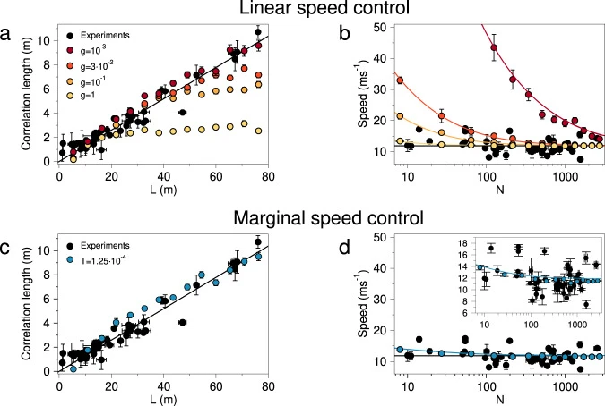

See paper · *Nature Communications* · 2022  
[Marginal speed confinement resolves the conflict between correlation and control in collective behaviour](https://pmc.ncbi.nlm.nih.gov/articles/PMC9090766/#Fig3) · [原始图片](https://cdn.ncbi.nlm.nih.gov/pmc/blobs/3317/9090766/40c69824ad5e/41467_2022_29883_Fig3_HTML.jpg) · [CC BY 4.0](https://creativecommons.org/licenses/by/4.0/)

## Fig. 4 · Social interactions extracted from VR capture the behavior of real groups.

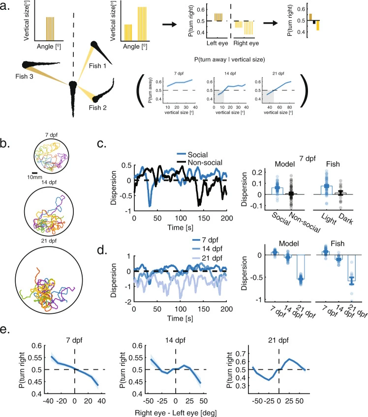

Harpaz et al. · *Nature Communications* · 2021  
[Precise visuomotor transformations underlying collective behavior in larval zebrafish](https://pmc.ncbi.nlm.nih.gov/articles/PMC8590009/#Fig4) · [原始图片](https://cdn.ncbi.nlm.nih.gov/pmc/blobs/740d/8590009/1116da86ab68/41467_2021_26748_Fig4_HTML.jpg) · [CC BY 4.0](https://creativecommons.org/licenses/by/4.0/)

## Fig. 4 · Individuals that are consistently faster to arrive at the stimulus maintain larger differences in the heading angle to their nearest neighbour outside of the foraging context.

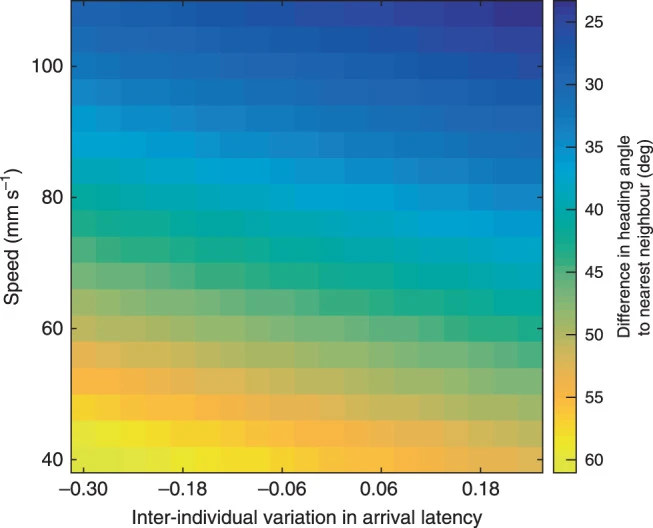

See paper · *Nature Communications* · 2020  
[Information can explain the dynamics of group order in animal collective behaviour](https://pmc.ncbi.nlm.nih.gov/articles/PMC7264142/#Fig4) · [原始图片](https://cdn.ncbi.nlm.nih.gov/pmc/blobs/9d07/7264142/046cf2a4ed47/41467_2020_16578_Fig4_HTML.jpg) · [CC BY 4.0](https://creativecommons.org/licenses/by/4.0/)

## Fig. 4 · A swarm of active swimmers cooperatively corrals passive particles.

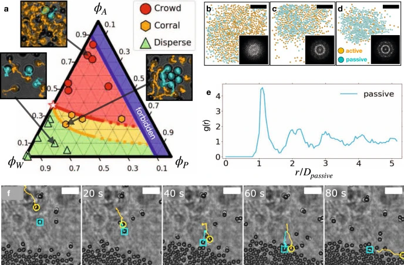

See paper · *Nature Communications* · 2022  
[Cooperation in a fluid swarm of fuel-free micro-swimmers](https://pmc.ncbi.nlm.nih.gov/articles/PMC8748659/#Fig4) · [原始图片](https://cdn.ncbi.nlm.nih.gov/pmc/blobs/93b8/8748659/2aba447f32fc/41467_2021_27870_Fig4_HTML.jpg) · [CC BY 4.0](https://creativecommons.org/licenses/by/4.0/)

## Fig. 4 · Single particle speed distributions.

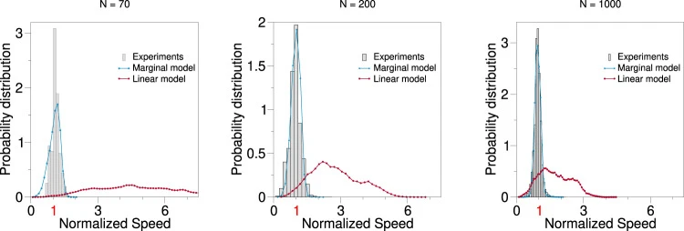

See paper · *Nature Communications* · 2022  
[Marginal speed confinement resolves the conflict between correlation and control in collective behaviour](https://pmc.ncbi.nlm.nih.gov/articles/PMC9090766/#Fig4) · [原始图片](https://cdn.ncbi.nlm.nih.gov/pmc/blobs/3317/9090766/769d2251189f/41467_2022_29883_Fig4_HTML.jpg) · [CC BY 4.0](https://creativecommons.org/licenses/by/4.0/)

## Fig. 5 · Conceptual circuit model describing visuomotor transformation underlying social interactions.

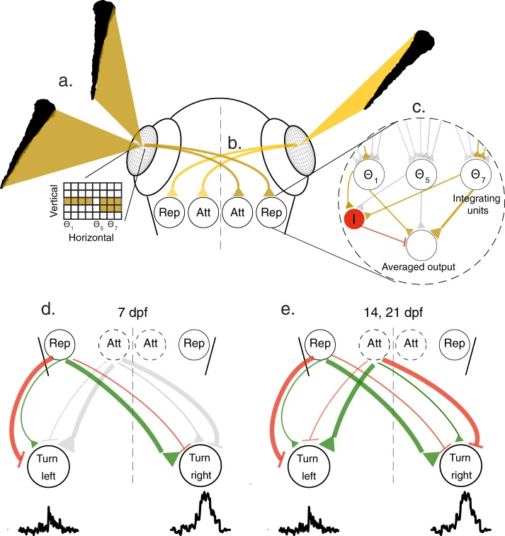

Harpaz et al. · *Nature Communications* · 2021  
[Precise visuomotor transformations underlying collective behavior in larval zebrafish](https://pmc.ncbi.nlm.nih.gov/articles/PMC8590009/#Fig5) · [原始图片](https://cdn.ncbi.nlm.nih.gov/pmc/blobs/740d/8590009/3ba89ae4f8c9/41467_2021_26748_Fig5_HTML.jpg) · [CC BY 4.0](https://creativecommons.org/licenses/by/4.0/)

